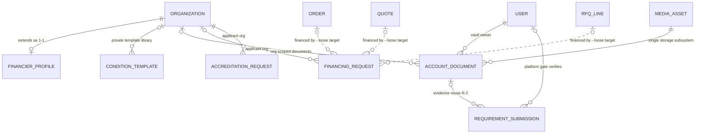

# Vendora — Entity Relationship Document (ERD)

| | |
|---|---|
| **Version** | 2.0 — recovery rebuild (ERD-14; previous ERD.md lost in environment rollback) |
| **Date** | September 2026 |
| **Source of truth** | `prisma/schema.prisma` — **52 models**, `provider = "sqlite"` — transcribed in full, nothing invented |
| **Companions** | `team/docs/01-domain-model.md`, `team/docs/06-data-dictionary.md`, `team/FINANCIER_SCHEMA.md` v5.0, `team/DECISIONS.md` (D-001…D-017, DP-1…DP-28) |
| **Status** | IMPLEMENTED — describes the live database, not a plan. Rebuilt against the 50-model schema; the notification email digest (DIGEST-13: `NotificationDigest`, `UserDigestPref`) landed in the schema during this rebuild and is included — see §8.11. |

---

## 1. Overview

### 1.1 Purpose

This document is the complete entity-relationship reference for the Vendora platform database. It covers **all 52 Prisma models** in `prisma/schema.prisma`: the **commerce core** (34 models — identity, catalog, pricing, orders, RFQ/quote negotiation, organizations, approvals, payments, payouts, disputes, media, notifications, email digest, settings, substrate) and the **financier domain** (18 models — financing/accreditation services, the requirements engine, the platform verification gate, the universal documents vault, offers, agreements, events, fees). It replaces the ERD.md lost in the environment rollback and is rebuilt fresh from the current schema.

Verification anchor: `rg -c "^model " prisma/schema.prisma` → **52**, and section 3 contains exactly 52 entity sections (34 commerce + 18 financier). (The task brief said 50 — the notification email digest models landed mid-rebuild; see §8.11.)

### 1.2 Scope and realization

- **Database**: SQLite (Prisma 6). There are no `@db.*` attributes, no `@@map` — **table names equal Prisma model names**, and ids are `String @id @default(cuid())`.
- **SQLite type mapping** (Prisma-managed): `String` → TEXT, `Int` → INTEGER, `Float` → REAL, `Boolean` → INTEGER (0/1), `DateTime` → DATETIME (text, UTC). `DateTime` columns use `@default(now())` / `@updatedAt`.
- **Money is `Float` everywhere** — the pre-conversion two-regime `Decimal(12,2)` / `Float` split described in `06-data-dictionary.md` predates the provider conversion (FIN-0); the current schema has no Decimal fields. Prisma types in this document are canonical.
- **Enums are strings** — SQLite has no native enums. Every status/type column is a plain string whose values form a closed TypeScript union validated with zod at the boundary. Value sets are quoted from the schema comments.
- **No multi-tenancy** (D-003) — no tenant discriminator exists anywhere; none may be added.
- **Zero native JSON columns** — SQLite has none; commerce "JSON" fields are JSON-in-`Text` strings (LEGACY-JSON, frozen by DP-18). The financier domain has zero JSON columns of any kind (R-1) — every list is a child table.

### 1.3 How to read this document

| Section | Content |
|---|---|
| §2 | Master Mermaid `erDiagram` with all 52 entities + a compact cross-domain bridge view |
| §3 | Entity reference — one section per model grouped by module, with full attribute tables |
| §4 | Relationship & cardinality inventory — all enforced FKs, implicit M-N joins, loose references |
| §5 | Constraints & indexes — uniques, composite indexes, code-enforced invariants, numbering |
| §6 | Module → entity map — which console uses which entities |
| §7 | Design assumptions (doctrine visible in the schema) |
| §8 | Open questions |

**Diagram conventions** (matching `01-domain-model.md`):

- **Solid connectors** (`--`) are Prisma-enforced FKs (real constraints).
- **Dashed connectors** (`..`) are **loose references** — plain string columns with no DB constraint, enforced in service code (the "Dispute pattern").
- Mermaid cardinality: `||` exactly one · `|o` zero-or-one · `}o` zero-or-more · `}|` one-or-more. Read `A ||--o{ B` as: each `B` row references exactly one `A`; each `A` has zero-or-more `B`s.
- Attribute keys: `PK` primary key · `FK` foreign key · `UK` unique. Only key fields and discriminating columns are shown in diagrams; the full inventory is §3.

### 1.4 Model inventory (52)

| # | Group | Models |
|---|---|---|
| 1–34 | **Commerce core** | User, Category, Product, ProductVariant, Review, Favorite, Order, OrderItem, Organization, OrganizationMember, CustomerGroup, PriceList, PriceListEntry, Rfq, RfqLine, Quote, QuoteLine, RfqMessage, ApprovalRequest, Notification, NotificationDigest, UserDigestPref, MediaAsset, Dispute, RecurringRfq, Payment, Payout, AuditLog, Sequence, PlatformSetting, BannerSlide, RfqSetting, SettingChange, Coupon |
| 35–52 | **Financier domain** | FinancierProfile, FinancierBranch, FinancierService, FinancierServiceAttribute, FinancierServiceCoverage, ConditionTemplate, ConditionOption, ServiceRequirement, RequirementSubmission, AccountDocument, RequestAttachment, FinancingRequest, FinancingOffer, FinancingOfferInstallment, FinancingAgreement, FinancingEvent, FinancingFee, AccreditationRequest |

The two domains share **three substrate entities** rather than duplicating them: identity lives once on `User`/`Organization`, media storage once on `MediaAsset`, settings/audit/numbering once on `RfqSetting`/`AuditLog`/`Sequence`. The bridge is drawn explicitly in §2.2.

---

## 2. Master Mermaid ER diagrams

### 2.1 Master diagram — all 52 entities

One single `erDiagram` covering every model, every enforced FK and every material loose reference. Entity blocks show PK / FK / UK columns plus discriminating attributes; the complete field inventory is in §3. (Rendered diagrams of this size are large; the bridge view in §2.2 is the readable shortcut.)

```mermaid
erDiagram
    %% -- COMMERCE CORE : identity, catalog, pricing ------------------------------

    USER ||--o{ PRODUCT : sells
    CATEGORY ||--o{ PRODUCT : categorizes
    PRODUCT ||--|{ PRODUCT_VARIANT : "has variants"
    PRODUCT ||--o{ REVIEW : receives
    USER ||--o{ REVIEW : writes
    USER ||--o{ FAVORITE : favorites
    PRODUCT ||--o{ FAVORITE : "is favorited by"
    USER ||--o{ ORDER : buys
    ORGANIZATION |o--o{ ORDER : "B2B context"
    ORDER ||--|{ ORDER_ITEM : contains
    PRODUCT ||--o{ ORDER_ITEM : "ordered as"
    PAYOUT |o--o{ ORDER_ITEM : settles
    ORGANIZATION ||--|{ ORGANIZATION_MEMBER : has
    USER ||--o{ ORGANIZATION_MEMBER : joins
    USER }o--o{ CUSTOMER_GROUP : "segmented by"
    ORGANIZATION }o--o{ CUSTOMER_GROUP : "segmented by"
    ORGANIZATION |o--o{ PRICE_LIST : "contract list"
    CUSTOMER_GROUP |o--o{ PRICE_LIST : "group list"
    PRICE_LIST ||--|{ PRICE_LIST_ENTRY : contains
    PRODUCT ||--o{ PRICE_LIST_ENTRY : "priced by"

    %% -- NEGOTIATION : RFQ, quotes, approvals, recurring -------------------------

    USER ||--o{ RFQ : requests
    ORGANIZATION |o--o{ RFQ : "org context"
    RFQ ||--|{ RFQ_LINE : contains
    PRODUCT |o--o{ RFQ_LINE : references
    PRODUCT_VARIANT |o..o{ RFQ_LINE : "variant loose"
    RFQ ||--o{ QUOTE : "answered by"
    USER ||--o{ QUOTE : issues
    QUOTE ||--|{ QUOTE_LINE : contains
    RFQ_LINE |o--o{ QUOTE_LINE : answers
    PRODUCT ||--o{ QUOTE_LINE : prices
    PRODUCT_VARIANT |o..o{ QUOTE_LINE : "variant loose"
    ORGANIZATION ||--o{ APPROVAL_REQUEST : scopes
    USER ||--o{ APPROVAL_REQUEST : requests
    USER |o--o{ APPROVAL_REQUEST : decides
    ORDER |o--o| APPROVAL_REQUEST : "gated by"
    QUOTE |o--o| APPROVAL_REQUEST : "gated by"
    RFQ |o..o{ APPROVAL_REQUEST : "context loose"
    RFQ ||--o{ RFQ_MESSAGE : discusses
    USER ||--o{ RFQ_MESSAGE : authors
    USER ||--o{ RECURRING_RFQ : owns
    RECURRING_RFQ |o..o{ RFQ : spawns
    RECURRING_RFQ |o..o| RFQ : "last run loose"
    ORGANIZATION |o..o{ RECURRING_RFQ : "org context loose"
    QUOTE |o..o| ORDER : "converts to loose"

    %% -- MONEY, DISPUTES, MEDIA, FEED, SUBSTRATE ---------------------------------

    ORDER ||--o| PAYMENT : "settled by"
    USER |o--o{ PAYMENT : captures
    USER ||--o{ PAYOUT : "paid via"
    ORDER ||--o{ DISPUTE : "disputed in"
    USER ||--o{ DISPUTE : raises
    USER ||--o{ DISPUTE : "raised against seller"
    USER |o--o{ DISPUTE : resolves
    RFQ |o..o{ DISPUTE : "context loose"
    USER ||--o{ MEDIA_ASSET : uploads
    USER ||--o{ NOTIFICATION : receives
    USER ||--o{ NOTIFICATION_DIGEST : "digests to"
    USER ||--o| USER_DIGEST_PREF : "opts in as"
    USER ||--o{ SETTING_CHANGE : edits
    SETTING_CHANGE |o..o{ SETTING_CHANGE : "rollback of loose"
    USER |o..o{ AUDIT_LOG : "acts loose"
    USER |o..o{ RFQ_SETTING : "last editor loose"

    %% -- FINANCIER DOMAIN : catalog + requirements engine ------------------------

    ORGANIZATION ||--o| FINANCIER_PROFILE : "extends as"
    FINANCIER_PROFILE ||--o{ FINANCIER_BRANCH : has
    FINANCIER_PROFILE ||--o{ FINANCIER_SERVICE : offers
    FINANCIER_SERVICE ||--o{ FINANCIER_SERVICE_ATTRIBUTE : "described by"
    FINANCIER_SERVICE ||--o{ FINANCIER_SERVICE_COVERAGE : covers
    FINANCIER_SERVICE ||--o{ SERVICE_REQUIREMENT : requires
    CONDITION_TEMPLATE ||--o{ SERVICE_REQUIREMENT : "attached as"
    CONDITION_TEMPLATE ||--o{ CONDITION_OPTION : lists
    ORGANIZATION |o--o{ CONDITION_TEMPLATE : "private library"
    USER ||--o{ CONDITION_TEMPLATE : creates

    %% -- FINANCIER DOMAIN : documents vault and submissions ----------------------

    USER ||--o{ ACCOUNT_DOCUMENT : owns
    ORGANIZATION |o--o{ ACCOUNT_DOCUMENT : scopes
    MEDIA_ASSET ||--o{ ACCOUNT_DOCUMENT : stores
    USER |o--o{ ACCOUNT_DOCUMENT : reviews
    ACCOUNT_DOCUMENT ||--o{ REQUEST_ATTACHMENT : "referenced by"
    FINANCING_REQUEST |o..o{ REQUEST_ATTACHMENT : "attached to loose"
    ACCREDITATION_REQUEST |o..o{ REQUEST_ATTACHMENT : "attached to loose"
    FINANCING_REQUEST ||--o{ REQUIREMENT_SUBMISSION : "checked by"
    ACCREDITATION_REQUEST ||--o{ REQUIREMENT_SUBMISSION : "checked by"
    SERVICE_REQUIREMENT ||--o{ REQUIREMENT_SUBMISSION : "answered by"
    ACCOUNT_DOCUMENT |o--o{ REQUIREMENT_SUBMISSION : evidences
    USER |o--o{ REQUIREMENT_SUBMISSION : verifies

    %% -- FINANCIER DOMAIN : requests, offers, agreements, accreditation ----------

    ORGANIZATION |o--o{ FINANCING_REQUEST : applies
    USER ||--o{ FINANCING_REQUEST : creates
    FINANCIER_SERVICE ||--o{ FINANCING_REQUEST : "applied for"
    USER |o--o{ FINANCING_REQUEST : "gate reviews"
    FINANCING_REQUEST ||--o{ FINANCING_OFFER : "answered by"
    USER ||--o{ FINANCING_OFFER : issues
    FINANCING_OFFER ||--|{ FINANCING_OFFER_INSTALLMENT : schedules
    FINANCING_OFFER ||--o| FINANCING_AGREEMENT : "freezes into"
    FINANCING_AGREEMENT ||--o{ FINANCING_EVENT : records
    USER |o--o{ FINANCING_EVENT : reports
    FINANCING_AGREEMENT ||--o{ FINANCING_FEE : accrues
    ORGANIZATION ||--o{ ACCREDITATION_REQUEST : "applies for"
    USER ||--o{ ACCREDITATION_REQUEST : submits
    FINANCIER_SERVICE ||--o{ ACCREDITATION_REQUEST : "accredits via"
    USER |o--o{ ACCREDITATION_REQUEST : "gate reviews"
    USER |o--o{ ACCREDITATION_REQUEST : decides
    USER |o--o{ ACCREDITATION_REQUEST : revokes

    %% -- CROSS-DOMAIN BRIDGES : what the financing is FOR ------------------------

    ORDER |o..o{ FINANCING_REQUEST : "financed by loose"
    QUOTE |o..o{ FINANCING_REQUEST : "financed by loose"
    RFQ_LINE |o..o{ FINANCING_REQUEST : "financed by loose"

    USER {
        string id PK
        string email UK
        string role "BUYER | SELLER | ADMIN"
        string status "ACTIVE | SUSPENDED"
        datetime verifiedAt "KYC-lite stamp"
        float commissionRate "payout override percent"
        string storeName "seller storefront"
        string phone "applicant profile - nullable"
        datetime createdAt
        datetime updatedAt
    }
    CATEGORY {
        string id PK
        string name
        string slug UK
        string icon
    }
    PRODUCT {
        string id PK
        string title
        float price "retail fallback"
        string images "LEGACY-JSON url array"
        string status "ACTIVE | DRAFT | ARCHIVED"
        string slug UK
        string categoryId FK
        string sellerId FK
        int stock
        boolean featured
    }
    PRODUCT_VARIANT {
        string id PK
        string productId FK
        string name
        string options "LEGACY-JSON map"
        float price "null = inherit"
        int stock
        boolean isActive
        int position
    }
    REVIEW {
        string id PK
        string productId FK
        string userId FK
        int rating "1 to 5"
        boolean verified
    }
    FAVORITE {
        string id PK
        string userId FK
        string productId FK
    }
    ORDER {
        string id PK
        string buyerId FK
        string organizationId FK "nullable B2B context"
        string status "7 states"
        float total
        string sourceType "CART | RFQ"
        string sourceQuoteId UK "loose - converted quote"
        string poNumber
    }
    ORDER_ITEM {
        string id PK
        string orderId FK
        string productId FK
        string sellerId "loose snapshot"
        int quantity
        float price "snapshot"
        string title "snapshot"
        string payoutId FK "set-once settlement"
        string variantId "loose"
    }
    ORGANIZATION {
        string id PK
        string name
        string slug UK
        string orgType "COMPANY | BANK | MFI | EWALLET"
        string status "4 states"
        int creditTermsDays "0 = prepaid"
        float creditLimit
        float approvalThreshold "null = off"
        datetime verifiedAt
    }
    ORGANIZATION_MEMBER {
        string id PK
        string organizationId FK
        string userId FK
        string role "OWNER | ADMIN | BUYER | APPROVER | VIEWER"
    }
    CUSTOMER_GROUP {
        string id PK
        string key UK
        string name
        int priority "higher wins"
        boolean isDefault
    }
    PRICE_LIST {
        string id PK
        string name
        string scope "ORG | GROUP | CHANNEL"
        string status "ACTIVE | DRAFT | ARCHIVED"
        string organizationId FK "nullable"
        string customerGroupId FK "nullable"
        int priority
        string currency "default USD"
    }
    PRICE_LIST_ENTRY {
        string id PK
        string priceListId FK
        string productId FK
        int minQuantity "ladder step"
        float unitPrice
    }
    RFQ {
        string id PK
        string number UK "RFQ-YYYY-NNNNNN"
        string userId FK
        string organizationId FK "nullable"
        string status "9 states"
        datetime expiresAt
        int extendedCount
        string sourceRecurringId "loose"
    }
    RFQ_LINE {
        string id PK
        string rfqId FK
        string productId FK "nullable - free item"
        string productName "snapshot"
        string variantId "loose"
        int quantity
        float targetPrice "buyer target"
    }
    QUOTE {
        string id PK
        string number UK "QTE-YYYY-NNNNNN"
        string rfqId FK
        string createdById FK
        string sellerId "loose - null = platform"
        string status "9 states"
        float total
        datetime validUntil
    }
    QUOTE_LINE {
        string id PK
        string quoteId FK
        string rfqLineId FK "nullable"
        string productId FK
        string variantId "loose"
        int quantity
        float unitPrice
    }
    APPROVAL_REQUEST {
        string id PK
        string organizationId FK
        string type "ORDER | QUOTE_ACCEPT"
        string orderId UK "nullable"
        string quoteId UK "nullable"
        string requesterId FK
        float amount
        string status "4 states"
        string decidedById FK "nullable"
        string rfqId "loose"
    }
    RFQ_MESSAGE {
        string id PK
        string rfqId FK
        string authorId FK
        string body
    }
    NOTIFICATION {
        string id PK
        string userId FK
        string type "10 values"
        string linkView "SPA view key"
        string linkId
        datetime readAt
    }
    NOTIFICATION_DIGEST {
        string id PK
        string userId FK
        string kind "DAILY | WEEKLY"
        datetime periodStart
        datetime periodEnd
        int itemCount
        string subject
        string html "rendered inline-styled HTML"
        string status "LOGGED | SENT"
    }
    USER_DIGEST_PREF {
        string userId PK "1-1 with user"
        string frequency "OFF | DAILY | WEEKLY"
    }
    MEDIA_ASSET {
        string id PK
        string key UK
        string originalName
        string mime
        int size
        string sha256 UK "content dedupe"
        string variants "LEGACY-JSON rendition keys"
        string uploadedById FK
    }
    DISPUTE {
        string id PK
        string number UK "DSP-YYYY-NNNNNN"
        string orderId FK
        string raisedById FK
        string sellerId FK
        string reason "7 values"
        string status "6 states"
        string outcome "6 values"
        string resolvedById FK "nullable"
        string rfqId "loose"
    }
    RECURRING_RFQ {
        string id PK
        string userId FK
        string frequency "WEEKLY | BIWEEKLY | MONTHLY | QUARTERLY | CUSTOM"
        string lines "LEGACY-JSON snapshot"
        boolean active
        datetime nextRunAt "lazy sweep"
        string organizationId "loose"
        string lastRfqId "loose"
    }
    PAYMENT {
        string id PK
        string orderId UK "1-1 with order"
        string method "CARD | BANK_TRANSFER | INVOICE"
        string status "4 states"
        float amount
        string capturedById FK "nullable"
    }
    PAYOUT {
        string id PK
        string number UK "PY-YYYY-NNNNNN"
        string sellerId FK
        datetime periodStart
        datetime periodEnd
        float grossAmount
        float commissionRate "snapshot percent"
        float commission
        float netAmount
        string status "PENDING | PAID | CANCELLED"
    }
    AUDIT_LOG {
        string id PK
        string actorId "loose - null for SYSTEM"
        string actorType "USER | SELLER | ADMIN | SYSTEM"
        string action
        string entityType
        string entityId
        string summary
        string metadata "LEGACY-JSON"
    }
    SEQUENCE {
        string key PK
        int value "current counter"
    }
    PLATFORM_SETTING {
        string key PK
        string value "JSON document as text"
    }
    BANNER_SLIDE {
        string id PK
        string image
        int position
        boolean active
    }
    RFQ_SETTING {
        string id PK
        string key "panel key"
        string scopeType "PLATFORM | ORG_TYPE | ORG | CATEGORY | REGION"
        string scopeId "empty at platform scope"
        string value "JSON document as text"
        string updatedById "loose"
    }
    SETTING_CHANGE {
        string id PK
        string settingKey
        string scopeType
        string scopeId
        string field
        string userId FK
        string rollbackOfId "loose - revert chain"
    }
    COUPON {
        string id PK
        string code UK
        int percentOff
        float minSubtotal
        boolean firstOrderOnly
        boolean active
    }
    FINANCIER_PROFILE {
        string id PK
        string organizationId UK "1-1 - the legal entity"
        string licenseNumber
        string regulator
        string logoUrl
        string contactEmail
        float minTicket "routing hint"
        float maxTicket
        int viewCount
    }
    FINANCIER_BRANCH {
        string id PK
        string financierProfileId FK
        string name
        string kind "BRANCH | AGENT | ATM"
        float latitude
        float longitude
        boolean isActive
        int position
    }
    FINANCIER_SERVICE {
        string id PK
        string financierProfileId FK
        string serviceKind "FINANCING | ACCREDITATION"
        string category "12 values"
        string name
        string status "DRAFT | ACTIVE | ARCHIVED"
        string currency "default YER"
        float amountMin "null = open"
        float amountMax
        string rateType "3 values"
        float rateMax "percent cap"
        int tenorMinMonths
        int tenorMaxMonths
        boolean shariaCompliant
        int accreditationValidMonths "ACCREDITATION kind"
    }
    FINANCIER_SERVICE_ATTRIBUTE {
        string id PK
        string serviceId FK
        string kind "FEATURE | ELIGIBILITY_CONDITION"
        int position
        string text
    }
    FINANCIER_SERVICE_COVERAGE {
        string id PK
        string serviceId FK
        string regionName "matched vs activityCity"
    }
    CONDITION_TEMPLATE {
        string id PK
        string scope "GENERAL | FINANCIER"
        string organizationId FK "nullable - null = GENERAL"
        string conditionType "8 typed kinds"
        string code "stable ref - unique in service"
        string title
        string profileFieldKey "PROFILE_FIELD only"
        string documentType "DOCUMENT only"
        float validationMin "NUMBER only"
        float validationMax "NUMBER only"
        int validityMonths "evidence freshness"
        boolean isRepeatable "DOCUMENT only"
        boolean isActive
        string createdById FK
    }
    CONDITION_OPTION {
        string id PK
        string conditionTemplateId FK
        string value "stored and displayed"
        int position
    }
    SERVICE_REQUIREMENT {
        string id PK
        string serviceId FK
        string conditionTemplateId FK
        boolean isRequired "optional never gates"
        int displayOrder
        string instructions "per-service override"
        boolean autoPassAccredited "DP-26"
        boolean isActive
    }
    REQUIREMENT_SUBMISSION {
        string id PK
        string serviceRequirementId FK
        string financingRequestId FK "XOR parent 1"
        string accreditationRequestId FK "XOR parent 2"
        string status "PENDING | SUBMITTED | VERIFIED | REJECTED | WAIVED"
        string valueText "TEXT DECLARATION SELECT"
        float valueNumber "NUMBER"
        datetime valueDate "DATE"
        string accountDocumentId FK "DOCUMENT evidence"
        string verifiedById FK "null on autoPass"
        string decisionNote "rejection or waiver reason"
    }
    ACCOUNT_DOCUMENT {
        string id PK
        string userId FK "owner - always set"
        string organizationId FK "nullable - org scope"
        string mediaId FK "the storage entry"
        string documentType "15 values"
        string status "PENDING | VERIFIED | REJECTED"
        string reviewedById FK "nullable"
        datetime expiresAt "freshness window"
        boolean isActive "soft delete"
    }
    REQUEST_ATTACHMENT {
        string id PK
        string parentType "FINANCING_REQUEST | ACCREDITATION_REQUEST"
        string parentId "loose polymorphic"
        string accountDocumentId FK
        string kind "GUARANTEE_DOC | STUDY | PROJECT_FILE | OTHER"
    }
    FINANCING_REQUEST {
        string id PK
        string number UK "FIN-YYYY-NNNNNN"
        string organizationId FK "nullable - individual if null"
        string createdById FK
        string serviceId FK "required - DP-22"
        string targetType "WORKING_CAPITAL | QUOTE | ORDER | RFQ_LINE"
        string targetId "loose"
        string multiGroupId "sibling routing - DP-25"
        string activityCity "coverage match"
        float amountRequested
        string currency "default YER"
        string status "11 gate states"
        string platformReviewedById FK "the gate - R-4"
        datetime forwardedAt "gate passed"
        datetime returnedAt "gate returned"
    }
    FINANCING_OFFER {
        string id PK
        string requestId FK
        string createdById FK "financier staff"
        float amount
        string currency "default YER"
        string rateType "3 values"
        float ratePercent
        float feeFlat
        int tenorMonths
        string collateralRequired "guarantee taxonomy"
        string status "6 states"
        datetime validUntil
    }
    FINANCING_OFFER_INSTALLMENT {
        string id PK
        string offerId FK
        int installmentNo
        datetime dueDate
        float amount
    }
    FINANCING_AGREEMENT {
        string id PK
        string number UK "AGR-YYYY-NNNNNN"
        string offerId UK "accepted offer - frozen"
        string fundingStatus "PENDING | REPORTED_FUNDED | REPORTED_SETTLED"
        string status "ACTIVE | COMPLETED | DEFAULTED | CANCELLED"
        datetime acceptedAt
        datetime fundedReportedAt
        datetime settledReportedAt
    }
    FINANCING_EVENT {
        string id PK
        string agreementId FK
        string type "5 values"
        datetime eventDate
        float amount
        string reportedById FK "nullable"
    }
    FINANCING_FEE {
        string id PK
        string agreementId FK
        string type "SUCCESS | ORIGINATION | ACCREDITATION"
        float baseAmount
        float percentApplied "snapshot"
        float amount
        string status "ACCRUED | INVOICED | PAID | WAIVED"
    }
    ACCREDITATION_REQUEST {
        string id PK
        string number UK "ACC-YYYY-NNNNNN"
        string organizationId FK "companies only"
        string submittedById FK
        string serviceId FK "ACCREDITATION kind"
        string multiGroupId "sibling routing"
        string status "11 states"
        string decidedById FK "nullable"
        string revokedById FK "nullable"
        datetime accreditedAt
        datetime validUntil "grant lifetime"
        datetime expiresAt "request expiry"
    }
```

### 2.2 Cross-domain bridge view

The financier domain deliberately reuses commerce substrate instead of duplicating it. The bridges:

- **Identity**: `FinancierProfile` is a 1:1 extension of `Organization`; `AccountDocument` is owned by `User` and optionally org-scoped; all financier staff/actors are `User`s.
- **Storage**: `AccountDocument.mediaId` → `MediaAsset` — one media pipeline (DP-19/DP-27).
- **Target**: `FinancingRequest.targetId` loosely points back into commerce (`Quote` / `Order` / `RfqLine` per `targetType`) — what the financing is *for*.



---

## 3. Entity reference

Grouped by bounded context (terminology aligned with `01-domain-model.md` §1 and `06-data-dictionary.md` Part A/B). Every attribute below is transcribed from the current `prisma/schema.prisma` — names, types, nullability and defaults are exact. Table names equal model names (no `@@map`).

Role legend: **PK** primary key · **FK** foreign key (Prisma-enforced, target in notes) · **UK** unique · **UK\*** member of a composite unique · **loose-FK** plain string reference with no DB constraint.

### 3.1 Identity & Access

#### User

**Table:** `User` — flat identity table doubling as the vendor registry and the financing applicant profile.

| Attribute | Type | Constraints / notes | Role |
|---|---|---|---|
| id | String | @id @default(cuid()) | PK |
| email | String | Login identity (email-based auth) | UK |
| password | String | Hashed credential | |
| name | String | Display name (single field — 4-part competitor names deliberately collapsed) | |
| image | String? | Avatar URL (MediaAsset-backed) | |
| role | String | @default("BUYER") — BUYER \| SELLER \| ADMIN; drives authorization | |
| status | String | @default("ACTIVE") — ACTIVE \| SUSPENDED (platform-controlled vendor lifecycle) | |
| suspendedAt | DateTime? | Suspension timestamp | |
| storeName | String? | Seller storefront name | |
| storeBio | String? | Seller storefront bio | |
| commissionRate | Float? | Vendor payout commission override (percent); null = platform default | |
| createdAt | DateTime | @default(now()) | |
| updatedAt | DateTime | @updatedAt | |
| verifiedAt | DateTime? | Platform verification stamp (KYC-lite); enables routing auto-approve + distribution filters | |
| phone | String? | Contact only — login stays email-based (applicant profile, FINANCIER_SCHEMA v5 §3.1) | |
| whatsappNumber | String? | Applicant profile | |
| dateOfBirth | DateTime? | Applicant profile | |
| gender | String? | MALE \| FEMALE \| OTHER | |
| maritalStatus | String? | SINGLE \| MARRIED \| DIVORCED \| WIDOWED | |
| nationality | String? | Applicant profile | |
| identityType | String? | NATIONAL_ID \| PASSPORT \| RESIDENCE_PERMIT \| OTHER | |
| identityNumber | String? | Applicant profile | |
| residenceStreet | String? | Applicant profile | |
| residenceCity | String? | Applicant profile | |
| residenceDistrict | String? | Applicant profile | |
| residenceType | String? | OWNED \| RENTED | |

The 12 applicant-profile columns (phone…residenceType) are additive and ALL nullable — B2C buyers are unaffected until they apply for financing (DP-14/R-2).

**Indexes:** `@@index([role])`.

**Relations (from User):** none outbound — User is the root of the graph.

**Referenced by (enforced):** Product.sellerId, Order.buyerId, Review.userId, Favorite.userId, OrganizationMember.userId, Rfq.userId, Quote.createdById, ApprovalRequest.requesterId, ApprovalRequest.decidedById, RfqMessage.authorId, MediaAsset.uploadedById, Dispute.raisedById, Dispute.sellerId, Dispute.resolvedById, RecurringRfq.userId, Payment.capturedById, Payout.sellerId, SettingChange.userId, Notification.userId, NotificationDigest.userId, UserDigestPref.userId, ConditionTemplate.createdById, RequirementSubmission.verifiedById, AccountDocument.userId, AccountDocument.reviewedById, FinancingRequest.createdById, FinancingRequest.platformReviewedById, FinancingOffer.createdById, FinancingEvent.reportedById, AccreditationRequest.submittedById, AccreditationRequest.platformReviewedById, AccreditationRequest.decidedById, AccreditationRequest.revokedById. **Referenced loosely by:** OrderItem.sellerId, Quote.sellerId, AuditLog.actorId, RfqSetting.updatedById.

**M-N:** `User ↔ CustomerGroup` (implicit join, relation name "UserCustomerGroups").

### 3.2 Catalog & Pricing

#### Category

**Table:** `Category` — slug-addressed product taxonomy.

| Attribute | Type | Constraints / notes | Role |
|---|---|---|---|
| id | String | @id @default(cuid()) | PK |
| name | String | Category name | |
| slug | String | URL handle | UK |
| icon | String? | Icon identifier | |

**Relations:** `products` → Product (1:N). **Indexes:** unique `slug`.

#### Product

**Table:** `Product` — governed catalog item; retail `price` is the fallback of the pricing pipeline.

| Attribute | Type | Constraints / notes | Role |
|---|---|---|---|
| id | String | @id @default(cuid()) | PK |
| title | String | | |
| description | String | | |
| price | Float | Retail list price (fallback of the pricing pipeline) | |
| compareAtPrice | Float? | Strike-through reference price | |
| images | String | @default("[]") — LEGACY-JSON: JSON string array of URLs (MediaAsset medium renditions) | |
| categoryId | String | → Category.id, required, onDelete: Restrict (default) | FK |
| sellerId | String | → User.id, required, onDelete: Restrict (default) | FK |
| stock | Int | @default(10) — total units; with variants = sum of variant stock | |
| soldCount | Int | @default(0) — moderation signal | |
| rating | Float | @default(0) — average review rating | |
| reviewCount | Int | @default(0) | |
| featured | Boolean | @default(false) | |
| sku | String? | Stock keeping unit | |
| barcode | String? | Product barcode | |
| videoUrl | String? | Product video URL | |
| highlights | String? | LEGACY-JSON — JSON array of bullet strings (About this item) | |
| specs | String? | LEGACY-JSON — JSON array of {label, value} (Specifications) | |
| materials | String? | Materials text | |
| care | String? | Care instructions | |
| weightGrams | Int? | Shipping weight | |
| lengthCm | Float? | Shipping dimension | |
| widthCm | Float? | Shipping dimension | |
| heightCm | Float? | Shipping dimension | |
| processingDays | Int? | Handling time before dispatch | |
| freeShipping | Boolean | @default(false) | |
| shippingFee | Float? | Flat rate; ignored when freeShipping = true | |
| shippingPolicy | String? | Shipping policy text | |
| slug | String? | SEO handle / future deep links | UK |
| metaTitle | String? | SEO title | |
| metaDescription | String? | SEO description | |
| moq | Int? | Minimum order quantity enforced by RFQ commercial rules (null = none) | |
| priceTiers | String? | LEGACY-JSON — JSON [{from,to,price}] quantity-break ladder applied in quotes | |
| status | String | @default("ACTIVE") — ACTIVE \| DRAFT \| ARCHIVED | |
| createdAt | DateTime | @default(now()) | |
| updatedAt | DateTime | @updatedAt | |

**Indexes:** `@@index([categoryId])`, `@@index([sellerId, status])`, `@@index([status, soldCount])`, `@@index([featured])`; unique `slug`.

**Referenced by (enforced):** OrderItem.productId, PriceListEntry.productId, RfqLine.productId (optional), QuoteLine.productId. **Referenced loosely by:** RfqLine.variantId, QuoteLine.variantId (variant-level).

#### ProductVariant

**Table:** `ProductVariant` — variant of a product; options as JSON map (LEGACY-JSON).

| Attribute | Type | Constraints / notes | Role |
|---|---|---|---|
| id | String | @id @default(cuid()) | PK |
| productId | String | → Product.id, required, onDelete: Cascade | FK |
| name | String | Display label, e.g. M / Black | |
| options | String | LEGACY-JSON — JSON map Size → M, Color → Black | |
| price | Float? | Null = inherit product price | |
| compareAtPrice | Float? | Strike-through reference price | |
| stock | Int | @default(0) | |
| sku | String? | Variant SKU | |
| position | Int | @default(0) — sort position | |
| isActive | Boolean | @default(true) — soft-visibility flag | |
| image | String? | Uploaded-media variant image URL | |
| createdAt | DateTime | @default(now()) | |

**Indexes:** `@@index([productId, isActive])`.

#### Review

**Table:** `Review` — consumer review; one per user per product.

| Attribute | Type | Constraints / notes | Role |
|---|---|---|---|
| id | String | @id @default(cuid()) | PK |
| productId | String | → Product.id, required, onDelete: Cascade | FK |
| userId | String | → User.id, required, onDelete: Restrict (default) | FK |
| rating | Int | 1..5 (validated in code) | |
| comment | String | Review body | |
| verified | Boolean | @default(false) — verified-purchase flag | |
| createdAt | DateTime | @default(now()) | |

**Indexes:** `@@unique([productId, userId])`, `@@index([userId])`.

#### Favorite

**Table:** `Favorite` — user's favorited products.

| Attribute | Type | Constraints / notes | Role |
|---|---|---|---|
| id | String | @id @default(cuid()) | PK |
| userId | String | → User.id, required, onDelete: Restrict (default) | FK |
| productId | String | → Product.id, required, onDelete: Cascade | FK |
| createdAt | DateTime | @default(now()) | |

**Indexes:** `@@unique([userId, productId])`.

#### CustomerGroup

**Table:** `CustomerGroup` — buyer segmentation that pricing and future promotions hang off (B2C segments e.g. VIP retail; B2B tiers e.g. wholesale-tier-1).

| Attribute | Type | Constraints / notes | Role |
|---|---|---|---|
| id | String | @id @default(cuid()) | PK |
| key | String | Stable group key | UK |
| name | String | | |
| description | String? | | |
| priority | Int | @default(0) — higher wins when several groups apply | |
| isDefault | Boolean | @default(false) | |
| createdAt | DateTime | @default(now()) | |

**Indexes:** `@@index([isDefault])`.

**Relations:** implicit M-N to User (relation "UserCustomerGroups") and to Organization (relation "OrganizationCustomerGroups") — Prisma-managed join tables; 1:N to PriceList (GROUP scope).

#### PriceList

**Table:** `PriceList` — the pricing engine's list header. Precedence: organization contract list > customer-group list > channel list (future) > retail Product.price.

| Attribute | Type | Constraints / notes | Role |
|---|---|---|---|
| id | String | @id @default(cuid()) | PK |
| name | String | | |
| description | String? | | |
| scope | String | ORG \| GROUP \| CHANNEL | |
| status | String | @default("ACTIVE") — ACTIVE \| DRAFT \| ARCHIVED | |
| priority | Int | @default(0) | |
| currency | String | @default("USD") | |
| startsAt | DateTime? | | |
| endsAt | DateTime? | | |
| organizationId | String? | → Organization.id, optional, onDelete: Cascade (explicit) — ORG scope | FK |
| customerGroupId | String? | → CustomerGroup.id, optional, onDelete: Cascade (explicit) — GROUP scope | FK |
| createdAt | DateTime | @default(now()) | |
| updatedAt | DateTime | @updatedAt | |

**Indexes:** `@@index([status, scope])`, `@@index([organizationId])`, `@@index([customerGroupId])`.

#### PriceListEntry

**Table:** `PriceListEntry` — ladder step within a price list.

| Attribute | Type | Constraints / notes | Role |
|---|---|---|---|
| id | String | @id @default(cuid()) | PK |
| priceListId | String | → PriceList.id, required, onDelete: Cascade | FK |
| productId | String | → Product.id, required, onDelete: Cascade | FK |
| minQuantity | Int | @default(1) — ladder step: applies from this quantity up | |
| unitPrice | Float | | |

**Indexes:** `@@unique([priceListId, productId, minQuantity])`, `@@index([productId])`.

#### Coupon

**Table:** `Coupon` — admin-managed checkout discounts (moved from hardcoded constants to data).

| Attribute | Type | Constraints / notes | Role |
|---|---|---|---|
| id | String | @id @default(cuid()) | PK |
| code | String | | UK |
| description | String | | |
| percentOff | Int | | |
| minSubtotal | Float | @default(0) | |
| firstOrderOnly | Boolean | @default(false) | |
| active | Boolean | @default(true) — soft-deactivate | |
| createdAt | DateTime | @default(now()) | |
| updatedAt | DateTime | @updatedAt | |

**Indexes:** `@@index([active])`.

### 3.3 Order & Fulfillment

#### Order

**Table:** `Order` — one order pipeline for B2C and B2B; B2B extensions are all optional so the B2C fast path is unchanged.

| Attribute | Type | Constraints / notes | Role |
|---|---|---|---|
| id | String | @id @default(cuid()) | PK |
| buyerId | String | → User.id, required, onDelete: Restrict (default) | FK |
| total | Float | | |
| status | String | @default("PAID") — PENDING_PAYMENT \| PENDING_APPROVAL \| PAID \| PROCESSING \| SHIPPED \| DELIVERED \| CANCELLED | |
| fullName | String | Shipping snapshot | |
| address | String | Shipping snapshot | |
| city | String | Shipping snapshot | |
| country | String | Shipping snapshot | |
| zip | String | Shipping snapshot | |
| phone | String? | Shipping snapshot | |
| createdAt | DateTime | @default(now()) | |
| organizationId | String? | → Organization.id, optional, onDelete: SetNull (default) — purchasing organization (B2B context) | FK |
| poNumber | String? | Buyer purchase-order reference | |
| costCenter | String? | | |
| paymentTerms | String? | e.g. NET-30; null = paid at checkout | |
| sourceType | String? | CART \| RFQ | |
| sourceQuoteId | String? | The quote that produced this order — one order per quote, ever | UK, loose-FK → Quote.id |

**Indexes:** `@@index([buyerId, createdAt])`, `@@index([status])`, `@@index([organizationId])`.

**Referenced by (enforced):** OrderItem.orderId (Cascade), Payment.orderId (unique, Cascade), ApprovalRequest.orderId (unique), Dispute.orderId.

#### OrderItem

**Table:** `OrderItem` — order line with purchase-time snapshots; carries sellerId for multi-seller splits and the set-once payout settlement link.

| Attribute | Type | Constraints / notes | Role |
|---|---|---|---|
| id | String | @id @default(cuid()) | PK |
| orderId | String | → Order.id, required, onDelete: Cascade | FK |
| productId | String | → Product.id, required, onDelete: Restrict (default) | FK |
| sellerId | String | Snapshot of Product.sellerId at purchase — no DB constraint | loose-FK → User.id |
| quantity | Int | | |
| price | Float | Snapshot at purchase time | |
| title | String | Snapshot of product title at purchase time | |
| image | String? | Snapshot of first product image | |
| variantId | String? | Purchased ProductVariant (null = base product) — no DB constraint | loose-FK → ProductVariant.id |
| variantName | String? | Snapshot of variant label at purchase time | |
| payoutId | String? | → Payout.id, optional, onDelete: SetNull (default) — set when this item's revenue was settled into a seller payout; set-once by service rule | FK |

**Indexes:** `@@index([orderId])`, `@@index([productId])`, `@@index([sellerId])`, `@@index([sellerId, payoutId])`.

### 3.4 Negotiation (RFQ / Quote)

#### Rfq

**Table:** `Rfq` — the B2B transaction primitive: multi-line request for quote.

| Attribute | Type | Constraints / notes | Role |
|---|---|---|---|
| id | String | @id @default(cuid()) | PK |
| number | String | RFQ-YYYY-NNNNNN via Sequence key "RFQ" | UK |
| userId | String | → User.id, required, onDelete: Restrict (default) | FK |
| organizationId | String? | → Organization.id, optional, onDelete: SetNull (default) | FK |
| title | String? | | |
| description | String? | | |
| status | String | @default("DRAFT") — DRAFT \| SUBMITTED \| UNDER_REVIEW \| QUOTED \| ACCEPTED \| REJECTED \| CANCELLED \| EXPIRED \| ORDERED | |
| submittedAt | DateTime? | | |
| respondedAt | DateTime? | | |
| closedAt | DateTime? | | |
| expiresAt | DateTime? | RFQ deadline (expiry settings; null = no deadline) — consumed by lazy sweep | |
| extendedCount | Int | @default(0) — buyer extensions used against the max-extensions rule | |
| sourceRecurringId | String? | The RecurringRfq schedule that spawned this run — no DB constraint | loose-FK → RecurringRfq.id |
| createdAt | DateTime | @default(now()) | |
| updatedAt | DateTime | @updatedAt | |

**Indexes:** `@@index([userId, createdAt])`, `@@index([organizationId])`, `@@index([status, createdAt])`.

**Referenced by (enforced):** RfqLine.rfqId (Cascade), Quote.rfqId (Cascade), RfqMessage.rfqId (Cascade). **Referenced loosely by:** ApprovalRequest.rfqId, Dispute.rfqId, RecurringRfq.lastRfqId.

#### RfqLine

**Table:** `RfqLine` — line of an RFQ; product-referenced or free text.

| Attribute | Type | Constraints / notes | Role |
|---|---|---|---|
| id | String | @id @default(cuid()) | PK |
| rfqId | String | → Rfq.id, required, onDelete: Cascade | FK |
| productId | String? | → Product.id, optional, onDelete: SetNull (default) — null = open/free item ("250 units of something like this") | FK |
| productName | String | Snapshot title / free description | |
| sku | String? | | |
| variantId | String? | Referenced catalog variant (optional) — no DB constraint | loose-FK → ProductVariant.id |
| variantName | String? | Snapshot "Color: Black / Bundle: Duo" | |
| quantity | Int | | |
| targetPrice | Float? | Buyer's target unit price (optional) | |
| notes | String? | | |

**Indexes:** `@@index([rfqId])`, `@@index([productId])`, `@@index([variantId])`.

**Referenced by (enforced):** QuoteLine.rfqLineId (optional).

#### Quote

**Table:** `Quote` — competing quote answering an RFQ, with validity window and money fields.

| Attribute | Type | Constraints / notes | Role |
|---|---|---|---|
| id | String | @id @default(cuid()) | PK |
| number | String | QTE-YYYY-NNNNNN via Sequence key "QTE" | UK |
| rfqId | String | → Rfq.id, required, onDelete: Cascade | FK |
| createdById | String | → User.id, required, onDelete: Restrict (default) — admin or seller who issued the quote | FK |
| sellerId | String? | Fulfilling seller (null = platform-facilitated) — no DB constraint | loose-FK → User.id |
| status | String | @default("SENT") — DRAFT \| SENT \| PENDING_REVIEW \| ACCEPTED \| DECLINED \| REJECTED \| EXPIRED \| CONVERTED \| WITHDRAWN | |
| currency | String | @default("USD") | |
| subtotal | Float | | |
| discountTotal | Float | @default(0) | |
| shippingTotal | Float | @default(0) | |
| taxTotal | Float | @default(0) | |
| total | Float | | |
| paymentTerms | String? | e.g. NET-30 | |
| validUntil | DateTime? | Consumed by lazy sweep | |
| notes | String? | | |
| sentAt | DateTime? | | |
| acceptedAt | DateTime? | | |
| declinedAt | DateTime? | | |
| convertedAt | DateTime? | | |
| createdAt | DateTime | @default(now()) | |
| updatedAt | DateTime | @updatedAt | |

**Indexes:** `@@index([rfqId])`, `@@index([status])`.

**Referenced by (enforced):** QuoteLine.quoteId (Cascade), ApprovalRequest.quoteId (unique). **Referenced loosely by:** Order.sourceQuoteId (unique).

#### QuoteLine

**Table:** `QuoteLine` — line of a quote, optionally answering a specific RFQ line.

| Attribute | Type | Constraints / notes | Role |
|---|---|---|---|
| id | String | @id @default(cuid()) | PK |
| quoteId | String | → Quote.id, required, onDelete: Cascade | FK |
| rfqLineId | String? | → RfqLine.id, optional, onDelete: SetNull (default) — the RFQ line answered | FK |
| productId | String | → Product.id, required, onDelete: Restrict (default) | FK |
| variantId | String? | Quoted variant (mirrors the RFQ line) — no DB constraint | loose-FK → ProductVariant.id |
| variantName | String? | Snapshot at quote time | |
| quantity | Int | | |
| unitPrice | Float | | |

**Indexes:** `@@index([quoteId])`, `@@index([productId])`.

#### RfqMessage

**Table:** `RfqMessage` — negotiation thread on an RFQ (buyer ↔ admin ↔ involved sellers Q&A).

| Attribute | Type | Constraints / notes | Role |
|---|---|---|---|
| id | String | @id @default(cuid()) | PK |
| rfqId | String | → Rfq.id, required, onDelete: Cascade | FK |
| authorId | String | → User.id, required, onDelete: Restrict (default) | FK |
| body | String | | |
| createdAt | DateTime | @default(now()) | |

**Indexes:** `@@index([rfqId, createdAt])`.

#### RecurringRfq

**Table:** `RecurringRfq` — standing purchase request re-published each cycle by a lazy spawn sweep (no cron, D-011).

| Attribute | Type | Constraints / notes | Role |
|---|---|---|---|
| id | String | @id @default(cuid()) | PK |
| userId | String | → User.id, required, onDelete: Restrict (default) — schedule owner | FK |
| organizationId | String? | Org context for settings resolution — no DB constraint | loose-FK → Organization.id |
| title | String? | | |
| description | String? | | |
| frequency | String | WEEKLY \| BIWEEKLY \| MONTHLY \| QUARTERLY \| CUSTOM | |
| intervalDays | Int | @default(0) — CUSTOM: every N days | |
| lines | String | LEGACY-JSON — JSON snapshot of line inputs [{productId, variantId, productName, quantity, targetPrice, notes}] | |
| recipientIds | String? | LEGACY-JSON — JSON array of seller ids (keepSameRecipients) | |
| active | Boolean | @default(true) — soft-deactivate | |
| pausedUntil | DateTime? | | |
| lastRunAt | DateTime? | | |
| nextRunAt | DateTime | Spawn deadline (lazy sweep) | |
| previewNotifiedAt | DateTime? | notifyBeforeHours heads-up sent flag | |
| emptyCycles | Int | @default(0) — consecutive spawned runs with zero quotes | |
| runCount | Int | @default(0) | |
| lastRfqId | String? | Most recently spawned RFQ — no DB constraint | loose-FK → Rfq.id |
| createdAt | DateTime | @default(now()) | |
| updatedAt | DateTime | @updatedAt | |

**Indexes:** `@@index([userId])`, `@@index([active, nextRunAt])`.

### 3.5 Organization & Approvals

#### Organization

**Table:** `Organization` — the B2B party graph root; carries verification state, tax identity, credit configuration and the settings scope key (`orgType`).

| Attribute | Type | Constraints / notes | Role |
|---|---|---|---|
| id | String | @id @default(cuid()) | PK |
| name | String | | |
| slug | String | | UK |
| orgType | String | @default("COMPANY") — COMPANY \| BANK \| MFI \| EWALLET (settings scope key) | |
| legalName | String? | | |
| taxId | String? | VAT / EIN | |
| registrationNumber | String? | | |
| industry | String? | | |
| website | String? | | |
| billingAddress | String? | | |
| status | String | @default("PENDING_VERIFICATION") — PENDING_VERIFICATION \| ACTIVE \| SUSPENDED \| REJECTED | |
| verifiedAt | DateTime? | | |
| creditTermsDays | Int | @default(0) — 0 = prepaid; 30 = NET-30 invoicing | |
| creditLimit | Float | @default(0) | |
| approvalThreshold | Float? | Orders/quote-accepts at or above this total placed by BUYER-role members require org approval (null = off) | |
| notes | String? | | |
| createdAt | DateTime | @default(now()) | |
| updatedAt | DateTime | @updatedAt | |

**Indexes:** `@@index([status])`, `@@index([createdAt])`.

**Referenced by (enforced):** OrganizationMember.organizationId (Cascade), Order.organizationId, Rfq.organizationId, PriceList.organizationId (Cascade), ApprovalRequest.organizationId (Cascade), FinancierProfile.organizationId (unique, Cascade), ConditionTemplate.organizationId, AccountDocument.organizationId, FinancingRequest.organizationId, AccreditationRequest.organizationId. **Referenced loosely by:** RecurringRfq.organizationId.

#### OrganizationMember

**Table:** `OrganizationMember` — membership join; a "B2B buyer" is a User acting inside an Organization with a role.

| Attribute | Type | Constraints / notes | Role |
|---|---|---|---|
| id | String | @id @default(cuid()) | PK |
| organizationId | String | → Organization.id, required, onDelete: Cascade | FK |
| userId | String | → User.id, required, onDelete: Cascade | FK |
| role | String | @default("BUYER") — OWNER \| ADMIN \| BUYER \| APPROVER \| VIEWER | |
| jobTitle | String? | | |
| createdAt | DateTime | @default(now()) | |

**Indexes:** `@@unique([organizationId, userId])`, `@@index([userId])`.

#### ApprovalRequest

**Table:** `ApprovalRequest` — B2B purchase-approval workflow. BUYER-role members trigger a request when an order (cart checkout) or a quote acceptance reaches the org's approvalThreshold; OWNER/ADMIN/APPROVER members decide; requesters never self-approve.

| Attribute | Type | Constraints / notes | Role |
|---|---|---|---|
| id | String | @id @default(cuid()) | PK |
| organizationId | String | → Organization.id, required, onDelete: Cascade | FK |
| type | String | ORDER \| QUOTE_ACCEPT | |
| orderId | String? | Set for ORDER — exactly one gate per order | UK, FK → Order.id (optional, SetNull default) |
| quoteId | String? | Set for QUOTE_ACCEPT — exactly one gate per quote | UK, FK → Quote.id (optional, SetNull default) |
| rfqId | String? | Owning RFQ context (QUOTE_ACCEPT) — no DB constraint | loose-FK → Rfq.id |
| requesterId | String | → User.id, required, onDelete: Restrict (default) | FK |
| amount | Float | | |
| note | String? | Requester's justification | |
| status | String | @default("PENDING") — PENDING \| APPROVED \| REJECTED \| CANCELLED | |
| decidedById | String? | → User.id, optional, onDelete: SetNull (default) — decider ≠ requester (service rule) | FK |
| decidedAt | DateTime? | | |
| decisionNote | String? | | |
| createdAt | DateTime | @default(now()) | |

**Indexes:** `@@index([organizationId, status])`, `@@index([requesterId])`.

### 3.6 Payments & Settlement

#### Payment

**Table:** `Payment` — explicit money settlement for orders (external to the platform, D-002). A payment row exists exactly when money is expected; SUCCEEDED flips the order to PAID.

| Attribute | Type | Constraints / notes | Role |
|---|---|---|---|
| id | String | @id @default(cuid()) | PK |
| orderId | String | → Order.id, required, onDelete: Cascade — one payment per order | UK, FK |
| method | String | CARD (simulated gateway — succeeds inline) \| BANK_TRANSFER (manual: buyer wires money, admin captures) \| INVOICE (NET-terms B2B flow from quote conversion) | |
| status | String | @default("PENDING") — PENDING \| SUCCEEDED \| FAILED \| CANCELLED | |
| amount | Float | | |
| currency | String | @default("USD") | |
| reference | String? | Buyer-supplied transfer reference / gateway txn id | |
| instructions | String? | Manual-payment instructions snapshot for the buyer | |
| dueAt | DateTime? | INVOICE: NET-terms due date | |
| paidAt | DateTime? | | |
| capturedById | String? | → User.id, optional, onDelete: SetNull (default) — admin who captured | FK |
| note | String? | Admin note on capture / failure | |
| createdAt | DateTime | @default(now()) | |
| updatedAt | DateTime | @updatedAt | |

**Indexes:** `@@index([status, createdAt])`, `@@index([method, status])`.

#### Payout

**Table:** `Payout` — platform → seller settlement. Sweeps all OrderItems whose payment SUCCEEDED and whose `payoutId` is NULL; commission = rate × gross where the rate is the vendor override (`User.commissionRate`) or the platform default (`PlatformSetting` key "payouts").

| Attribute | Type | Constraints / notes | Role |
|---|---|---|---|
| id | String | @id @default(cuid()) | PK |
| number | String | PY-YYYY-NNNNNN via Sequence key "PY" | UK |
| sellerId | String | → User.id, required, onDelete: Restrict (default) — settled seller | FK |
| periodStart | DateTime | | |
| periodEnd | DateTime | | |
| itemCount | Int | @default(0) | |
| grossAmount | Float | @default(0) | |
| commissionRate | Float | Percent actually applied (snapshot) | |
| commission | Float | @default(0) | |
| netAmount | Float | @default(0) — gross − commission | |
| status | String | @default("PENDING") — PENDING \| PAID \| CANCELLED | |
| paidAt | DateTime? | | |
| note | String? | | |
| createdAt | DateTime | @default(now()) | |
| updatedAt | DateTime | @updatedAt | |

**Indexes:** `@@index([sellerId, status])`, `@@index([status, createdAt])`.

**Referenced by (enforced):** OrderItem.payoutId (optional, SetNull default).

### 3.7 Disputes

#### Dispute

**Table:** `Dispute` — buyer raises a dispute on a delivered/in-flight order against a specific seller; admins mediate and record an outcome. Escalation, response windows and outcome effects are enforced by the Dispute Resolution settings.

| Attribute | Type | Constraints / notes | Role |
|---|---|---|---|
| id | String | @id @default(cuid()) | PK |
| number | String | DSP-YYYY-NNNNNN via Sequence key "DSP" | UK |
| orderId | String | → Order.id, required, onDelete: Restrict (default) | FK |
| raisedById | String | → User.id, required — buyer (or admin acting for them) | FK |
| sellerId | String | → User.id, required — the disputed seller | FK |
| rfqId | String? | RFQ context when the order came from a quote — no DB constraint | loose-FK → Rfq.id |
| reason | String | NOT_AS_DESCRIBED \| DAMAGED \| LATE_DELIVERY \| WRONG_QUANTITY \| QUALITY_ISSUE \| PAYMENT_NOT_RECEIVED \| OTHER | |
| description | String | | |
| amount | Float? | Claimed amount (partial resolution support) | |
| status | String | @default("OPEN") — OPEN \| SELLER_RESPONDED \| ESCALATED \| RESOLVED \| CLOSED \| CANCELLED | |
| sellerResponse | String? | | |
| sellerRespondedAt | DateTime? | | |
| escalateAt | DateTime? | autoEscalateDays deadline while unresolved (lazy sweep) | |
| outcome | String? | FULL_REFUND \| PARTIAL_REFUND \| REPLACEMENT \| REPAIR \| NO_ACTION \| SELLER_PENALTY | |
| resolutionNote | String? | | |
| resolvedById | String? | → User.id, optional, onDelete: SetNull (default) — mediating admin | FK |
| resolvedAt | DateTime? | | |
| closedAt | DateTime? | | |
| createdAt | DateTime | @default(now()) | |
| updatedAt | DateTime | @updatedAt | |

**Indexes:** `@@index([status, createdAt])`, `@@index([raisedById])`, `@@index([sellerId])`, `@@index([orderId])`.

### 3.8 Media

#### MediaAsset

**Table:** `MediaAsset` — the single upload subsystem: images deduplicated by content hash (sha256), processed into webp renditions by the storage pipeline. Product.images references the medium rendition URL; deletes are reference-checked.

| Attribute | Type | Constraints / notes | Role |
|---|---|---|---|
| id | String | @id @default(cuid()) | PK |
| key | String | Storage base key (no extension) | UK |
| originalName | String | | |
| mime | String | | |
| size | Int | | |
| width | Int? | | |
| height | Int? | | |
| sha256 | String | Content-level dedupe | UK |
| variants | String? | LEGACY-JSON — JSON {thumb,medium,large,full} storage keys | |
| uploadedById | String | → User.id, required, onDelete: Restrict (default) | FK |
| createdAt | DateTime | @default(now()) | |

**Indexes:** `@@index([uploadedById, createdAt])`.

**Referenced by (enforced):** AccountDocument.mediaId.

### 3.9 Notifications & email digest

#### Notification

**Table:** `Notification` — server-side notification feed (RFQ / approval / message events). Order events stay derived client-side (NotificationsBell); this table covers everything the order list can't see.

| Attribute | Type | Constraints / notes | Role |
|---|---|---|---|
| id | String | @id @default(cuid()) | PK |
| userId | String | → User.id, required, onDelete: Cascade — recipient | FK |
| type | String | RFQ_SUBMITTED_SELLER \| RFQ_QUOTE_RECEIVED \| RFQ_QUOTE_ACCEPTED \| RFQ_QUOTE_DECLINED \| RFQ_QUOTE_WITHDRAWN \| RFQ_QUOTE_CONVERTED \| RFQ_STATUS \| RFQ_MESSAGE \| APPROVAL_REQUESTED \| APPROVAL_DECIDED | |
| title | String | | |
| body | String? | | |
| linkView | String | SPA destination: rfq \| orders \| business \| seller | |
| linkId | String? | rfqId / orderId / approval context id | |
| readAt | DateTime? | | |
| createdAt | DateTime | @default(now()) | |

**Indexes:** `@@index([userId, readAt])`, `@@index([userId, createdAt])`.

#### NotificationDigest

**Table:** `NotificationDigest` — notification email digest (DIGEST-13). Rendered digest emails are BUILT and STORED here (branded inline-styled HTML); delivery goes through a pluggable transport. The bundled dev transport only logs, so status stays LOGGED until a real SMTP transport is wired in.

| Attribute | Type | Constraints / notes | Role |
|---|---|---|---|
| id | String | @id @default(cuid()) | PK |
| userId | String | → User.id, required, onDelete: Cascade — recipient | FK |
| kind | String | DAILY \| WEEKLY | |
| periodStart | DateTime | Aggregation window start | |
| periodEnd | DateTime | Aggregation window end | |
| itemCount | Int | Notifications rolled up | |
| subject | String | Email subject | |
| html | String | Rendered inline-styled HTML body | |
| status | String | @default("LOGGED") — LOGGED now; SENT when a transport is configured | |
| createdAt | DateTime | @default(now()) | |

**Indexes:** `@@index([userId, createdAt])`.

#### UserDigestPref

**Table:** `UserDigestPref` — per-user digest opt-in + cadence. No row (or OFF) = never included in batches.

| Attribute | Type | Constraints / notes | Role |
|---|---|---|---|
| userId | String | → User.id, required, onDelete: Cascade — 1:1 with User (userId IS the PK) | PK, FK |
| frequency | String | @default("OFF") — OFF \| DAILY \| WEEKLY | |

**Indexes:** none — `userId` is both PK and the FK.

### 3.10 Settings & Governance

#### PlatformSetting

**Table:** `PlatformSetting` — generic platform-level documents (storefront config today). Value is JSON-in-Text (LEGACY-JSON).

| Attribute | Type | Constraints / notes | Role |
|---|---|---|---|
| key | String | Natural key, e.g. "payouts", storefront config keys | PK |
| value | String | JSON document | |
| updatedAt | DateTime | @updatedAt | |

#### RfqSetting

**Table:** `RfqSetting` — scoped configuration: one row per (panel key, scope). Scope precedence (most specific wins): ORG/CATEGORY/REGION > ORG_TYPE > PLATFORM.

| Attribute | Type | Constraints / notes | Role |
|---|---|---|---|
| id | String | @id @default(cuid()) | PK |
| key | String | Panel key, e.g. "quoteRouting" (financing section adds its 6 panels) | UK\* |
| scopeType | String | PLATFORM \| ORG_TYPE \| ORG \| CATEGORY \| REGION | UK\* |
| scopeId | String | @default("") — "" at platform scope; otherwise the org/type/category/region identifier | UK\* |
| value | String | JSON document of the panel's fields | |
| updatedById | String? | Last editor — no DB constraint, no relation declared | loose-FK → User.id |
| createdAt | DateTime | @default(now()) | |
| updatedAt | DateTime | @updatedAt | |

**Indexes:** `@@unique([key, scopeType, scopeId])`, `@@index([scopeType, scopeId])`.

#### SettingChange

**Table:** `SettingChange` — append-only settings change log: every field mutation is a row; rollback restores oldValue and is itself logged (rollbackOf chain). Deliberately NOT FK-linked to RfqSetting so history survives override deletion.

| Attribute | Type | Constraints / notes | Role |
|---|---|---|---|
| id | String | @id @default(cuid()) | PK |
| settingKey | String | | |
| scopeType | String | Same vocabulary as RfqSetting.scopeType | |
| scopeId | String | @default("") | |
| field | String | Field path within the panel | |
| oldValue | String? | | |
| newValue | String? | | |
| userId | String | → User.id, required, onDelete: Restrict (default) — admin who changed the setting | FK |
| rollbackOfId | String? | Set when this change reverts an earlier one — no DB constraint | loose-FK → SettingChange.id |
| createdAt | DateTime | @default(now()) | |

**Indexes:** `@@index([settingKey, scopeType, scopeId, createdAt])`.

#### BannerSlide

**Table:** `BannerSlide` — hero banner slides (admin-managed, position-ordered).

| Attribute | Type | Constraints / notes | Role |
|---|---|---|---|
| id | String | @id @default(cuid()) | PK |
| eyebrow | String? | | |
| title | String? | | |
| subtitle | String? | | |
| image | String | | |
| ctaLabel | String? | | |
| ctaView | String? | SPA view key | |
| ctaCategory | String? | | |
| position | Int | @default(0) | |
| active | Boolean | @default(true) — soft-deactivate | |
| createdAt | DateTime | @default(now()) | |
| updatedAt | DateTime | @updatedAt | |

**Indexes:** `@@index([active, position])`.

### 3.11 Platform substrate

#### AuditLog

**Table:** `AuditLog` — polymorphic audit trail (loose actorId — SYSTEM entries have no user). The financier domain writes `summary` text only, never `metadata` (R-1).

| Attribute | Type | Constraints / notes | Role |
|---|---|---|---|
| id | String | @id @default(cuid()) | PK |
| actorId | String? | SYSTEM entries have no user — no DB constraint | loose-FK → User.id |
| actorType | String | USER \| SELLER \| ADMIN \| SYSTEM | |
| action | String | e.g. ORG_VERIFIED, RFQ_SUBMITTED, PRICELIST_UPDATED | |
| entityType | String | | |
| entityId | String? | | |
| summary | String? | | |
| metadata | String? | LEGACY-JSON — frozen (DP-18) | |
| createdAt | DateTime | @default(now()) | |

**Indexes:** `@@index([entityType, entityId])`, `@@index([createdAt])`, `@@index([actorType, action])`.

#### Sequence

**Table:** `Sequence` — atomic gapless number generator behind every business number (D-006); one counter row per prefix; never client-side counters.

| Attribute | Type | Constraints / notes | Role |
|---|---|---|---|
| key | String | Prefix: RFQ \| QTE \| DSP \| PY \| FIN \| AGR \| ACC | PK |
| value | Int | @default(0) — current counter | |

### 3.12 Financier — identity & services catalog

> The financier domain implements FINANCIER_SCHEMA v5.0 rulings: zero Json columns (R-1), single entry per data point (R-2), reuse of existing substrate (R-3), the platform verification gate (R-4/DP-23), flexible requirements (R-5/DP-24). Money is Float (SQLite); statuses are string enums validated in TS/zod. Services, not products (DP-22); accreditation is a MAIN service (DP-26).

#### FinancierProfile

**Table:** `FinancierProfile` — slim 1:1 extension of Organization: financing facts ONLY; identity (legal name, tax id, contacts of record) stays on Organization.

| Attribute | Type | Constraints / notes | Role |
|---|---|---|---|
| id | String | @id @default(cuid()) | PK |
| organizationId | String | → Organization.id, required, onDelete: Cascade — the legal entity (BANK \| MFI \| EWALLET) | UK, FK |
| about | String? | Public marketing text (About tab) | |
| licenseNumber | String? | | |
| regulator | String? | | |
| logoUrl | String? | MediaAsset-backed URL (existing pattern: User.image) | |
| contactEmail | String? | | |
| contactPhone | String? | | |
| minTicket | Float? | Routing hint; service-level ranges remain authoritative | |
| maxTicket | Float? | Routing hint | |
| viewCount | Int | @default(0) | |
| createdAt | DateTime | @default(now()) | |
| updatedAt | DateTime | @updatedAt | |

**Indexes:** `@@index([organizationId])`.

#### FinancierBranch

**Table:** `FinancierBranch` — typed address columns (no Json, no geo tables, DP-16 applies to coverage).

| Attribute | Type | Constraints / notes | Role |
|---|---|---|---|
| id | String | @id @default(cuid()) | PK |
| financierProfileId | String | → FinancierProfile.id, required, onDelete: Cascade | FK |
| name | String | | |
| kind | String | @default("BRANCH") — BRANCH \| AGENT \| ATM | |
| street | String? | | |
| city | String? | | |
| district | String? | | |
| latitude | Float? | | |
| longitude | Float? | | |
| phone | String? | | |
| isActive | Boolean | @default(true) — soft-deactivate | |
| position | Int | @default(0) | |
| createdAt | DateTime | @default(now()) | |
| updatedAt | DateTime | @updatedAt | |

**Indexes:** `@@index([financierProfileId, isActive])`.

#### FinancierService

**Table:** `FinancierService` — THE offering (services, not products — DP-22). `serviceKind` splits the catalog into FINANCING and ACCREDITATION programs.

| Attribute | Type | Constraints / notes | Role |
|---|---|---|---|
| id | String | @id @default(cuid()) | PK |
| financierProfileId | String | → FinancierProfile.id, required, onDelete: Cascade | FK |
| serviceKind | String | FINANCING \| ACCREDITATION (DP-22/DP-26) | |
| category | String | FINANCING: WORKING_CAPITAL \| INVOICE_FINANCING \| PO_FINANCING \| EQUIPMENT \| VEHICLE \| HOME \| EDUCATION \| AGRICULTURE \| MICROENTERPRISE \| SME \| OTHER; ACCREDITATION: SUPPLIER_QUALIFICATION \| VENDOR_APPROVAL | |
| name | String | | |
| summary | String? | One-line card text | |
| description | String? | | |
| targetSegment | String? | BUSINESS \| INDIVIDUAL \| BOTH (DP-13) | |
| status | String | @default("ACTIVE") — DRAFT \| ACTIVE \| ARCHIVED | |
| currency | String | @default("YER") | |
| amountMin | Float? | Null = open (ACCREDITATION kinds) | |
| amountMax | Float? | Competitor's currency.min/max folds here | |
| rateType | String? | MURABAHA_ANNUAL \| FIXED_ANNUAL \| FLAT_FEE | |
| rateMax | Float? | e.g. 30.000 = 30%/yr cap (murabaha) | |
| feeFlat | Float? | | |
| tenorMinMonths | Int? | | |
| tenorMaxMonths | Int? | | |
| repaymentFrequency | String? | MONTHLY \| QUARTERLY \| LUMP_SUM | |
| gracePeriodDays | Int? | | |
| shariaCompliant | Boolean | @default(false) | |
| processingDays | Int? | | |
| accreditationValidMonths | Int? | ACCREDITATION kind: lifetime of the grant once ACCREDITED | |
| accreditationFeeAmount | Float? | ACCREDITATION kind: fee (invoiced externally, D-002) | |
| viewCount | Int | @default(0) | |
| createdAt | DateTime | @default(now()) | |
| updatedAt | DateTime | @updatedAt | |

**Indexes:** `@@index([financierProfileId, status])`, `@@index([serviceKind, category, status])`.

**Referenced by (enforced):** FinancierServiceAttribute.serviceId (Cascade), FinancierServiceCoverage.serviceId (Cascade), ServiceRequirement.serviceId (Cascade), FinancingRequest.serviceId, AccreditationRequest.serviceId.

#### FinancierServiceAttribute

**Table:** `FinancierServiceAttribute` — text-bullet traits (competitor's "features" + "eligibility conditions" as rows, R-1).

| Attribute | Type | Constraints / notes | Role |
|---|---|---|---|
| id | String | @id @default(cuid()) | PK |
| serviceId | String | → FinancierService.id, required, onDelete: Cascade | FK |
| kind | String | FEATURE \| ELIGIBILITY_CONDITION | |
| position | Int | @default(0) | UK\* |
| text | String | | |

**Indexes:** `@@unique([serviceId, kind, position])`, `@@index([serviceId, kind])`.

#### FinancierServiceCoverage

**Table:** `FinancierServiceCoverage` — geographic coverage as region NAMES, no geo tables (DP-16).

| Attribute | Type | Constraints / notes | Role |
|---|---|---|---|
| id | String | @id @default(cuid()) | PK |
| serviceId | String | → FinancierService.id, required, onDelete: Cascade | FK |
| regionName | String | Normalized at write; matched case-insensitively vs FinancingRequest.activityCity | UK\* |

**Indexes:** `@@unique([serviceId, regionName])`, `@@index([serviceId])`.

### 3.13 Financier — requirements engine

#### ConditionTemplate

**Table:** `ConditionTemplate` — a reusable condition definition: GENERAL (platform-curated shared library) or FINANCIER (private to one financier org).

| Attribute | Type | Constraints / notes | Role |
|---|---|---|---|
| id | String | @id @default(cuid()) | PK |
| scope | String | GENERAL \| FINANCIER (R-5) | |
| organizationId | String? | → Organization.id, optional, onDelete: SetNull (default) — null = GENERAL (platform library); set = FINANCIER (private) | FK |
| conditionType | String | DOCUMENT \| PROFILE_FIELD \| DECLARATION \| TEXT \| NUMBER \| DATE \| SELECT \| MULTI_SELECT (8 typed kinds, DP-24) | |
| code | String? | Optional stable ref, e.g. "COM-REG" (uniqueness enforced in service layer) | |
| title | String | | |
| description | String? | Instructions shown to the applicant | |
| profileFieldKey | String? | PROFILE_FIELD only — closed set, zod-validated | |
| documentType | String? | DOCUMENT only — expected AccountDocument.documentType | |
| validationMin | Float? | NUMBER only — inclusive lower bound | |
| validationMax | Float? | NUMBER only — inclusive upper bound | |
| validityMonths | Int? | Evidence freshness window | |
| isRepeatable | Boolean | @default(false) — DOCUMENT only: multiple docs allowed | |
| isActive | Boolean | @default(true) — soft-deactivate | |
| createdById | String | → User.id, required, onDelete: Restrict (default) — admin (GENERAL) or financier staff (FINANCIER) | FK |
| createdAt | DateTime | @default(now()) | |
| updatedAt | DateTime | @updatedAt | |

**Indexes:** `@@index([scope, organizationId, isActive])`, `@@index([conditionType, isActive])`.

#### ConditionOption

**Table:** `ConditionOption` — SELECT / MULTI_SELECT choices — every list a table (R-1).

| Attribute | Type | Constraints / notes | Role |
|---|---|---|---|
| id | String | @id @default(cuid()) | PK |
| conditionTemplateId | String | → ConditionTemplate.id, required, onDelete: Cascade | FK |
| value | String | Stored + displayed | UK\* |
| position | Int | @default(0) | |

**Indexes:** `@@unique([conditionTemplateId, value])`, `@@index([conditionTemplateId, position])`.

#### ServiceRequirement

**Table:** `ServiceRequirement` — the attachment: ONE template on ONE service, with per-service config.

| Attribute | Type | Constraints / notes | Role |
|---|---|---|---|
| id | String | @id @default(cuid()) | PK |
| serviceId | String | → FinancierService.id, required, onDelete: Cascade | FK |
| conditionTemplateId | String | → ConditionTemplate.id, required, onDelete: Restrict (default) | FK |
| isRequired | Boolean | @default(true) — optional conditions inform but never gate | |
| displayOrder | Int | @default(0) | |
| instructions | String? | Financier's per-service override text | |
| autoPassAccredited | Boolean | @default(false) — auto-VERIFIED when applicant org holds a live accreditation from THIS financier (DP-26) | |
| isActive | Boolean | @default(true) — soft-deactivate | |
| createdAt | DateTime | @default(now()) | |
| updatedAt | DateTime | @updatedAt | |

**Indexes:** `@@unique([serviceId, conditionTemplateId])`, `@@index([serviceId, isActive, displayOrder])`.

#### RequirementSubmission

**Table:** `RequirementSubmission` — per-request checklist row and THE GATE's verification unit. Parent is EXACTLY ONE request (financing XOR accreditation — service-enforced; both FKs nullable).

| Attribute | Type | Constraints / notes | Role |
|---|---|---|---|
| id | String | @id @default(cuid()) | PK |
| serviceRequirementId | String | → ServiceRequirement.id, required, onDelete: Cascade | FK |
| financingRequestId | String? | → FinancingRequest.id, optional, onDelete: Cascade — XOR parent #1 | FK |
| accreditationRequestId | String? | → AccreditationRequest.id, optional, onDelete: Cascade — XOR parent #2 | FK |
| status | String | @default("PENDING") — PENDING \| SUBMITTED \| VERIFIED \| REJECTED \| WAIVED | |
| valueText | String? | TEXT / DECLARATION / SELECT answers | |
| valueNumber | Float? | NUMBER answers | |
| valueDate | DateTime? | DATE answers | |
| accountDocumentId | String? | → AccountDocument.id, optional, onDelete: SetNull (default) — DOCUMENT evidence: REUSE of an AccountDocument | FK |
| submittedAt | DateTime? | | |
| verifiedAt | DateTime? | | |
| verifiedById | String? | → User.id, optional, onDelete: SetNull (default) — platform admin (or system for autoPass: null) | FK |
| decisionNote | String? | Rejection reason / waiver reason — shown to applicant | |
| createdAt | DateTime | @default(now()) | |
| updatedAt | DateTime | @updatedAt | |

**Indexes:** `@@unique([financingRequestId, serviceRequirementId])`, `@@unique([accreditationRequestId, serviceRequirementId])`, `@@index([status])`.

### 3.14 Financier — universal documents vault

#### AccountDocument

**Table:** `AccountDocument` — universal documents (R-2, DP-27): uploaded + verified ONCE at account level, reused by every request type. Storage lives on MediaAsset (DP-19).

| Attribute | Type | Constraints / notes | Role |
|---|---|---|---|
| id | String | @id @default(cuid()) | PK |
| userId | String | → User.id, required, onDelete: Cascade — owner/uploader, ALWAYS set | FK |
| organizationId | String? | → Organization.id, optional, onDelete: SetNull (default) — org-scope docs; null = personal | FK |
| mediaId | String | → MediaAsset.id, required, onDelete: Restrict (default) — THE storage entry (key/originalName/mime/size/sha256/renditions) | FK |
| documentType | String | NATIONAL_ID \| PASSPORT \| RESIDENCE_PERMIT \| COMMERCIAL_REG \| TAX_CARD \| BUSINESS_LICENSE \| BANK_STATEMENT \| FINANCIAL_STATEMENT \| PROOF_OF_ADDRESS \| GUARANTEE_DOC \| FEASIBILITY_STUDY \| INVOICE \| PURCHASE_ORDER \| PROJECT_FILE \| OTHER (15 values) | |
| title | String? | | |
| issuedAt | DateTime? | Document's own issue date | |
| expiresAt | DateTime? | Freshness vs ConditionTemplate.validityMonths | |
| status | String | @default("PENDING") — PENDING \| VERIFIED \| REJECTED | |
| reviewedById | String? | → User.id, optional, onDelete: SetNull (default) — verifying staff user (verified once) | FK |
| reviewedAt | DateTime? | | |
| note | String? | Verification / rejection note | |
| isActive | Boolean | @default(true) — soft-delete | |
| createdAt | DateTime | @default(now()) | |
| updatedAt | DateTime | @updatedAt | |

**Indexes:** `@@index([userId, documentType, status])`, `@@index([organizationId])`, `@@index([mediaId])`.

**Referenced by (enforced):** RequirementSubmission.accountDocumentId (optional), RequestAttachment.accountDocumentId (Cascade).

#### RequestAttachment

**Table:** `RequestAttachment` — free-form request attachments not tied to a specific requirement (loose-parent pattern).

| Attribute | Type | Constraints / notes | Role |
|---|---|---|---|
| id | String | @id @default(cuid()) | PK |
| parentType | String | FINANCING_REQUEST \| ACCREDITATION_REQUEST | |
| parentId | String | Loose FK (Dispute pattern) — no DB constraint | loose-FK → FinancingRequest.id \| AccreditationRequest.id |
| accountDocumentId | String | → AccountDocument.id, required, onDelete: Cascade | FK |
| kind | String | GUARANTEE_DOC \| STUDY \| PROJECT_FILE \| OTHER | |
| createdAt | DateTime | @default(now()) | |

**Indexes:** `@@index([parentType, parentId])`, `@@index([accountDocumentId])`.

### 3.15 Financier — requests & offers

#### FinancingRequest

**Table:** `FinancingRequest` — the financing application (v3), service-scoped (DP-22) and gate-first (DP-23).

| Attribute | Type | Constraints / notes | Role |
|---|---|---|---|
| id | String | @id @default(cuid()) | PK |
| number | String | Generated via Sequence key "FIN" (see §5.4 — schema comment says FR-YYYY-######; runtime emits FIN-YYYY-NNNNNN) | UK |
| organizationId | String? | → Organization.id, optional, onDelete: SetNull (default) — applicant org (B2B); null = individual (DP-13) | FK |
| createdById | String | → User.id, required, onDelete: Restrict (default) — submitting user | FK |
| serviceId | String | → FinancierService.id, required, onDelete: Restrict (default) — REQUIRED, service-scoped application (DP-22); kind = FINANCING enforced in service | FK |
| targetType | String | WORKING_CAPITAL \| QUOTE \| ORDER \| RFQ_LINE | |
| targetId | String? | Quote/order/rfqLine id — no DB constraint | loose-FK → Quote.id \| Order.id \| RfqLine.id |
| multiGroupId | String? | Multi-financier routing (DP-25): null = exclusive; set = sibling group | |
| activityStatus | String? | Wizard step 2 | |
| activityName | String? | | |
| activityDescription | String? | | |
| activityStartDate | DateTime? | | |
| activityCity | String? | Matched against FinancierServiceCoverage.regionName | |
| activityDistrict | String? | | |
| activityAddress | String? | | |
| activityLocationType | String? | OWNED \| RENTED | |
| activityCategory | String? | | |
| activityCategoryOther | String? | | |
| capitalAmount | Float? | Underwriting input | |
| ownContributionAmount | Float? | Underwriting input | |
| monthlyInstallmentCapacity | Float? | Underwriting input | |
| previousFinancing | Boolean? | Underwriting input | |
| otherIncomeSources | String? | Underwriting input | |
| amountRequested | Float | The ask | |
| currency | String | @default("YER") | |
| purpose | String? | | |
| tenorRequestedMonths | Int? | | |
| guaranteeType | String? | PERSONAL_GUARANTEE \| BANK_GUARANTEE \| GOLD \| COMMERCIAL \| MORTGAGE \| CONVERTIBLE_SECURITIES \| SELF_GUARANTEE \| OTHER | |
| guaranteeTypeOther | String? | | |
| guaranteeStatus | String? | AVAILABLE \| PARTIALLY_AVAILABLE \| UNAVAILABLE \| OTHER | |
| guaranteeStatusOther | String? | | |
| applicantNotes | String? | | |
| consentAt | DateTime? | Stamped at submit (requireConsent setting) | |
| platformReviewedById | String? | → User.id, optional, onDelete: SetNull (default) — the admin working the gate (R-4/DP-23) | FK |
| platformReviewedAt | DateTime? | | |
| platformNote | String? | | |
| returnedAt | DateTime? | Gate returned the request | |
| returnedReason | String? | Aggregate reason shown to applicant | |
| forwardedAt | DateTime? | Gate passed — ONLY from here can a financier see the request | |
| status | String | @default("DRAFT") — 11 gate-first states (see §5.3): DRAFT \| SUBMITTED \| UNDER_PLATFORM_REVIEW \| RETURNED_FOR_COMPLETION \| FORWARDED_TO_FINANCIER \| UNDER_FINANCIER_REVIEW \| OFFERED \| ACCEPTED \| DECLINED \| EXPIRED \| CANCELLED | |
| expiresAt | DateTime? | Lazy sweep at expiry | |
| submittedAt | DateTime? | | |
| closedAt | DateTime? | | |
| createdAt | DateTime | @default(now()) | |
| updatedAt | DateTime | @updatedAt | |

**Indexes:** `@@index([organizationId, status])`, `@@index([createdById, createdAt])`, `@@index([status, createdAt])`, `@@index([serviceId])`, `@@index([multiGroupId])`, `@@index([targetType, targetId])`, `@@index([activityCity])`.

**Referenced by (enforced):** FinancingOffer.requestId (Cascade), RequirementSubmission.financingRequestId (Cascade). **Referenced loosely by:** RequestAttachment.parentId.

#### FinancingOffer

**Table:** `FinancingOffer` — the financier's proposal answering a request; the installment schedule is the offer's own (R-1).

| Attribute | Type | Constraints / notes | Role |
|---|---|---|---|
| id | String | @id @default(cuid()) — offers stay id-addressed (DP-12) | PK |
| requestId | String | → FinancingRequest.id, required, onDelete: Cascade | FK |
| createdById | String | → User.id, required, onDelete: Restrict (default) — financier staff User | FK |
| amount | Float | | |
| currency | String | @default("YER") | |
| rateType | String? | MURABAHA_ANNUAL \| FIXED_ANNUAL \| FLAT_FEE | |
| ratePercent | Float? | | |
| feeFlat | Float? | | |
| tenorMonths | Int | | |
| collateralRequired | String? | From the guarantee taxonomy (§3.15 FinancingRequest.guaranteeType) | |
| notes | String? | | |
| validUntil | DateTime? | Lazy sweep | |
| status | String | @default("DRAFT") — DRAFT \| SENT \| ACCEPTED \| DECLINED \| EXPIRED \| WITHDRAWN | |
| sentAt | DateTime? | | |
| acceptedAt | DateTime? | | |
| declinedAt | DateTime? | | |
| withdrawnAt | DateTime? | | |
| createdAt | DateTime | @default(now()) | |
| updatedAt | DateTime | @updatedAt | |

**Indexes:** `@@index([requestId, status])`.

**Referenced by (enforced):** FinancingOfferInstallment.offerId (Cascade), FinancingAgreement.offerId (unique).

#### FinancingOfferInstallment

**Table:** `FinancingOfferInstallment` — proposed repayment schedule row.

| Attribute | Type | Constraints / notes | Role |
|---|---|---|---|
| id | String | @id @default(cuid()) | PK |
| offerId | String | → FinancingOffer.id, required, onDelete: Cascade | FK |
| installmentNo | Int | | UK\* |
| dueDate | DateTime | | |
| amount | Float | | |

**Indexes:** `@@unique([offerId, installmentNo])`, `@@index([offerId, dueDate])`.

### 3.16 Financier — agreements, events, fees

#### FinancingAgreement

**Table:** `FinancingAgreement` — references the accepted offer; NO terms snapshot (DP-20) — the offer and its installment rows are frozen instead.

| Attribute | Type | Constraints / notes | Role |
|---|---|---|---|
| id | String | @id @default(cuid()) | PK |
| number | String | AGR-YYYY-NNNNNN via Sequence key "AGR" | UK |
| offerId | String | → FinancingOffer.id, required, onDelete: Restrict (default) — the ACCEPTED offer; service FREEZES it | UK, FK |
| fundingStatus | String | @default("PENDING") — PENDING \| REPORTED_FUNDED \| REPORTED_SETTLED — financier-REPORTED external money events (D-002) | |
| status | String | @default("ACTIVE") — ACTIVE \| COMPLETED \| DEFAULTED \| CANCELLED | |
| acceptedAt | DateTime | | |
| fundedReportedAt | DateTime? | | |
| settledReportedAt | DateTime? | | |
| createdAt | DateTime | @default(now()) | |
| updatedAt | DateTime | @updatedAt | |

**Indexes:** `@@index([status])`.

**Referenced by (enforced):** FinancingEvent.agreementId (Cascade), FinancingFee.agreementId (Cascade).

#### FinancingEvent

**Table:** `FinancingEvent` — track-only ledger (D-002): the platform records what the financier reports; no money moves on-platform.

| Attribute | Type | Constraints / notes | Role |
|---|---|---|---|
| id | String | @id @default(cuid()) | PK |
| agreementId | String | → FinancingAgreement.id, required, onDelete: Cascade | FK |
| type | String | DISBURSEMENT \| REPAYMENT \| EARLY_SETTLEMENT \| LATE_FEE \| NOTE | |
| eventDate | DateTime | | |
| amount | Float? | | |
| note | String? | | |
| reportedById | String? | → User.id, optional, onDelete: SetNull (default) — reporting financier staff | FK |
| createdAt | DateTime | @default(now()) | |

**Indexes:** `@@index([agreementId, eventDate])`.

#### FinancingFee

**Table:** `FinancingFee` — commission accounting, invoiced externally (D-001/D-002).

| Attribute | Type | Constraints / notes | Role |
|---|---|---|---|
| id | String | @id @default(cuid()) | PK |
| agreementId | String | → FinancingAgreement.id, required, onDelete: Cascade | FK |
| type | String | SUCCESS \| ORIGINATION \| ACCREDITATION | |
| baseAmount | Float | | |
| percentApplied | Float | Snapshot of the configured rate at accrual | |
| amount | Float | | |
| status | String | @default("ACCRUED") — ACCRUED \| INVOICED \| PAID \| WAIVED | |
| invoicedAt | DateTime? | | |
| paidAt | DateTime? | | |
| createdAt | DateTime | @default(now()) | |
| updatedAt | DateTime | @updatedAt | |

**Indexes:** `@@index([agreementId, type, status])`, `@@index([status, createdAt])`.

### 3.17 Financier — accreditation

#### AccreditationRequest

**Table:** `AccreditationRequest` — the QUALIFICATION & ACCREDITATION flow (a MAIN service — DP-26): same platform gate as financing, grant-on-request ACCREDITED + validUntil, revocation, renewal as a new request.

| Attribute | Type | Constraints / notes | Role |
|---|---|---|---|
| id | String | @id @default(cuid()) | PK |
| number | String | ACC-YYYY-NNNNNN via Sequence key "ACC" | UK |
| organizationId | String | → Organization.id, required, onDelete: Restrict (default) — applicant company (NOT nullable: companies only) | FK |
| submittedById | String | → User.id, required, onDelete: Restrict (default) — submitting org member | FK |
| serviceId | String | → FinancierService.id, required, onDelete: Restrict (default) — the financier's ACCREDITATION-kind service (service-enforced) | FK |
| multiGroupId | String? | Multi-financier routing (DP-25) | |
| scopeNotes | String? | | |
| consentAt | DateTime? | | |
| platformReviewedById | String? | → User.id, optional, onDelete: SetNull (default) — the admin working the gate (R-4) | FK |
| platformReviewedAt | DateTime? | | |
| platformNote | String? | | |
| returnedAt | DateTime? | | |
| returnedReason | String? | | |
| forwardedAt | DateTime? | | |
| status | String | @default("DRAFT") — DRAFT \| SUBMITTED \| UNDER_PLATFORM_REVIEW \| RETURNED_FOR_COMPLETION \| FORWARDED_TO_FINANCIER \| UNDER_FINANCIER_REVIEW \| ACCREDITED \| REJECTED \| EXPIRED \| REVOKED \| CANCELLED (11 states) | |
| submittedAt | DateTime? | | |
| decidedById | String? | → User.id, optional, onDelete: SetNull (default) — financier's deciding staff | FK |
| decidedAt | DateTime? | | |
| decisionNote | String? | | |
| accreditedAt | DateTime? | | |
| validUntil | DateTime? | Grant lifetime — service.accreditationValidMonths default; lazy sweep to EXPIRED | |
| revokedById | String? | → User.id, optional, onDelete: SetNull (default) — revoking staff (financier or platform) | FK |
| revokedAt | DateTime? | | |
| revocationReason | String? | Required on revoke (service rule) | |
| expiresAt | DateTime? | REQUEST-level expiry (pre-decision) | |
| createdAt | DateTime | @default(now()) | |
| updatedAt | DateTime | @updatedAt | |

**Indexes:** `@@unique([serviceId, organizationId])` — one accreditation per financier-program per org; renewals after terminal states (service-enforced); `@@index([organizationId, status])`, `@@index([status, createdAt])`, `@@index([multiGroupId])`, `@@index([validUntil])`.

**Referenced by (enforced):** RequirementSubmission.accreditationRequestId (Cascade). **Referenced loosely by:** RequestAttachment.parentId.

---

## 4. Relationships & cardinality summary

Totals: **84 Prisma-enforced FK fields** (47 commerce + 37 financier), **2 implicit many-to-many joins**, and **15 loose string reference columns** (plus URL-level media references). Prisma default referential actions apply where not noted: Restrict for required relations, SetNull for optional relations.

### 4.1 Commerce domain — enforced FKs (47)

| # | From (field) | To | Cardinality | onDelete | Semantics |
|---|---|---|---|---|---|
| 1 | Product.categoryId | Category.id | N:1 required | Restrict (default) | Product belongs to one category |
| 2 | Product.sellerId | User.id | N:1 required | Restrict (default) | Owning seller |
| 3 | Order.buyerId | User.id | N:1 required | Restrict (default) | Buying user |
| 4 | Order.organizationId | Organization.id | N:1 optional (0..1 per order) | SetNull (default) | B2B purchasing org context |
| 5 | OrderItem.orderId | Order.id | N:1 required | Cascade | Order line |
| 6 | OrderItem.productId | Product.id | N:1 required | Restrict (default) | Ordered product |
| 7 | OrderItem.payoutId | Payout.id | N:1 optional | SetNull (default) | Set-once settlement link (§5.3) |
| 8 | ProductVariant.productId | Product.id | N:1 required | Cascade | Variant of product |
| 9 | Review.productId | Product.id | N:1 required | Cascade | Reviewed product |
| 10 | Review.userId | User.id | N:1 required | Restrict (default) | Review author |
| 11 | Favorite.userId | User.id | N:1 required | Restrict (default) | Favoriting user |
| 12 | Favorite.productId | Product.id | N:1 required | Cascade | Favorited product |
| 13 | OrganizationMember.organizationId | Organization.id | N:1 required | Cascade | Membership |
| 14 | OrganizationMember.userId | User.id | N:1 required | Cascade | Member user |
| 15 | PriceList.organizationId | Organization.id | N:1 optional | Cascade (explicit) | ORG-scope contract list |
| 16 | PriceList.customerGroupId | CustomerGroup.id | N:1 optional | Cascade (explicit) | GROUP-scope list |
| 17 | PriceListEntry.priceListId | PriceList.id | N:1 required | Cascade | Ladder entry |
| 18 | PriceListEntry.productId | Product.id | N:1 required | Cascade | Priced product |
| 19 | Rfq.userId | User.id | N:1 required | Restrict (default) | Requesting user |
| 20 | Rfq.organizationId | Organization.id | N:1 optional | SetNull (default) | Org context for settings resolution |
| 21 | RfqLine.rfqId | Rfq.id | N:1 required | Cascade | RFQ line |
| 22 | RfqLine.productId | Product.id | N:1 optional | SetNull (default) | Catalog reference; null = free item |
| 23 | Quote.rfqId | Rfq.id | N:1 required | Cascade | Quote answers RFQ |
| 24 | Quote.createdById | User.id | N:1 required | Restrict (default) | Issuing admin/seller |
| 25 | ApprovalRequest.organizationId | Organization.id | N:1 required | Cascade | Approving org |
| 26 | ApprovalRequest.orderId | Order.id | 1:1 optional (unique) | SetNull (default) | ORDER-type gate; one per order |
| 27 | ApprovalRequest.quoteId | Quote.id | 1:1 optional (unique) | SetNull (default) | QUOTE_ACCEPT-type gate; one per quote |
| 28 | ApprovalRequest.requesterId | User.id | N:1 required | Restrict (default) | Requesting member |
| 29 | ApprovalRequest.decidedById | User.id | N:1 optional | SetNull (default) | Deciding member (≠ requester) |
| 30 | QuoteLine.quoteId | Quote.id | N:1 required | Cascade | Quote line |
| 31 | QuoteLine.rfqLineId | RfqLine.id | N:1 optional | SetNull (default) | Answered RFQ line |
| 32 | QuoteLine.productId | Product.id | N:1 required | Restrict (default) | Quoted product |
| 33 | Notification.userId | User.id | N:1 required | Cascade | Recipient |
| 34 | RfqMessage.rfqId | Rfq.id | N:1 required | Cascade | Negotiation thread |
| 35 | RfqMessage.authorId | User.id | N:1 required | Restrict (default) | Message author |
| 36 | MediaAsset.uploadedById | User.id | N:1 required | Restrict (default) | Uploader |
| 37 | Dispute.orderId | Order.id | N:1 required | Restrict (default) | Disputed order |
| 38 | Dispute.raisedById | User.id | N:1 required | Restrict (default) | Buyer (or admin for them) |
| 39 | Dispute.sellerId | User.id | N:1 required | Restrict (default) | Disputed seller |
| 40 | Dispute.resolvedById | User.id | N:1 optional | SetNull (default) | Mediating admin |
| 41 | RecurringRfq.userId | User.id | N:1 required | Restrict (default) | Schedule owner |
| 42 | Payment.orderId | Order.id | 1:1 required (unique) | Cascade | The order's payment — exactly one |
| 43 | Payment.capturedById | User.id | N:1 optional | SetNull (default) | Admin who captured |
| 44 | Payout.sellerId | User.id | N:1 required | Restrict (default) | Settled seller |
| 45 | SettingChange.userId | User.id | N:1 required | Restrict (default) | Admin who changed a setting |
| 46 | NotificationDigest.userId | User.id | N:1 required | Cascade | Recipient of the rendered digest email |
| 47 | UserDigestPref.userId | User.id | 1:1 required (PK = FK) | Cascade | Per-user digest opt-in + cadence |

**Implicit many-to-many (Prisma-managed join tables, no FK fields on the models):**

| Join | Relation name | Semantics |
|---|---|---|
| User ↔ CustomerGroup | "UserCustomerGroups" | Segments users for pricing (B2C segments) |
| Organization ↔ CustomerGroup | "OrganizationCustomerGroups" | Segments orgs for pricing (B2B tiers) |

### 4.2 Financier domain — enforced FKs (37)

| # | From (field) | To | Cardinality | onDelete | Semantics |
|---|---|---|---|---|---|
| 1 | FinancierProfile.organizationId | Organization.id | 1:1 required (unique) | Cascade | The financier legal entity (BANK/MFI/EWALLET) |
| 2 | FinancierBranch.financierProfileId | FinancierProfile.id | N:1 required | Cascade | Branch/agent/ATM of financier |
| 3 | FinancierService.financierProfileId | FinancierProfile.id | N:1 required | Cascade | Service catalog entry (DP-22) |
| 4 | FinancierServiceAttribute.serviceId | FinancierService.id | N:1 required | Cascade | Feature / eligibility bullet |
| 5 | FinancierServiceCoverage.serviceId | FinancierService.id | N:1 required | Cascade | Covered region name |
| 6 | ConditionTemplate.organizationId | Organization.id | N:1 optional | SetNull (default) | FINANCIER-private scope; null = GENERAL library (R-5) |
| 7 | ConditionTemplate.createdById | User.id | N:1 required | Restrict (default) | Admin (GENERAL) or financier staff (FINANCIER) |
| 8 | ConditionOption.conditionTemplateId | ConditionTemplate.id | N:1 required | Cascade | SELECT / MULTI_SELECT choice row (R-1) |
| 9 | ServiceRequirement.serviceId | FinancierService.id | N:1 required | Cascade | Template attached to this service |
| 10 | ServiceRequirement.conditionTemplateId | ConditionTemplate.id | N:1 required | Restrict (default) | The attached condition definition |
| 11 | RequirementSubmission.serviceRequirementId | ServiceRequirement.id | N:1 required | Cascade | Checklist row — the gate's verification unit |
| 12 | RequirementSubmission.financingRequestId | FinancingRequest.id | N:1 optional | Cascade | XOR parent #1 (service-enforced exactly-one) |
| 13 | RequirementSubmission.accreditationRequestId | AccreditationRequest.id | N:1 optional | Cascade | XOR parent #2 (service-enforced exactly-one) |
| 14 | RequirementSubmission.accountDocumentId | AccountDocument.id | N:1 optional | SetNull (default) | DOCUMENT evidence — reuse of a vault doc (R-2) |
| 15 | RequirementSubmission.verifiedById | User.id | N:1 optional | SetNull (default) | Platform admin (null on autoPass) |
| 16 | AccountDocument.userId | User.id | N:1 required | Cascade | Owner/uploader — ALWAYS set (DP-27) |
| 17 | AccountDocument.organizationId | Organization.id | N:1 optional | SetNull (default) | Org-scope docs (company registry papers) |
| 18 | AccountDocument.mediaId | MediaAsset.id | N:1 required | Restrict (default) | THE storage entry (DP-19) |
| 19 | AccountDocument.reviewedById | User.id | N:1 optional | SetNull (default) | Verifying staff user (verified once) |
| 20 | RequestAttachment.accountDocumentId | AccountDocument.id | N:1 required | Cascade | Free attachment references the vault |
| 21 | FinancingRequest.organizationId | Organization.id | N:1 optional | SetNull (default) | Applicant org; null = individual (DP-13) |
| 22 | FinancingRequest.createdById | User.id | N:1 required | Restrict (default) | Submitting user |
| 23 | FinancingRequest.serviceId | FinancierService.id | N:1 required | Restrict (default) | REQUIRED — service-scoped application (DP-22) |
| 24 | FinancingRequest.platformReviewedById | User.id | N:1 optional | SetNull (default) | The admin working the gate (R-4) |
| 25 | FinancingOffer.requestId | FinancingRequest.id | N:1 required | Cascade | Offer answers request |
| 26 | FinancingOffer.createdById | User.id | N:1 required | Restrict (default) | Financier staff (via OrganizationMember, DP-1) |
| 27 | FinancingOfferInstallment.offerId | FinancingOffer.id | N:1 required | Cascade | Proposed schedule row |
| 28 | FinancingAgreement.offerId | FinancingOffer.id | 1:1 required (unique) | Restrict (default) | The accepted offer; NO snapshot (DP-20) |
| 29 | FinancingEvent.agreementId | FinancingAgreement.id | N:1 required | Cascade | Track-only ledger entry |
| 30 | FinancingEvent.reportedById | User.id | N:1 optional | SetNull (default) | Reporting financier staff |
| 31 | FinancingFee.agreementId | FinancingAgreement.id | N:1 required | Cascade | Platform commission row |
| 32 | AccreditationRequest.organizationId | Organization.id | N:1 required | Restrict (default) | Applicant company (NOT nullable) |
| 33 | AccreditationRequest.submittedById | User.id | N:1 required | Restrict (default) | Submitting org member |
| 34 | AccreditationRequest.serviceId | FinancierService.id | N:1 required | Restrict (default) | ACCREDITATION-kind service (service-enforced) |
| 35 | AccreditationRequest.platformReviewedById | User.id | N:1 optional | SetNull (default) | The admin working the gate (R-4) |
| 36 | AccreditationRequest.decidedById | User.id | N:1 optional | SetNull (default) | Financier's deciding staff |
| 37 | AccreditationRequest.revokedById | User.id | N:1 optional | SetNull (default) | Revoking staff (financier or platform) |

### 4.3 Loose references (no DB constraint; enforced in service code)

| From (field) | To | Semantics |
|---|---|---|
| Order.sourceQuoteId (unique) | Quote.id | The quote whose acceptance produced this order — one order per quote, ever |
| OrderItem.sellerId | User.id | Purchase-time snapshot of Product.sellerId for multi-seller splits |
| Rfq.sourceRecurringId | RecurringRfq.id | The schedule whose lazy sweep spawned this run |
| RfqLine.variantId | ProductVariant.id | Referenced catalog variant |
| Quote.sellerId | User.id | Fulfilling seller; null = platform-facilitated |
| QuoteLine.variantId | ProductVariant.id | Quoted variant (mirrors the RFQ line) |
| ApprovalRequest.rfqId | Rfq.id | Owning RFQ context for QUOTE_ACCEPT approvals |
| Dispute.rfqId | Rfq.id | RFQ context when the order came from a quote |
| RecurringRfq.organizationId | Organization.id | Org context for settings resolution |
| RecurringRfq.lastRfqId | Rfq.id | Most recently spawned RFQ |
| AuditLog.actorId | User.id | Acting user; null = SYSTEM |
| RfqSetting.updatedById | User.id | Last editor (no relation declared) |
| SettingChange.rollbackOfId | SettingChange.id | Change this row reverts (rollback chain) |
| FinancingRequest.targetId (+targetType) | Quote.id / Order.id / RfqLine.id | What the financing is for (Dispute pattern) |
| RequestAttachment.parentId (+parentType) | FinancingRequest.id / AccreditationRequest.id | Loose parent — one table serves both request kinds |

URL-level (value, not id) media references: `Product.images`, `ProductVariant.image`, `User.image`, `FinancierProfile.logoUrl`, `OrderItem.image` (snapshot) hold MediaAsset rendition URLs. Deletes are reference-checked by the storage pipeline, not the DB.

### 4.4 Cascade rules that matter

- **Ownership cascades** (delete the parent, children go): Order → OrderItem; Product → ProductVariant/Review/Favorite/PriceListEntry; Rfq → RfqLine/Quote/RfqMessage; Quote → QuoteLine; Organization → OrganizationMember; PriceList → PriceListEntry; Payment.orderId (Order → Payment); Organization → FinancierProfile → Branches/Services → Attributes/Coverage/Requirements; FinancierService → ServiceRequirement → RequirementSubmission; FinancingRequest/FinancierOffer/FinancingAgreement → their child rows; User → Notification/AccountDocument.
- **History must survive**: `AuditLog` (loose actorId), `SettingChange` (deliberately not FK-linked to RfqSetting), `RfqSetting` overrides can be deleted while their change log remains.
- **Set-once / protect**: `OrderItem.payoutId` is SetNull but never re-settled once attached; `FinancingAgreement.offerId` Restrict protects the frozen offer from accidental deletes while agreements exist.
- **Order.organizationId / Rfq.organizationId SetNull** keeps orders/RFQs alive if an org is deleted — business data outlives party records.

---

## 5. Constraints & indexes

### 5.1 Unique constraints

**Field-level (single-column) uniques:**

| Model.field | Notes |
|---|---|
| User.email | Login identity |
| Category.slug | Taxonomy handle |
| Product.slug | Optional SEO handle |
| CustomerGroup.key | Stable segment key |
| Organization.slug | |
| Rfq.number / Quote.number / Dispute.number / Payout.number / FinancingRequest.number / FinancingAgreement.number / AccreditationRequest.number | Business numbers via Sequence (§5.4) |
| Order.sourceQuoteId | One order per quote, ever (loose) |
| Payment.orderId | Exactly one payment per order |
| ApprovalRequest.orderId / ApprovalRequest.quoteId | One approval gate per order / per quote |
| MediaAsset.key / MediaAsset.sha256 | Storage key + content-level dedupe |
| Coupon.code | |
| FinancierProfile.organizationId | 1:1 with Organization |
| FinancingAgreement.offerId | 1:1 with the accepted offer (DP-20) |

**Composite uniques:**

| Model | Constraint | Meaning |
|---|---|---|
| Review | (productId, userId) | One review per user per product |
| Favorite | (userId, productId) | One favorite per user per product |
| OrganizationMember | (organizationId, userId) | One membership per user per org |
| PriceListEntry | (priceListId, productId, minQuantity) | One ladder step per quantity break |
| RfqSetting | (key, scopeType, scopeId) | One row per panel per scope |
| FinancierServiceAttribute | (serviceId, kind, position) | One bullet per slot |
| FinancierServiceCoverage | (serviceId, regionName) | One region per service |
| ConditionOption | (conditionTemplateId, value) | No duplicate choice values |
| ServiceRequirement | (serviceId, conditionTemplateId) | One template per service |
| RequirementSubmission | (financingRequestId, serviceRequirementId) | One checklist row per requirement per financing request |
| RequirementSubmission | (accreditationRequestId, serviceRequirementId) | One checklist row per requirement per accreditation request |
| FinancingOfferInstallment | (offerId, installmentNo) | Ordered schedule |
| AccreditationRequest | (serviceId, organizationId) | One accreditation record per financier program per org; renewals only after terminal states (service-enforced) |

### 5.2 Secondary indexes (all `@@index` declarations)

| Model | Indexes |
|---|---|
| User | [role] |
| Product | [categoryId], [sellerId, status], [status, soldCount], [featured] |
| Order | [buyerId, createdAt], [status], [organizationId] |
| OrderItem | [orderId], [productId], [sellerId], [sellerId, payoutId] |
| ProductVariant | [productId, isActive] |
| Review | [userId] |
| OrganizationMember | [userId] |
| Organization | [status], [createdAt] |
| CustomerGroup | [isDefault] |
| PriceList | [status, scope], [organizationId], [customerGroupId] |
| PriceListEntry | [productId] |
| Rfq | [userId, createdAt], [organizationId], [status, createdAt] |
| RfqLine | [rfqId], [productId], [variantId] |
| Quote | [rfqId], [status] |
| ApprovalRequest | [organizationId, status], [requesterId] |
| QuoteLine | [quoteId], [productId] |
| Notification | [userId, readAt], [userId, createdAt] |
| NotificationDigest | [userId, createdAt] |
| RfqMessage | [rfqId, createdAt] |
| MediaAsset | [uploadedById, createdAt] |
| Dispute | [status, createdAt], [raisedById], [sellerId], [orderId] |
| RecurringRfq | [userId], [active, nextRunAt] |
| Payment | [status, createdAt], [method, status] |
| Payout | [sellerId, status], [status, createdAt] |
| AuditLog | [entityType, entityId], [createdAt], [actorType, action] |
| BannerSlide | [active, position] |
| RfqSetting | [scopeType, scopeId] |
| SettingChange | [settingKey, scopeType, scopeId, createdAt] |
| Coupon | [active] |
| FinancierProfile | [organizationId] |
| FinancierBranch | [financierProfileId, isActive] |
| FinancierService | [financierProfileId, status], [serviceKind, category, status] |
| FinancierServiceAttribute | [serviceId, kind] |
| FinancierServiceCoverage | [serviceId] |
| ConditionTemplate | [scope, organizationId, isActive], [conditionType, isActive] |
| ConditionOption | [conditionTemplateId, position] |
| ServiceRequirement | [serviceId, isActive, displayOrder] |
| RequirementSubmission | [status] |
| AccountDocument | [userId, documentType, status], [organizationId], [mediaId] |
| RequestAttachment | [parentType, parentId], [accountDocumentId] |
| FinancingRequest | [organizationId, status], [createdById, createdAt], [status, createdAt], [serviceId], [multiGroupId], [targetType, targetId], [activityCity] |
| FinancingOffer | [requestId, status] |
| FinancingOfferInstallment | [offerId, dueDate] |
| FinancingAgreement | [status] |
| FinancingEvent | [agreementId, eventDate] |
| FinancingFee | [agreementId, type, status], [status, createdAt] |
| AccreditationRequest | [organizationId, status], [status, createdAt], [multiGroupId], [validUntil] |

Models with no secondary indexes: Category, Favorite (unique only), PlatformSetting, Sequence (key PK), UserDigestPref (userId is PK + FK). (Category, Favorite, PlatformSetting, Sequence have no `@@index`.)

### 5.3 Check-style conventions enforced in code (SQLite has no CHECK/enum constraints)

All of the following are enforced by the service layer + zod, not the DB:

- **Status state machines** (values are the closed unions): Rfq (9 states), Quote (9), Order (7), Payment (4), Payout (3), Dispute (6), FinancingRequest (11 — DRAFT → SUBMITTED → UNDER_PLATFORM_REVIEW → RETURNED_FOR_COMPLETION → FORWARDED_TO_FINANCIER → UNDER_FINANCIER_REVIEW → OFFERED → ACCEPTED/DECLINED/EXPIRED/CANCELLED), AccreditationRequest (11 — replaces OFFERED with ACCREDITED/REJECTED/REVOKED), RequirementSubmission (PENDING → SUBMITTED → VERIFIED/REJECTED/WAIVED), FinancingOffer (6), FinancingAgreement (status 4 + fundingStatus 3), FinancingFee (4), AccountDocument (3).
- **The platform verification gate (R-4/DP-23):** no financing/accreditation request is visible to a financier before `forwardedAt` is set — financier inbox queries filter to `FORWARDED_TO_FINANCIER` and later states; the forward transition is transaction-guarded (every REQUIRED RequirementSubmission must be VERIFIED or WAIVED-with-note).
- **XOR parent:** `RequirementSubmission.financingRequestId XOR accreditationRequestId` — both nullable, exactly one set (service-enforced); composite uniques keep one checklist row per requirement per request.
- **Requester ≠ decider** on ApprovalRequest; self-approval impossible by construction. Trigger: amount ≥ Organization.approvalThreshold.
- **`OrderItem.payoutId` is set-once:** payout eligibility selects items where `payoutId IS NULL` AND order payment SUCCEEDED AND order not CANCELLED; once attached, an item never re-settles.
- **Review.rating** 1..5; **payout commission rate** 0–90% (PlatformSetting key "payouts", zod-validated); vendor override via User.commissionRate.
- **Quote→Order uniqueness:** accepting a quote auto-declines siblings and closes the RFQ; conversion sets Quote.status = CONVERTED + Rfq.status = ORDERED atomically.
- **Accreditation renewal:** a new AccreditationRequest for the same (service, organization) is allowed only after the previous record reached EXPIRED/REVOKED/REJECTED/CANCELLED.
- **ConditionTemplate.code** uniqueness is enforced in the service layer, not the DB.
- **Coverage matching:** FinancierServiceCoverage.regionName is normalized at write and matched case-insensitively against FinancingRequest.activityCity.
- **Media integrity:** MediaAsset.sha256 dedupe; deletes are reference-checked (URL references in Product.images etc. are scanned before removal).

### 5.4 Sequence & numbering conventions (D-006)

Every business number is generated inside a transaction from `Sequence` (one counter row per prefix; upsert-increment-retry; never client-side counters). Format: `PREFIX-YYYY-NNNNNN` (calendar year, 6-digit zero-padded).

| Sequence key | Number format | Used on | Example |
|---|---|---|---|
| RFQ | RFQ-YYYY-NNNNNN | Rfq.number | RFQ-2026-000001 |
| QTE | QTE-YYYY-NNNNNN | Quote.number | QTE-2026-000042 |
| DSP | DSP-YYYY-NNNNNN | Dispute.number | DSP-2026-000001 |
| PY | PY-YYYY-NNNNNN | Payout.number | PY-2026-000001 |
| FIN | FIN-YYYY-NNNNNN | FinancingRequest.number | FIN-2026-000001 |
| AGR | AGR-YYYY-NNNNNN | FinancingAgreement.number | AGR-2026-000001 |
| ACC | ACC-YYYY-NNNNNN | AccreditationRequest.number | ACC-2026-000001 |

Note: the FinancingRequest schema comment says "FR-YYYY-###### via Sequence 'FIN'", but the runtime generator (`src/server/modules/sequences/service.ts` + `financing/requests.ts`) emits `FIN-YYYY-NNNNNN` — see §8. Offers stay id-addressed (DP-12 — no number).

---

## 6. Module → entity map

Surfaces: SPA views under `src/components/marketplace/**` (single route `/`, `?view=` routing), dashboards under `src/components/dashboards/**`, APIs under `src/app/api/**`, services under `src/server/modules/**`.

| Module / console | Main surfaces | Entities (primary) |
|---|---|---|
| **Storefront (B2C retail)** | home-view, catalog-view, product-view, cart-view, checkout-view, favorites-view, compare; /api/home, /api/catalog, /api/categories, /api/products, /api/favorites, /api/coupons, /api/orders, /api/payments/methods | Category, Product, ProductVariant, Review, Favorite, BannerSlide, PlatformSetting, Coupon, MediaAsset (rendition URLs), Order, OrderItem, Payment, User (session) |
| **Buyer dashboard & B2B business console** | dashboards/buyer-*, marketplace/b2b/{business-view, approvals-card, recurring, disputes, rfq-view}; /api/orders, /api/rfqs, /api/recurring-rfqs, /api/disputes, /api/approvals, /api/organizations | Order, OrderItem, Payment, Organization, OrganizationMember, ApprovalRequest, Rfq, RfqLine, Quote, RecurringRfq, Dispute, Notification, UserDigestPref (digest opt-in), CustomerGroup (indirect — pricing) |
| **Seller console** | marketplace/seller-view, seller/{earnings, rfq-inbox, disputes}, product-form*; /api/seller/*, /api/products, /api/uploads, /api/quotes | Product, ProductVariant, MediaAsset, Order, OrderItem (fulfillment + settlement view), Rfq, RfqLine, Quote, QuoteLine, RfqMessage, Dispute, Payout, User (commissionRate, verifiedAt, status) |
| **Admin console — commerce** | marketplace/admin/* tabs; /api/admin/* | User (vendor lifecycle), Organization, Product, Order, Payment (capture/fail), Payout (generate/mark-paid/cancel), Coupon, Dispute (resolve), PriceList, PriceListEntry, CustomerGroup, Rfq/Quote oversight, NotificationDigest (digest batch runs — /api/admin/notifications/digest/run), AuditLog, PlatformSetting, RfqSetting, SettingChange, BannerSlide, Notification, Sequence (indirect) |
| **RFQ engine (cross-cutting)** | server/modules/rfq/*, server/modules/price-lists, lib/rfq-settings; /api/rfqs, /api/quotes, /api/rfq-config | Rfq, RfqLine, Quote, QuoteLine, RfqMessage, RecurringRfq, ApprovalRequest, PriceList, PriceListEntry, CustomerGroup, Organization, Notification, Sequence, RfqSetting, SettingChange, AuditLog |
| **Financing applicant console** | marketplace/financing-view, financing/{wizard, requests, documents, services, agreements, accreditation, overview}; /api/financing/*, /api/accreditation/*, /api/documents | FinancierProfile, FinancierBranch, FinancierService (+attributes/coverage — browse), FinancingRequest, RequirementSubmission, AccountDocument, RequestAttachment, FinancingOffer, FinancingOfferInstallment (schedule view), FinancingAgreement, AccreditationRequest, User (applicant profile), Notification |
| **Financier console** | marketplace/financier-view, financier/{dashboard, inbox, requests, offers, services, requirements, conditions, agreements, accreditations, profile}; /api/financier/* | FinancierProfile, FinancierBranch, FinancierService, FinancierServiceAttribute, FinancierServiceCoverage, ConditionTemplate, ConditionOption, ServiceRequirement, FinancingRequest (forwarded states only), FinancingOffer, FinancingOfferInstallment, FinancingAgreement, FinancingEvent, FinancingFee, AccreditationRequest, RequirementSubmission (review), Organization + OrganizationMember (identity/staff) |
| **Admin financing gate & oversight** | admin/financing/{gate-queue-section, gate-review-console, requirements-library-section, conditions, fees-section, documents-queue-section, institutions-section, monitor-section, submissions}; /api/admin/financing/* | FinancingRequest + AccreditationRequest (gate fields), RequirementSubmission (verify/reject/waive), AccountDocument (review), ConditionTemplate + ConditionOption (GENERAL library), FinancierService, FinancingFee (mark invoiced/paid), FinancingAgreement (monitor), RfqSetting (financing panels), Organization (institutions verify/suspend), AuditLog, Notification |
| **Platform substrate (cross-cutting)** | server/modules/{sequences, audit, settings, notifications}, lib/notifications/digest.ts, lib/storage/* | Sequence, AuditLog, PlatformSetting, RfqSetting, SettingChange, Notification, NotificationDigest, UserDigestPref, MediaAsset |

---

## 7. Design assumptions (doctrine visible in the schema)

1. **B2B is data, not code paths.** One buyer graph (User + Organization + CustomerGroup), one pricing pipeline (PriceList), one negotiation primitive (Rfq/Quote), one order pipeline with additive optional B2B columns (`organizationId`, `poNumber`, `costCenter`, `paymentTerms`, `sourceType`, `sourceQuoteId`). The B2C fast path is never branched in the schema.
2. **Zero JSON in the financier domain (R-1/DP-18).** All 18 financier models use typed scalar columns and child tables (`FinancierServiceAttribute`, `FinancierServiceCoverage`, `ConditionOption`, `FinancingOfferInstallment`, `RequestAttachment`). Legacy JSON-in-Text in commerce (`Product.images/highlights/specs/priceTiers`, `ProductVariant.options`, `RecurringRfq.lines/recipientIds`, `MediaAsset.variants`, `AuditLog.metadata`, `PlatformSetting.value`, `RfqSetting.value`) is frozen — keep working, do not extend.
3. **Single-entry bookkeeping — money never touches the platform (D-001/D-002).** `Payment` records expected external money per order; `Payout` records external settlement; `FinancingFee` is invoiced externally and only marked PAID by an admin; `FinancingEvent` is a track-only ledger; `FinancingAgreement.fundingStatus` is REPORTED_* precisely because funds move outside. No table holds balances — only event/record rows.
4. **Soft-deactivate instead of delete.** `isActive`/`active` flags: AccountDocument, ProductVariant, FinancierBranch, ConditionTemplate, ServiceRequirement, Coupon, RecurringRfq, BannerSlide; status DRAFT/ARCHIVED on Product/PriceList/FinancierService; SUSPENDED on User/Organization. Hard CASCADE deletes are reserved for true child rows (lines, messages, submissions).
5. **One media pipeline, reused (DP-19/DP-27).** All storage is `MediaAsset` (sha256 dedupe, webp renditions). The financier document vault references it via `AccountDocument.mediaId` — no storageKey/fileName/size duplication anywhere; Product/User/FinancierProfile hold rendition URLs.
6. **Snapshots at write time.** `OrderItem.title/image/variantName/price`, `RfqLine.productName/variantName`, `QuoteLine.variantName/unitPrice`, `Payout.commissionRate`, `FinancingFee.percentApplied` — display/settlement data is frozen against later edits.
7. **Loose-FK polymorphism (the Dispute pattern).** Where a reference target is polymorphic or history must survive (`Order.sourceQuoteId`, `FinancingRequest.targetId`, `RequestAttachment.parentId`, `AuditLog.actorId`, `SettingChange.rollbackOfId`), a plain string column + service enforcement is preferred over speculative FKs.
8. **Flat identity, additive profiles.** No separate applicant/financier user types: financing applicant data is 12 nullable columns on User; financier identity is Organization (orgType BANK/MFI/EWALLET) + a slim 1:1 FinancierProfile.
9. **String enums + zod.** SQLite has no enums; every status/type column carries its value set as a schema comment and is validated at the boundary. `06-data-dictionary.md` §2 is the registry.
10. **Atomic numbering (D-006) and lazy sweeps, no cron (D-011).** All business numbers come from `Sequence`; all deadlines (`expiresAt`, `validUntil`, `escalateAt`, `nextRunAt`) are consumed by sweeps on traffic.
11. **No multi-tenancy (D-003).** No tenant discriminator on any of the 50 models.
12. **SQLite realization.** Float money, no `@db.*` attributes, no `@@map` (table names = model names), cuid string ids — the schema is provider-portable by design.

---

## 8. Open questions

1. **FIN- vs FR- prefix.** The `FinancingRequest` schema comment and `01-domain-model.md` say the number is `FR-YYYY-######`, but the runtime (`nextNumber('FIN')`) emits `FIN-YYYY-NNNNNN`. Which is canonical? (Doc/code mismatch worth resolving; this document documents the runtime behavior.)
2. **Implicit M-N join tables.** `_UserCustomerGroups` / `_OrganizationCustomerGroups` are Prisma-managed and not counted among the 50 models. If membership ever needs attributes (e.g. addedAt, source), they must become explicit models.
3. **`FinancingRequest.status` has no value-set comment** in the schema (unlike AccreditationRequest). The 11-state machine is defined in code and `01-domain-model.md` §5.7; adding the comment to the schema would prevent drift. (Schema is read-only for this task.)
4. **`RfqSetting.scopeId` uses `""` (empty string) at platform scope** rather than NULL — a magic value; consumers must remember `"", not null` when querying.
5. **`AuditLog.metadata` (LEGACY-JSON)** is frozen per DP-18 and unused by the financier domain (R-1: summary text only). Unclear whether any new feature may ever write it, or whether it should be scheduled for normalization/ removal at migration time.
6. **Loose seller references** (`OrderItem.sellerId`, `Quote.sellerId`) have no DB constraint; integrity is service-level. If a seller User were hard-deleted, snapshots survive but resolution joins could orphan. Current doctrine keeps Users (SUSPENDED, not deleted), which makes this safe by convention.
7. **`FinancierService.amountMin/amountMax` null semantics** differ per serviceKind (null = open, meaningful for ACCREDITATION kinds); the bounds check (`assertServiceApplicable`) is service-layer. Should the schema document this per-kind contract more explicitly?
8. **`multiGroupId`** is neither unique nor FK-linked; sibling-group semantics (DP-25 exclusive vs multi routing) live entirely in service code. Consider documenting the group lifecycle (who creates/closes the group) in the domain docs.
9. **`Dispute.amount`** is nullable "claimed amount (partial resolution support)" — the interplay between partial outcomes (`PARTIAL_REFUND`) and this field is settings-driven; the schema alone does not constrain it.
10. **`Notification.linkView`** currently values `rfq | orders | business | seller` per the schema comment; the financier domain adds `financing` / `financier` destinations (per FINANCIER_SCHEMA v5 §6) — the schema comment has not been extended to list them.
11. **Schema moved during this rebuild (DIGEST-13).** The task brief pinned the schema at 50 models; the notification email digest feature (`NotificationDigest`, `UserDigestPref`, plus `User.digests` / `User.digestPref` back-relations) landed in `prisma/schema.prisma` while this document was being rebuilt and is included here, bringing the total to 52. The `NotificationDigest.status` value `SENT` is currently unreachable — the bundled transport only logs (status stays LOGGED) — and the digest cadence is admin-triggered (no cron, consistent with D-011). Watch for further concurrent schema changes before the next regeneration.
