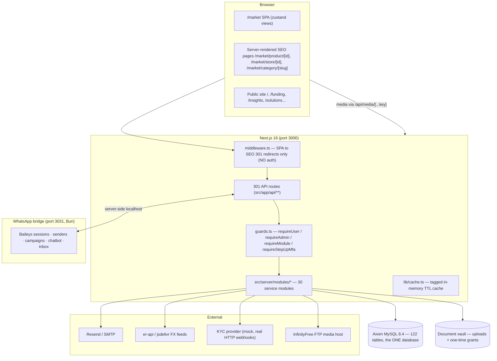
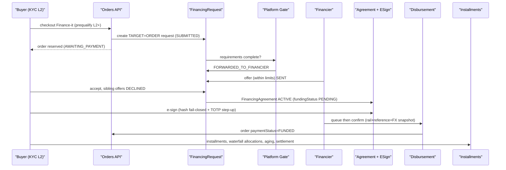

# Vendora — System Manual

**Version:** 1.0 · generated 2026-10-06 (post Phase-12, post audit/hardening round `d8e4a21`)
**Audience:** full-stack developers, product managers, operators, auditors.
**Purpose:** a single self-contained master document that fully explains the Vendora platform as it exists today — architecture, backend, frontend, database, modules, permissions, account types, capabilities, workflows, integrations, operations, and security — without requiring the reader to open the code. Every claim points at the exact file, model, route, or migration that implements it.

> **How to read this manual.** §2 (accounts/parties) and §3 (marketplace/catalog) resolve the most common confusions: *what is a seller, what is an organization, who sees what.* §7 is the security reference. §8 walks every account type from A to Z. The **mandatory Q&A appendix (§13)** answers 32 explicit questions with evidence. §14 is a one-page extension guide for a new developer; §15 is a one-page capability cheat-sheet per account type.

---

## Table of contents

1. Executive overview
2. Account and party model
3. Marketplace and catalog model
4. Backend architecture
5. Database and data model
6. Frontend and UI
7. Permissions and security
8. Complete workflows (end-to-end)
9. Modules and capabilities
10. Phase status and delivery evidence
11. Operating the platform
12. Appendices (diagrams, route inventory, permissions matrix, data flows, glossary)
13. Mandatory Q&A appendix (32 questions)
14. How to extend Vendora (one page)
15. User capabilities by account type (cheat sheet)
16. English summary
17. الملخص العربي (Arabic summary)

---

## 1. Executive overview

### 1.1 What Vendora is today

Vendora is a **multi-vendor B2B/B2C marketplace for solar-energy equipment and services with a built-in, Sharia-aware financing layer**, aimed at the Yemeni market (phone-first identity, Yemeni rial as a display currency, governorate-level geography).

Concretely, the platform as built combines:

- **A shared product marketplace** (one catalog, many vendors): platform-curated catalog records plus seller-owned listings; multiple sellers can offer the *same* product side-by-side with independent price/stock/variants (`ProductOffer`, `OfferVariant` — `prisma/schema.prisma` catalog domain).
- **B2C retail checkout**: simulated card, manual bank transfer, and **Murabaha "Finance-it"** checkout (Islamic financing gated on KYC L2) — `src/app/api/orders/route.ts`, `src/server/modules/financing/murabaha.ts`.
- **A B2B procurement engine**: multi-line RFQs, competing quotes with snapshot pricing, negotiation threads, org-level purchase approvals, NET-terms invoice payments, recurring RFQs with lease-fenced scheduling — `src/server/modules/rfq/`.
- **A financing marketplace**: financial institutions (banks, MFIs, e-wallets) onboard, publish financing/accreditation services, receive verified applications through a platform gate, issue offers, sign agreements electronically (TOTP step-up), disburse with rail references and FX snapshots, and service installments through a waterfall allocation engine with reconciliation and aging — `src/server/modules/financing/` (19 service files).
- **A monetization layer**: an immutable fee ledger (order commission, financing success, subscription renewal) and seller subscription tiers whose module bundles *clamp* what an organization can switch on — `src/server/modules/fees/`, `src/server/modules/subscriptions/`.
- **An operations back office**: admin console spanning catalog moderation, vendor verification, KYC provider routing, FX/currency management, payments capture, payout settlement, refunds, disputes, RBAC staff management, WhatsApp business messaging (templates, chatbot, bulk campaigns, unified inbox), and a storefront designer — `src/components/marketplace/admin-view.tsx` (28 sections).

### 1.2 Core value proposition and primary user journeys

| Actor | Primary journey |
|---|---|
| Individual buyer | register by phone OTP → browse/search (typo-tolerant, facets, brands) → cart → checkout (card demo / bank / finance-it) → track order → refund/dispute if needed |
| Company buyer | company wizard → invite team, assign roles → RFQ → internal approval → quote acceptance → NET-terms order → financing |
| Seller (individual or company) | register with "Sell" intent → verify (KYC L2 to publish) → list products/offers/variants → quote RFQs → fulfill → earn payouts (commission-deducted) |
| Financier institution | institution application → admin verification → publish services → review platform-gated applications → offer → e-sign agreement → disburse → collect installments |
| Platform admin | moderate catalog, verify vendors & KYB, run FX/payouts/refunds, manage staff RBAC + MFA policy, monetization, WhatsApp channels, modules on/off |

### 1.3 Current deployment topology

| Component | Detail | Evidence |
|---|---|---|
| Web app | Next.js 16 App Router, dev server `:3000` (Turbopack), React 19, TS 5 | `package.json` (`dev`), `src/app/` |
| Database | **Aiven MySQL 8.4** `mysql-marketplace-sunsolar1.f.aivencloud.com:23363/defaultdb`, 122 tables + `_prisma_migrations`, charset utf8mb4, `max_connections=76` | `.env` (recovered from git history commit `5371cc0`), `scripts/mysql-check.ts` |
| Prisma | Client v6.19.2, **migration-managed since 2026-10-06** (baseline `prisma/migrations/0_init/migration.sql`, 3033 lines, marked applied — zero data touch); before that the DB was `db push`-managed | `prisma/migrations/`, commit `a7ec517` |
| WhatsApp bridge | Bun mini-service `:3031` (`mini-services/whatsapp-service/index.ts`), Baileys 7.0.0-rc14, internal token `X-Internal-Token` | `mini-services/whatsapp-service/` |
| Public media host | InfinityFree FTP (`ftpupload.net:21` → `https://yusr.site.je/storage/…`), local-disk fallback | `src/lib/storage/ftp-hosting.ts` |
| Email | Resend REST API primary, nodemailer SMTP fallback | `src/lib/mailer.ts`, `src/lib/resend.ts` |
| FX feeds | `open.er-api.com` → `cdn.jsdelivr.net` (no-key public APIs) | `src/server/modules/currency/service.ts` |
| KYC provider | In-repo **mock provider** exercising the full production path (real HTTP + HMAC-signed webhooks) | `src/server/modules/kyc/provider/mock-provider.ts` |
| Gateway | Caddy (single exposed port; `XTransformPort` query convention for browser→mini-service calls — an infrastructure convention, currently unused by app code) | `CLAUDE.md` |
| Repo | `github.com/shca2626/marketplace-mysql` (public; `.env` untracked since `680426a`) | `git remote -v` |

### 1.4 High-level architecture diagram



---

## 2. Account and party model

> **This section resolves the most common audit confusions.** Vendora separates **identity** (a `User`), **tenancy** (an `Organization`), **selling qualification** (`SellerProfile`), and **financing qualification** (`FinancierProfile`). There is exactly one user-authentication mechanism; every "account type" is data layered on top, not a different login.

### 2.1 The parties at a glance

| Party | Where it lives | Created by | Can act alone? |
|---|---|---|---|
| **Individual buyer** | `User` with `role=BUYER`, no Organization | AuthModal register (phone OTP) | Yes — browse/buy/RFQ/finance |
| **Company/organization buyer** | `User` + `Organization` (`orgType=COMPANY`) + `OrganizationMember(OWNER/ADMIN/BUYER/APPROVER/VIEWER)` | 5-step company wizard | No — acts through memberships |
| **Seller (individual)** | `User` with `role=SELLER` (+ store fields), auto-provisioned `Organization` + `SellerProfile` | AuthModal "Sell" intent, or `POST /api/auth/become-seller` | Yes |
| **Seller organization (merchant/dealer)** | `Organization` + `SellerProfile` + OWNER/ADMIN members with staff roles | Company wizard with Sell/Buy/Both intent | Multi-staff tenancy |
| **Financier institution** | `Organization` (`orgType=BANK/MFI/EWALLET`) + `FinancierProfile` + members with `financier.*` roles | Financier application door (admin-approved) | Multi-staff tenancy |
| **Platform admin / staff** | `User` (+ legacy `role=ADMIN` marker) + **`UserRole` assignments only** | Seeded / RBAC console invitations | Yes |

### 2.2 User — the universal identity (`prisma/schema.prisma:34`)

- **Phone-first**: `phone` unique E.164 (Yemeni prefixes 70/71/73/77/78), `phoneVerifiedAt` set at OTP registration (instant KYC **L1**). `email` is **optional** — never assume it exists (`GuardUser.email` is nullable, `src/server/guards.ts:22`).
- `role ∈ BUYER | SELLER | ADMIN` — **data only, never an authorization fact** since Phase 6: "the legacy `User.role === 'ADMIN'` bypass is GONE from every guard" (`src/server/guards.ts:11-15`). It drives UI badges and default nav only.
- `status ACTIVE | SUSPENDED` — suspension (platform-controlled vendor lifecycle) fails session resolution (`src/lib/auth.ts:110-113`).
- `kycLevel 0-3` — derived (see §8.3 KYC engine).
- `merchantType ∈ EXCLUSIVE_AGENT | AUTHORIZED_AGENT | DISTRIBUTOR | WHOLESALER | RETAILER` (merchant classification from the company wizard).
- Store fields for individual sellers: `storeName`, `storeBio`, `storeCover`, `commissionRate` (legacy per-vendor commission override that wins over fee-engine rules — `src/server/modules/payouts/service.ts:114`).
- Auth hardening: `sessionVersion` (all-session kill epoch), `mfaRequired`, `isBreakGlass`, `verifiedAt` (legacy stamp kept in sync with seller verification).

### 2.3 Organization — the legal-entity tenant (`prisma/schema.prisma:486`)

- `orgType ∈ COMPANY | BANK | MFI | EWALLET` (default COMPANY). Financier-eligible types: `BANK | MFI | EWALLET` (`FINANCIER_ORG_TYPES`, `src/server/modules/financing/shared.ts:101`).
- `status PENDING_VERIFICATION | ACTIVE | SUSPENDED | REJECTED` — the **operational** lifecycle (deliberately *not* seller-trust state; lastplan S3).
- KYB: `kycLevel` (3 = business verified), `approvalThreshold` (B2B purchase approvals), `creditTermsDays`/`creditLimit` (B2B credit).
- `OrganizationType` is an **admin-managed metadata dictionary *over*** `orgType` (labels, ordering, registration visibility, custom display keys — `prisma/schema.prisma:208`) — the "customize, not static" lever for organization categories.
- One-org-per-**OWNER** rule enforced at creation only (409 — `src/server/modules/organizations/service.ts:107-115`).

### 2.4 OrganizationMember — the multi-tenancy edge (`prisma/schema.prisma:537`)

- `role ∈ OWNER | ADMIN | BUYER | APPROVER | VIEWER` (default BUYER), plus `jobTitle`.
- `@@unique([organizationId, userId])` — one row per user per org, but `userId` alone is **not** unique → **a user CAN belong to multiple organizations** (the financier console ships an institution switcher for exactly this — FIN-013).
- The canonical membership predicate lives in ONE place: `src/server/membership.ts:33-44` (`isActiveMembership` = member row ∧ user ACTIVE ∧ org ACTIVE), with `requireActiveMembership`, `activeMembers`, `countActiveOwners`, and the **last-active-owner invariant** `assertNotLastActiveOwner` (H2, lines 98-110).

### 2.5 SellerProfile — selling qualification, one per selling org (`prisma/schema.prisma:1058`)

- `organizationId @unique` (1:1 with the selling `Organization`), `ownerUserId` → the founding seller.
- `verificationState UNVERIFIED | PENDING | VERIFIED | REJECTED` + note/timestamps. **Verification ≠ suspension** — an UNVERIFIED seller can still trade (checkout/publish gates live elsewhere); a SUSPENDED user/org cannot.
- Admin setter: `setSellerVerification` (`src/server/modules/vendors/service.ts:264-339`) — defensively auto-provisions org+profile+OWNER membership for legacy sellers lacking one.
- **"Is seller a User role, an org capability, or a profile?" — all three, deliberately:** the `User.role=SELLER` flag marks the account's primary intent and unlocks the seller console nav; the `SellerProfile` binds *selling verification* to the org tenant; the org is the authoritative tenant for offers/payouts via `sellerOrgId` columns. One person can run everything (individual seller = owner of a one-member org); a company can have many staff covering different roles (RBAC, §7).

### 2.6 FinancierProfile — financing qualification, one per institution (`prisma/schema.prisma:1540`)

- `organizationId @unique` for BANK/MFI/EWALLET orgs. License/regulator facts, branches (`FinancierBranch` kind BRANCH/AGENT/ATM), social links, success stories.
- **No direct user link** — financier *staff* reach it via OrganizationMember (OWNER/ADMIN) or org-scoped `financier.*` UserRoles (DP-1: no new global role).
- Auto-provisioned on first console access (FIN-001: `ensureFinancierProfile`, `src/server/modules/financing/shared.ts:193-214`).

### 2.7 Capability flags & the module/entitlement stack

What an account can *see and do* is resolved at four layers (all customizable at runtime, none hardcoded):

1. **Module activation** (`ModuleDefinition` + `ModuleActivation`, `src/server/modules/modules/service.ts`): 9 seeded modules (`marketplace` core, `financing-hub`, `rfq`, `b2b-orgs`, `financier-console`, `compare`, `reviews`, `insights`, `solutions`), resolved by chain **ORG → ORG_TYPE → PLATFORM → default**, unknown keys fail closed.
2. **Subscription ceiling** (Phase 11.2): `SellerSubscription` tier bundles clamp gated modules — an org flip can never exceed the plan (`subscriptionCeilingForOrg`, `src/server/modules/subscriptions/service.ts:156-178`).
3. **RBAC permissions** (67 keys — §7): server-enforced per route; nav filters to match.
4. **KYC level** (L0-L3): gates publishing (L2), Murabaha checkout (L2), business features (L3).

### 2.8 Multi-organization policy & conflict of interest

- Allowed: one user, many memberships (e.g., buyer employee in two companies, or a consultant with staff roles at two institutions).
- **Technical isolation**: every org-scoped read/write goes through membership checks (`isActiveMembership` / `requireActiveMembership`) or the financier context guard; seller data is scoped by `sellerOrgId` stamped at creation. Cross-tenant access is blocked at the service layer (negative suite NEG-01..20, `audit/negative-suite-2026-10-05.md` — 20/20 PASS).
- **Conflict of interest** (e.g., member of two competing sellers): *no explicit policy or technical control exists today* — membership is not exclusive and no "competing seller" guard runs at join time. Data leakage is prevented (org scoping), but a person CAN hold roles in two competing selling orgs. See §13 Q7 and §10 gaps.

---

## 3. Marketplace and catalog model

### 3.1 One shared marketplace, not per-seller storefront silos

Vendora is **one shared marketplace**: a single catalog (`/market` SPA + server-rendered SEO pages), one search, one cart, one checkout. A seller's "storefront" is a **page inside Vendora** — `/market/store/[id]` (SEO) or `?view=store&id=` (SPA) — rendered from the seller's brand (navy hero, trust panel, categories, first 48 products), *not* a separate market or domain. Routes: `src/app/market/(public)/store/[id]/page.tsx`; middleware 301s in `src/middleware.ts`.

### 3.2 The three-concept catalog: what it is vs who sells it vs how you buy it

| Concept | Model | Question it answers | Authority |
|---|---|---|---|
| **Product** | `Product` (`prisma/schema.prisma:222`) | *What is the thing?* Title, description, images, GTIN/MPN, brand, category, specs, certifications | Catalog record — **`sellerId` nullable** |
| **ProductOffer** | `ProductOffer` (`:315`) | *Who sells it, at what price/stock/lead-time?* | The seller-org tenant — `sellerOrgId` |
| **OfferVariant** | `OfferVariant` (`:1260`) | *Which purchasable configuration?* Price override, per-variant stock/sku | Purchase-time authority — `@@unique([offerId, variantId])` |

- **Platform-curated products** (`sellerId=null`, `isCurated`, `curatedById`): the platform authors catalog records ("Vendora Catalog"); they are **display-only** — purchasable *only* through a real vendor's ACTIVE offer (checkout fails closed with `CURATED_REQUIRES_OFFER` 400; legacy price fallbacks were removed in Phase 9 — `src/app/api/orders/route.ts:150-161`).
- **Seller-owned products** (`sellerId` set): classic listings with retail `price` fallback and their own variants; the owner edits Product fields while other sellers attach offers.
- **Multiple sellers can offer the same Product** — `@@unique([productId, sellerId])` guarantees one offer per seller per product; the storefront renders a vendor picker with From-price and "Available from these vendors" cards (Phase 9.1).
- **Buyers compare offers** on the product page (price, stock, lead time, per-variant availability); cart lines record the chosen offer/variant ("Added from {store}'s offer" — `src/components/marketplace/cart-drawer.tsx`).
- **Attribution chain**: `RfqLine.offerId/offerVariantId` → `QuoteLine` snapshots (price, `availableStock` — H1: never reconstructed) → `OrderItem.offerId/offerVariantId/sellerOrgId`. Pair validation runs fail-closed at every transition (Phase 7.6).

### 3.3 Catalog support layers

- `Category` (taxonomy) · `Brand` (directory, `isVerified`, origin) · `UnitOfMeasure` · `SpecAttribute` (KYP structured specs per category: TEXT/NUMBER/SELECT/BOOLEAN + unit) · `ProductCertification` (compliance artifacts, PENDING/VERIFIED/REJECTED, vault-backed) · `PublicationAgreementTemplate` + `PublicationConsent` (versioned legal consent per product publication).
- Pricing: `PriceList` scope ORG/GROUP/CHANNEL with priority and validity windows → `PriceListEntry` quantity-break ladders; resolution precedence **org contract list > customer-group list > channel list (future) > retail `Product.price`** (`src/server/modules/pricing/resolver.ts`).
- Discovery: typo-tolerant search (Levenshtein, did-you-mean), spec-attribute facets (60s cached, shareable URLs), brands directory + brand pages, bestsellers rails (Phase 12) — `src/server/modules/catalog/{search,facets}.ts`.

---

## 4. Backend architecture

### 4.1 Service/module boundaries

- **Routes stay thin** (`src/app/api/**` = 301 routes): parse → guard → call service → serialize.
- **All business logic in `src/server/modules/`** — 30 module folders (approvals, audit, catalog, coupons, currencies, currency, customer-groups, documents, fees, financing [19 files], kyc, mfa, modules, notifications, orders, organizations, otp, payments, payouts, price-lists, pricing, products, rbac, refunds, rfq, sellers, sequences, settings, subscriptions, vendors, whatsapp).
- **Mini-service**: only the WhatsApp bridge (`mini-services/whatsapp-service/`, port 3031, Bun + `bun --hot`). It owns Baileys session lifecycle, paced campaign sending, chatbot auto-reply, and persists every inbound message into the shared MySQL. The Next app calls it **server-side** (`src/lib/whatsapp.ts`); browsers never talk to 3031 directly.
- **Background jobs are deliberately lazy** ("no cron infrastructure in the sandbox"): reservation-TTL release throttled once/min from `GET /api/orders` (config `PlatformSetting "reservations"`, default 48h, clamp 1-720); subscription GRACE→DOWNGRADED self-heals on read; KYC retention via manual script (`scripts/kyc-retention.ts`); RFQ/recurring sweeps piggyback read paths; currency self-heals on public reads (180-min default); digest build is an ops-triggered header-secret route; campaign send loop runs inside the bridge.

### 4.2 Authentication and authorization model

- **Sessions**: HMAC-SHA256-signed `vendora_session` cookie (30d), scrypt password hashing, `AUTH_SECRET` fail-fast in production (`src/lib/auth.ts`). Every issued token gets a `SessionRegistry` row (tokenHash, UA/IP, throttled lastUsedAt, `revokedAt/Reason`, `mfaSatisfiedAt` for step-up freshness). `sessionVersion` epoch bump kills every pre-bump token (`scripts/bump-all-sessions.ts`).
- **Guards** (`src/server/guards.ts`): `requireUser()` (401) · `requireAdmin(permission)` (**throws if called without a key** — the Phase-6 rule that ended the ADMIN bypass) · `requireAdminAny([...])` · `requireModule(moduleKey, ctx?)` (fail-closed, `MODULE_UNKNOWN`/`MODULE_DISABLED` 403) · `requireStepUpMfa()` (5-min freshness window). RBAC resolution in `src/server/modules/rbac/service.ts`.
- **Org context resolution (server-side, per console)**:
  - *Financier console*: `requireFinancierContext()` (`src/server/modules/financing/shared.ts:242-256`) — memberships (OWNER/ADMIN of BANK/MFI/EWALLET ∪ orgs with a profile ∪ org-scoped `financier.*` roles), active org via `fin_org` cookie set by `POST /api/financier/context`; enforces the `financier-console` module.
  - *Seller console*: org resolved **from the caller's SellerProfile** per call-site (never a client parameter) — e.g. `src/server/modules/payouts/service.ts:108-113`, `src/app/api/seller/subscription/route.ts`.
  - *Buyer org context*: first ACTIVE membership at checkout (`src/app/api/orders/route.ts:270-274`); Business view selects among the user's orgs client-side.
- **`src/middleware.ts` does NO auth** — it only 301s legacy SPA URLs to SEO routes. Authorization is per-route + guard-lint enforced (§7.5).

### 4.3 Document storage model

- **Driver registry** `src/lib/storage/index.ts`: `STORAGE_DRIVER=local-disk | ftp-hosting` (unset = local-disk); adapters implement `StorageAdapter`; s3/r2 would register here.
- **Namespaces** (6.6.1): `public-media` vs `private-vault` (`vault/` root). Dedup by content hash **never crosses namespaces** (`MediaAsset @@unique([namespace, sha256])`). The FTP driver never uploads vault keys to the public host; public serving 404s keys that exist behind an `AccountDocument` (10-min cached blocked-key set).
- **Private retrieval is always an authenticated proxy** — `GET /api/vault/[documentId]`: authorize via the 6.8 access matrix (`src/server/modules/documents/access.ts`: OWNER → PLATFORM_REVIEWER (`financing.documents.verify`) → ORG_MEMBER (ORG_INTERNAL only) → FINANCIER_SCOPE (review-scope-tied)) → mint a one-time `VaultAccessGrant` nonce (5-min TTL, HMAC-bound) → retrieval re-authenticates, verifies HMAC+expiry+grant, **atomically consumes the nonce** (`updateMany WHERE consumedAt IS NULL`), audits `DOCUMENT_FILE_RETRIEVED`, streams bytes `Cache-Control: no-store`. Replay → 410.

### 4.4 External integrations

| Integration | Files | Notes |
|---|---|---|
| Email | `src/lib/mailer.ts`, `src/lib/resend.ts` | Resend REST → SMTP fallback; branded-sender auto-fallback; digest engine wired |
| WhatsApp | `src/lib/whatsapp.ts` + bridge | senders pairing (Baileys linked devices), templates `{{var}}`, chatbot rules, paced bulk campaigns, unified inbox; dev fallback = console delivery |
| Payments | `src/server/modules/payments/service.ts` | CARD simulated inline (self-hosting requirement — no PSP), BANK_TRANSFER manual with admin capture, INVOICE NET-terms from quote conversion only |
| FX | `src/server/modules/currency/service.ts` | open.er-api → jsdelivr; append-only `ExchangeRate` ledger; admin pins survive refreshes; YER pinned 535.5 |
| KYC | `src/server/modules/kyc/provider/*` | per-doc-type routing MANUAL/PROVIDER/PROVIDER_THEN_MANUAL; mock does REAL HTTP + HMAC-signed webhooks (±5-min window, nonce-unique, eventId-idempotent) |
| Media hosting | `src/lib/storage/ftp-hosting.ts` | magic-byte validation, immutable names (30d edge cache), executable rejection, 10MB cap, 60s circuit breaker |
| TOTP | `src/lib/totp.ts` | dependency-free RFC 6238; secrets AES-256-GCM under `MFA_ENCRYPTION_KEY` |

---

## 5. Database and data model

### 5.1 Scale and conventions

- **122 models → 123 tables** (122 + `_prisma_migrations`). No DB enums — statuses are string unions enforced in TS/zod (documented convention). MySQL quirks: explicit composite-`@@id` M2M joins (Aiven requires PKs), `@db.Text`/`MediumText` for long fields, dedicated `@@index` on every FK not leftmost in an existing index (`MYSQL-FK-INDEX` comments).
- **Migration history**: managed since 2026-10-06 (`0_init` baseline = full Phase-12 schema, marked applied on Aiven with zero data touch — commit `a7ec517`). All critical financial/commerce tables were created via `db push` through Phases 0-12; the baseline captures them faithfully (3033-line diff-from-empty).

### 5.2 Model inventory by domain (purpose · scope · key constraints)

**Identity & organizations** — `User` (universal identity, phone-first), `Organization` (tenant; `slug` unique; orgType COMPANY/BANK/MFI/EWALLET; status/credit/threshold), `OrganizationMember` (`@@unique([organizationId,userId])`; OWNER/ADMIN/BUYER/APPROVER/VIEWER), `OrganizationType` (admin-managed dictionary over orgType), `CustomerGroup(±User/Organization join)` (buyer segmentation with priority), `SellerProfile` (1:1 org; verification state), `FinancierProfile` (1:1 institution org), `FinancierBranch` (BRANCH/AGENT/ATM with lat/lng).

**RBAC & staff** — `Permission` (dotted keys), `Role` (scope PLATFORM/ORG, isSystem/isProtected), `RolePermission`, `UserRole` (`organizationId @default("")` = platform scope; unique triple), `StaffInvitation` (SHA-256 tokenHash, PENDING/ACCEPTED/REVOKED).

**Auth hardening** — `PasswordResetToken`/`EmailVerificationToken` (hashed single-use), `MfaEnrollment` (TOTP secret AES-GCM, lastTotpStep replay guard), `MfaBackupCode` (scrypt), `SessionRegistry` (one row per issued cookie), `OtpCode` (hashed 6-digit, 5-min TTL, caps), `UserNotificationPref`, `UserDigestPref`.

**Catalog** — `Category`, `Brand`, `UnitOfMeasure`, `Product` (sellerId nullable = curated; status DRAFT/ACTIVE/PENDING_REVIEW/REJECTED/ARCHIVED; publication-consent fields), `ProductVariant`, `ProductOffer` (`@@unique([productId,sellerId])`; PENDING_REVIEW/ACTIVE/PAUSED/REJECTED/ARCHIVED), `OfferVariant` (`@@unique([offerId,variantId])`), `SpecAttribute` (`@@unique([categoryId,key])`), `ProductCertification`, `MediaAsset` (sha256 dedup per namespace), `PublicationAgreementTemplate` (single-active), `PublicationConsent`.

**Pricing & promotions** — `PriceList`/`PriceListEntry` (org/group/channel + priority + validity), `Coupon` (percentOff, firstOrderOnly).

**Orders & settlement** — `Order` (legacy `status` + dimension split `paymentStatus` AWAITING_PAYMENT/PAID/FUNDED/PARTIALLY_REFUNDED/REFUNDED/OUTSTANDING and `fulfillmentStatus` UNFULFILLED/PARTIALLY_FULFILLED/FULFILLED/PARTIALLY_CANCELLED/CANCELLED; B2B fields poNumber/costCenter/paymentTerms; sourceType CART/RFQ with `sourceQuoteId @unique`; `financingAgreementId` Murabaha link), `OrderItem` (snapshots + offer/variant/sellerOrgId/payoutId attribution), `OrderFulfillment` (one per order×sellerOrg group; roll-up derived), `OrderFulfillmentItem`, `Payment` (one per order; CARD/BANK_TRANSFER/INVOICE; SUCCEEDED flips order PAID), `Refund` (REQUESTED→APPROVED→COMPLETED-with-reference obligation/execution split) + `RefundAllocation` (item buckets), `Payout` (PY-…; commission snapshot; transferReference REQUIRED to mark paid; idempotency key), `PayoutLine` (**immutable settlement ledger**; SETTLEMENT/REVERSAL/REISSUE; `claimKey @unique` per order item = DB backstop single-flight), `Dispute`, `Review`, `Favorite`.

**RFQ engine** — `Rfq` (DRAFT→SUBMITTED→UNDER_REVIEW→QUOTED→ACCEPTED/REJECTED/CANCELLED/EXPIRED/ORDERED), `RfqLine` (catalog product / open item / specific offer+variant), `Quote` + `QuoteLine` (H1 snapshots), `ApprovalRequest` (org threshold; requester never self-approves), `RfqMessage`, `RecurringRfq` + `RecurringRfqRun` (lease + fencing token), `Notification` (in-app feed).

**Financier module (v5 + Phase 10 ops)** — `FinancierService` (FINANCING/ACCREDITATION offering: category, target segment, amount/tenor/rate caps, shariaCompliant), `FinancierServiceAttribute`, `FinancierServiceCoverage` (region names), `ConditionTemplate`/`ConditionOption`/`ServiceRequirement`/`RequirementSubmission` (requirements engine), `AccountDocument` (universal vault docs), `VaultAccessGrant`, `RequestAttachment`, `FinancingRequest` (FR-… application; WHO org?/user; WHAT service; targetType WORKING_CAPITAL/QUOTE/ORDER/RFQ_LINE; platform gate fields; status machine incl. FORWARDED_TO_FINANCIER), `FinancingOffer` + `FinancingOfferInstallment`, `FinancingAgreement` (AGR-…; references accepted offer, NO terms snapshot by design DP-20; fundingStatus PENDING/REPORTED_FUNDED/REPORTED_SETTLED), `FinancingEvent` (track-only ledger), `FinancingFee` (commission accounting), `AccreditationRequest` (ACC-…; activeKey DB-trigger; supersedesId chain; unique (service,org,activeKey)), `InstallmentPayment`/`InstallmentAllocation`/`PaymentReconciliation` (collections waterfall + aging + daily rail reconciliation), `DisbursementRecord` (rail + reference + FX snapshot), `RiskConfig`/`RiskAssessment`, `ShariaCertification`, `FinancingContractTemplate` (sha256-versioned), `ESignatureExecution` (evidence package), `UnderwritingLimit` (scopeKey matrix).

**Monetization** — `FeeRule` (scope chain ORG>ORG_TYPE>PLATFORM; versioned), `FeeAssessment` (**immutable ledger**; idempotencyKey unique; append-only reversals), `SubscriptionPlan` (module bundles + limits), `SellerSubscription` (one per org; TRIALING/ACTIVE/GRACE/DOWNGRADED/CANCELLED), `SubscriptionInvoice`.

**KYC provider (Phase 12)** — `KycProviderConfig` (per-doc-type routing; absence = MANUAL fail-safe), `KycCase` (state machine incl. PROVIDER_ERROR → MANUAL_QUEUE; transmittedFields minimization evidence), `KycWebhookEvent` (immutable receive log; eventId + nonce uniqueness).

**WhatsApp suite** — `WhatsAppSender` (paired numbers), `WhatsAppMessage` (delivery ledger), `WhatsAppTemplate`, `ChatbotRule`, `BulkCampaign`, `WhatsAppChatThread`/`WhatsAppChatMessage` (unified inbox incl. webchat widget).

**Site/CMS** — `ContactMessage`, `FaqItem`, `FinancierSocialLink`, `FundingStory`, `InsightPost`, `LegalDocument`, `Partner`, `SiteStep`, `Solution(±Feature)`.

**Platform substrate** — `PlatformSetting` (KV JSON: storefront, payments, payouts, reservations, currency, whatsapp), `BannerSlide`, `RfqSetting` (scoped precedence), `SettingChange` (append-only rollback chains), `AuditLog` (actor/action/entity/metadata; sensitive actions transactional), `Sequence` (RFQ/QTE/DSP/PY/FIN/AGR/ACC/RF/SUB number minting), `ModuleDefinition`/`ModuleActivation`, `NotificationDigest`, `Currency`/`ExchangeRate`.

### 5.3 Authoritative sources vs read-models/snapshots

- **Authoritative**: `PayoutLine` (settlement), `FeeAssessment` (fees), `ExchangeRate` (FX), `RequirementSubmission` (checklist truth), `SessionRegistry` (sessions), `AuditLog` (actions).
- **Snapshots (deliberate, immutable once written)**: `OrderItem` title/image/price; `QuoteLine` price/offer/availableStock; `Payout.commissionRate`; `DisbursementRecord.fxRate`; `KycCase.transmittedFields`; `ESignatureExecution` evidence; `FeeAssessment.ruleSnapshot`.
- **Derived/roll-ups** (recomputed, never edited directly): `Order.paymentStatus`/`fulfillmentStatus`; subscription effective state; KYC levels; trust counters (`computeStoreTrust`).

### 5.4 Financial integrity controls

- **Claims & single-flight**: payout generation claims each order item conditionally (`updateMany WHERE payoutId IS NULL`, affected-rows verified) with `PayoutLine.claimKey @unique` as the DB backstop — at most one live settlement claim per item ever.
- **Idempotency**: `Payout.transferIdempotencyKey @unique`; `FeeAssessment.idempotencyKey` (e.g. `ORDER_COMMISSION:payout:PY-…`); KYC webhook eventId dedupe.
- **Reconciliation**: fee revenue console reconciles per-event to the cent with legacy rows excluded; daily installment rail reconciliation writes `PaymentReconciliation` discrepancy rows; subscription invoices reconcile renewals.
- **Atomic money transitions**: stock decrements conditional (`stock >= qty`) with `StockConflict` 409 rollback; approvals reservation TTL; reversals are always appended rows (refund, payout REVERSAL, installment reversal), originals never mutated.
- **Evidence discipline**: transfer references mandatory on payout mark-paid and refund completion; disbursement requires rail+reference+FX snapshot; e-sign binds template sha256 + MFA timestamp.

---

## 6. Frontend and UI

### 6.1 The surfaces

1. **Public marketing site** (server-rendered, `src/app/(site)/`): `/`, `/about`, `/contact`, `/faq`, `/how-it-works`, `/insights(+/[slug])`, `/legal/[slug]`, `/sell`, `/solutions(+/[slug])`, `/funding` (module-gated) + `/funding/programs/[id]`, `/funding/entities/[id]` (financier mini-site profiles).
2. **The marketplace SPA** at `/market` (`src/components/marketplace/marketplace-app.tsx` + `src/lib/routing.ts` + zustand store `src/store/marketplace.ts`) — views via query params: storefront `home | catalog | product | store | brands | cart | checkout | forgot-password | reset-password | verify-email | register-company | register-financier`; consoles `admin | seller | account | rfqs | business | orders | favorites | financing | financier` (each mounting its own `DashboardLayout`, zero storefront chrome). Deep links shareable; `popstate` re-applies.
3. **SEO routes beside the SPA**: `/market/product/[id]`, `/market/store/[id]`, `/market/category/[slug]` (JSON-LD, server-rendered); middleware 301s the SPA equivalents (`?spa=1` bypass for the "Compare on Vendora" CTA).

### 6.2 Navigation per account type (single source: `src/components/dashboards/nav-config.ts`)

- **ADMIN_NAV** — Platform: Overview · Operations: Vendors, Products, Spec Attributes, Certifications, Orders, Organizations, Pricing & Lists, Coupons · Catalog: Review Queue, Catalog Listings, Brands, Categories, Units, Org Types, Duplicates, Popular Rail, Pub. Agreements · Finance: Payments, Payouts, Monetization, Currencies & FX, Financing · B2B Engine: RFQ Pipeline, Disputes · Configuration: Roles & Access, Security, KYC Provider, Modules, WhatsApp Channels, RFQ Settings (22 panels), Storefront Designer · Compliance: Audit Log. Sidebar filters per permissions.
- **SELLER_NAV** — Overview: Dashboard · Catalog: Products, My Offers · Sales: Orders, Earnings, Subscription, RFQ Inbox, Disputes.
- **BUYER_NAV** — Overview: Dashboard · Procurement: My RFQs (`rfq` module), Business Account (`b2b-orgs`) · Financing: Financing & Accreditation, Services, Applications, Accreditation, Agreements (`financing-hub`) · Shopping: Orders, Favorites · Account: Profile & Security, Verification, Document Vault.
- **FINANCIER_NAV** — Overview: Dashboard · Offering: Services, Requirements · Pipeline: Requests Inbox, Offers, Accreditations · Portfolio: Agreements, Operations, Analytics, Institution Profile · Compliance: Sharia & Contracts · Institution: Team & Roles.
- **Public chrome**: platform header (`/`, Market, Funding, About, Contact + "For business" dropdown → merchant/financier doors), market header (search, currency switcher, notifications bell, cart drawer, role-aware account menu incl. Financier console when context resolves), footers per surface.

### 6.3 Registration — the three doors (verbatim labels)

1. **Customer fast path** (`auth-modal.tsx`): login "Phone or email" + password (+ MFA step when enrolled) · register step 1 phone OTP (+967 chip, "Send WhatsApp code") · step 2 "Full name", intent radio **"I want to… 🛍️ Shop / 🏪 Sell"** (Sell reveals "Store name"), password + strength meter, optional email/invitation code, terms checkbox, **"Create account"**. Footer: "New to Vendora? Create an account · Already a member? Sign in · **Registering a company? Merchant/Dealer signup · Financial institution**".
2. **Merchant/Dealer company wizard** (`?view=register-company`, 5 resumable steps): Account (owner OTP) → Business profile (legal/trade name, merchant-type radio cards Exclusive agent/Authorized agent/Distributor/Wholesaler/Retailer, registration #, tax card, industry, governorate) → KYB documents (commercial registration required → vault) → Store intent (Sell/Buy/Both + store name/category/description) → Review & submit → `POST /api/auth/register/company` (org PENDING_VERIFICATION; SELL/BOTH flips owner's role to SELLER).
3. **Financial institution door** (`?view=register-financier`): legal name (+ Arabic), org-type cards **Bank / Microfinance institution / E-wallet**, license # + expiry, CBY #, governorate, website, contact + OTP, service presets (Working capital, Invoice financing, PO financing, Equipment leasing, Murabaha retail, Sukuk, Microenterprise loans, Agriculture financing) + custom, authorized-representative consent → `POST /api/auth/register/financier` (BANK/MFI/EWALLET org PENDING_VERIFICATION — invisible until admin verification).

### 6.4 The four consoles (SPA views)

- **Admin** (`admin-view.tsx`, 28 tab components in `src/components/marketplace/admin/`): overview stats; vendors (verification/suspension); products + review queue; catalog (listings, brands, categories, units, org types, duplicates, popular, agreements); orders; payments (capture queue + config); payouts (generate/preview/mark-paid/reverse + config); monetization (fee rules/simulator/ledger/revenue/subscriptions — pill tabs); currencies & FX (live rates & pins + history); financing (gate queue, institutions, fees, requirements library); organizations; pricing (price lists + customer groups); coupons; RFQ pipeline; disputes; RBAC (roles/staff/invitations/assignments); security (MFA policy); KYC provider (Routing/Case Queue/Webhook Log); modules matrix; WhatsApp (chats/campaigns/chatbot/templates); RFQ settings; storefront designer; audit log. Sensitive actions wrapped by `admin/step-up-guard.tsx`.
- **Seller** (`seller-view.tsx`): dashboard (sales chart, fulfillment pipeline, store health); products (7-tab form incl. variants/attributes/bulk CSV; publish gate **KYC L2**); My Offers (multi-vendor offers on others' catalog records); orders (PAID→PROCESSING→SHIPPED→DELIVERED buttons; PENDING_APPROVAL for financed); earnings (settlement balance, commission, payout history); subscription (plan/entitlements/limits); RFQ inbox (quote composer); disputes. Buyer-role visitors see the "Turn your passion into a store" upgrade card (`POST /api/auth/become-seller`).
- **Financier** (`financier-view.tsx` + `financier/*` sections): activation journey for PENDING_VERIFICATION/REJECTED orgs; institution switcher (≥2 orgs); dashboard, services CRUD, requirements composer, platform-gated inbox, offers with installment schedules, accreditations, agreements (funding status/events), operations (disbursements, collections, reconciliation), analytics (funnel/aging/NPL/CSV), sharia (certs + versioned contracts), e-sign evidence, profile, team & roles.
- **Buyer** (`buyer-dashboard.tsx` + `financing-view.tsx` + `b2b/*`): overview; profile & security (details, email/sessions, password, TOTP 2FA + backup codes, devices + global sign-out); verification stepper (L0→L3); document vault; financing wizard (3 steps: profile/vault → activity/underwriting/ask/guarantee/requirements/multi-financier → review/consent), services directory with facets, requests, agreements (installments, events, e-sign, statements); RFQ pipeline (picker, recurring schedule, quote comparison + negotiation thread, PDF export); business account (org profile, team members + add-member dialog, approvals card with threshold editor, org selector); orders (timeline, tracking, invoice, item-level refund request, disputes); favorites & compare tray (max 4).

### 6.5 Multi-tenancy presentation in the UI

- Financier: server-side institution switcher (cookie `fin_org`).
- Buyer B2B: client-side org `<Select>` (localStorage `vendora_active_org`).
- Seller: no switcher — org comes from SellerProfile.
- Module-aware nav: entries carry `module` keys; `filterNavByModules` drops OFF entries.
- Marketplace vs storefront: one SPA; seller storefront = public store page with trust panel (KYC-tier badge, orders fulfilled, dispute-free ≥5-order honesty gate — no fabricated metrics).

### 6.6 Theming & design

- Design system "bh": navy `#06396c`/gold `#d3af3c` on light `#f3f6fc`; dark variants under `.dark` (`src/app/globals.css`). Blue/indigo forbidden. shadcn NY + lucide + framer-motion.
- `next-themes` light/dark; **live theme bridge** (`storefront-theme.tsx`): admin-configured accent (auto-contrasted), radius scale, default theme → pushed to `:root` at boot and on every admin save.
- Currency switcher in market header (active currencies + live DB rates; YER 535.5 pin).
- **RTL: NOT STARTED** — Phase 13 (planned). Partial `dir="auto"` on WhatsApp bubbles; Arabic fields in financier registration.

---

## 7. Permissions and security

### 7.1 RBAC catalog

- **67 permission keys** (48 PLATFORM + 19 ORG) in `src/lib/rbac-catalog.ts` — the client-safe single source of truth. PLATFORM domains: overview, vendors, catalog (view/create/update/moderate/delete), orders, organizations, pricing, coupons, payments (view/capture), payouts (view/manage), financing (gate.view/gate.review/institutions.manage/fees.manage/requirements.manage/documents.verify), rfq (pipeline.view/quotes.review/settings.manage), disputes, storefront, whatsapp (view/manage), audit.view, staff (+rbac.*, modules.manage). ORG domains: org-profile, org-members, org-procurement, org-pricing, org-finance, financier-services, financier-pipeline, financier-team.
- **14 system roles** in `SYSTEM_ROLES` (`:322-473`): platform.super-admin (locked/protected), platform.kyc-reviewer, platform.catalog-moderator, platform.finance-ops, platform.support; org.owner (protected), org.admin, org.buyer, org.approver, org.viewer; financier.admin, financier.underwriter, financier.reviewer, financier.branch-officer. Plus unlimited **custom roles** via the RBAC console. (Worklog's "15 roles" = 14 system + 1 live custom.)
- **Assignment**: `UserRole(userId, roleId, organizationId="")` — `""` = PLATFORM scope (platform staff keep `role=BUYER`!), org id = ORG scope. Org-level roles are BOTH the legacy `OrganizationMember.role` (used by financier/seller context + approvals) AND RBAC org-scoped UserRoles (seeded from members).
- **Seeding**: `scripts/seed-rbac.ts` (idempotent, `assertNotProd()`): upsert permissions → roles → sync mappings → migrate legacy `User.role='ADMIN'` → platform.super-admin → migrate every member role to matching `org.*` assignment.

### 7.2 MFA / step-up

- TOTP enrollment + 8 backup codes; secrets AES-256-GCM under `MFA_ENCRYPTION_KEY`; replay guard `lastTotpStep`.
- **`MFA_TRIGGER_PERMISSIONS`** (`src/server/modules/mfa/service.ts:26-42`): holding `rbac.manage`, `staff.manage`, `payouts.manage`, `payments.capture`, `financing.documents.verify`, `orgs.verify`, `vendors.verify`, `disputes.resolve`, `modules.manage`, `financier.agreements.manage`… auto-requires MFA for the account (6.7.4); platform policy `security-mfa.requireForStaff`.
- **Step-up (5-min freshness via `SessionRegistry.mfaSatisfiedAt`)** enforced on: admin security, modules, payouts (config/generate/cancel/mark-paid/reverse), refunds complete, RBAC writes, financing e-signature (own `verifyMfaCode` stamping `signerMfaVerifiedAt`, unenrolled → 428). **Audit round `d8e4a21` closed 3 documented deviations**: fee-ledger reversal, KYC provider-configs PUT, subscription mutations — all now require step-up.
- Remaining documented deviations (audit-only): fee-rule create/edit (versioned+audited), KYC case decisions (audited), financier disbursement confirm (rail+reference+FX evidence) — accepted by plan.

### 7.3 Document access rules

- Sensitivity matrix (`src/server/modules/documents/sensitivity.ts`): PUBLIC / ORG_INTERNAL / SENSITIVE_IDENTITY / SENSITIVE_FINANCIAL.
- One access resolver (`access.ts`, 6.8 matrix): OWNER → PLATFORM_REVIEWER (`financing.documents.verify`) → ORG_MEMBER (ORG_INTERNAL class only) → FINANCIER_SCOPE (review-scope-tied; mere membership NOT enough).
- One-time HMAC-bound vault URLs; retrieval always authenticated proxy, `no-store`, atomic nonce consume; issue/retrieve audited separately.
- KYC provider **data minimization**: only `{docType, mediaSha256, reference:"vault:<mediaId>", issuedAt, expiresAt, title}` leaves the platform (per-type extras), snapshotted in `transmittedFields` BEFORE submit so evidence survives a throwing submit.

### 7.4 Rate limiting, OTP, webhooks, secrets

- Named in-memory sliding-window policies (`src/lib/rate-limit.ts`): login, register, upload, productWrite, review, order, mediaRead, digest*, emailConfig, mysqlCheck, password*, emailVerify, otp*, companyRegister, financierRegister, chatWidget* — per-IP or per-user, applied with `enforceRateLimit` + CSRF `assertSameOrigin`.
- OTP: hashed codes, 5-min TTL, 60s cooldown, 5/day/phone + 10/hr/IP, 5 attempts, single-use burn, HMAC possession-proof token (10 min).
- KYC webhooks: HMAC-SHA256 over `timestamp.nonce.rawBody`, `timingSafeEqual`, ±5-min freshness, eventId idempotency, nonce-unique per provider (DB), unauth 401 audited, every delivery logged. WhatsApp bridge: `X-Internal-Token`.
- Secrets: `secret-box.ts` AES-256-GCM; secret-sweep + admin-bypass-sweep committed (`audit/secret-sweep.md`); `.env` untracked from the public repo (`680426a`).

### 7.5 guard-lint (the authorization CI gate)

`bun run guard:lint` (`scripts/check-guards.ts`) — classification-first lint over **`audit/route-classification.json`** (301 routes; buckets PUBLIC 25 · MANUAL_REVIEW 47 · AUTHENTICATED_USER 96 · PLATFORM_PRIVILEGED 133 · ORG_SCOPED 0-defined-unused) with **6 failure conditions**: unclassified route, local `requireAdmin` shadow, bare `requireAdmin()` call, unknown permission key, classification drift, **audit-atomicity drift** (sensitive actions must use `recordAuditTx`). Current state: zero across all conditions.

### 7.6 Negative tests & isolation evidence

- `scripts/negative-authz-suite.ts` — 20 cases (NEG-01..20) covering cross-tenant read/write/approval, self-approval, immediate revocation, non-member org-role assignment, disabled/unknown module fail-closed, privileged-without-MFA (403 `MFA_ENROLLMENT_REQUIRED`), last-active-owner (409), break-glass audited, vault public-route/cross-session/one-time-replay/expired-URL/member-vs-identity-doc. Committed results: `audit/negative-suite-2026-10-05.md` (20/20 PASS), reruns green through Phase 12.
- KYC webhook security matrix proven E2E: 401 no-sig, 400 stale-ts, replay-noop `{duplicate:true, applied:false}`, nonce-reuse 400, decided-case finality.
- Checkout fail-closed: curated-without-offer → 400 `CURATED_REQUIRES_OFFER`; (offer,variant) pair validated at every transition.

---

## 8. Complete workflows (end-to-end)

> Each flow lists: UI → API → service → DB writes → status transitions. All flows below are **implemented and E2E-verified** unless marked otherwise (evidence in worklog/commits per §10).

### 8.1 Individual buyer: register → browse → cart → direct checkout → payment → tracking → refund

1. **Register** — AuthModal → `POST /api/auth/register` (phone OTP verified via `verifyOtpProof`) → `User(role=BUYER, phoneVerifiedAt, kycLevel=1)`. No org involved anywhere downstream — checkout, RFQ, financing all accept user-only context.
2. **Browse** — `/market` SPA: `GET /api/home` (cached aggregate since `d8e4a21`), `/api/products` (search/facets/typo-correction), `/api/brands`, `/api/categories`, store pages `/market/store/[id]` (trust panel).
3. **Cart** — client zustand (localStorage `vendora-store`); cart drawer/page with per-line variant+offer attribution.
4. **Checkout** — `checkout-view.tsx` → `POST /api/orders`: CSRF + rate limit → zod → suspended-seller guard → **curated purchasability rule** (null seller without offerId → 400) → (offer,variant) pair validation → coupon re-check → server-side pricing `computePricing` → B2B approval routing (if org context + threshold) → **one transaction**: `Order` (CARD→`PAID`+`paymentStatus=PAID` · BANK_TRANSFER→`PENDING_PAYMENT`/AWAITING_PAYMENT with wire instructions · MURABAHA→reserved order + financing request after commit) + `OrderFulfillment` groups per seller org + **conditional atomic stock decrements** (`StockConflict`→409 rollback) + `Payment` (CARD simulated succeed inline `SIM-…`).
5. **Payment completion** — bank: admin captures via `POST /api/admin/payments/[id]/capture` (`payments.capture`) → `Payment.SUCCEEDED` → order PAID.
6. **Tracking** — orders view: status timeline; seller advances `UNFULFILLED → PROCESSING → SHIPPED → DELIVERED` per group (`advanceSellerFulfillment` stamps carrier/tracking/shippedAt/deliveredAt); `Order.fulfillmentStatus` rolls up from groups.
7. **Refund** — buyer item-level dialog → `POST /api/orders/[id]/refund` → `Refund(REQUESTED)` + `RefundAllocation` buckets → admin `approveRefund` → `APPROVED` (obligation) → admin `completeRefund` (**step-up MFA + mandatory paymentReference**) → `COMPLETED` → `paymentStatus` re-derived (PARTIALLY_REFUNDED/REFUNDED **only from COMPLETED evidence**) → payout claims auto-released + `PayoutLine` REVERSAL rows appended.

### 8.2 Individual RFQ: RFQ → quotes → accept → order → payment/financing

1. RFQ view "New RFQ" dialog → `POST /api/rfqs` → `createRfq`: `RFQ-…` number, `DRAFT`→`SUBMIT` → `computeEligibleSellers` fan-out (ownership filter × `distribution` RFQ-settings panel: minVerification/minRating/excludeDisputed/maxSellers; curated products skipped).
2. Seller inbound (`sellerRfqInbox` / `openRfqDirectory` for open items) → quote composer → `POST /api/rfqs/[id]/quotes` → `QTE-…` `Quote(SENT)` with `QuoteLine` snapshots (offer/variant/availableStock H1) → optional platform review (`reviewQuote`).
3. Buyer compares quotes (negotiation thread `RfqMessage`, counter-offers) → accept → `convertQuoteToOrder`: order `sourceType=RFQ` (`sourceQuoteId @unique`), stock reserved, `paymentTerms` (e.g. NET-30) → `Payment(method=INVOICE)` (the only INVOICE origin) → buyer pays per terms; or the buyer finances the order (8.3).
4. **Recurring**: `RecurringRfq` schedule → `RecurringRfqRun` per cycle: **Tx1 claims** (lease token + expiry), **Tx2 executes conditioned on the token** (affected-rows verified) — stale workers can never duplicate; lazy sweep on read paths; settings (maxActivePerBuyer, autoPublish, empty-cycle policies).

### 8.3 Individual financing: request → KYC → review → offer → agreement → disbursement → installments

1. **KYC ladder** (`computeUserKycLevel`): L0 registered → L1 phone verified → L2 ≥1 VERIFIED identity doc (NATIONAL_ID/PASSPORT/RESIDENCE_PERMIT in the vault — verified manually or via KYC provider §9) → L3 business-verified (org KYB or ≥2 verified business doc types). Levels recompute on evidence changes and **can decrease**.
2. Wizard (`?view=financing&wizard=<serviceId>`) 3 steps → `POST /api/financing/requests` → `createFinancingRequest` (`FR-2026-…`) → `submitFinancingRequest` → `SUBMITTED`.
3. **Platform gate (R-4)**: every required condition VERIFIED or WAIVED (decision note) → `forwardRequest` → `FORWARDED_TO_FINANCIER`; incomplete → `RETURNED_FOR_COMPLETION`. Financier inbox sees only `FINANCIER_VISIBLE_STATUSES`.
4. Financier review (optional risk scoring — auto-decision OFF unless enabled) → `createOffer/sendOffer` (underwriting limits enforced: scopeKey org/branch/user most-specific-wins) → `FinancingOffer(SENT)` + `FinancingOfferInstallment` schedule.
5. Buyer `acceptOffer` → sibling SENT offers DECLINED → `FinancingAgreement(ACTIVE, fundingStatus=PENDING, AGR-…)` + `FinancingFee(SUCCESS)` accrued + `assessFee('FINANCING_SUCCESS', …)` in-tx.
6. **E-signature**: `GET /api/financing/agreements/[id]/contract` → `POST …/sign`: applicant binding → ACTIVE agreement + no prior execution → ACTIVE template → **sha256 hash fail-closed (recomputed == stored == client-seen)** → consent → **TOTP step-up** (unenrolled 428) → `ESignatureExecution` evidence (identity, MFA timestamp, consent text, template version+hash, IP/UA, signature image) + audit + notifications.
7. **Disbursement**: financier queues (one per agreement, ≤ offer amount) → `confirmDisbursement`: **rail (BANK/CASH/WALLET/OTHER) + reference MANDATORY + FX snapshot from latest ExchangeRate (pinned or 400)** → `CONFIRMED` → agreement `REPORTED_FUNDED` → financed orders flip `paymentStatus=FUNDED` (+ legacy `status=PAID` for seller UX — **FUNDED ≠ obligation cleared**; installments remain unpaid).
8. **Installments**: `recordPayment` (channel, optional FX) → `allocatePayment` strict waterfall by (dueDate, installmentNo) — partials, prepayment-into-future, credit → `InstallmentAllocation`; reversals append mirroring rows; `agreementStatement` aging buckets CURRENT/D1_30/D31_60/D61_90/D90_PLUS (NPL = D90_PLUS or DEFAULTED); daily `reconcileDay` vs rail exports with `PaymentReconciliation` discrepancy queue; settlement → `REPORTED_SETTLED`.
9. **Murabaha checkout** (retail entry): `GET /api/financing/murabaha/prequalify` (KYC L2+ gate — clean card/bank fallback below L2) → "Finance it" → range-fit service routing → USD→YER conversion (pinned rate) → order + `FinancingRequest(targetType=ORDER)` auto-created SUBMITTED through the untouched platform gate → the same flow 3-8. Preconditions & late-fee policy: `docs/murabaha-preconditions.md` (legal/Sharia sign-off rows PENDING = demo mode).

### 8.4 Company buyer: registration → invite → role → RFQ → internal approval → purchase

1. Company wizard (§6.3 door 2) → org `PENDING_VERIFICATION` + OWNER → admin verifies → ACTIVE (+ KYB recompute L3 on docs).
2. Business view "Add a member" → `POST /api/organizations/[id]/members` (maxUsers subscription limit 402) → role ADMIN/BUYER/APPROVER/VIEWER (+ job title) — members act within org scope; RBAC org roles seeded in sync.
3. Buyer creates org-scoped RFQ (same engine; `Rfq.organizationId` set) → quotes arrive → accept decision crosses the **approval threshold** → `ApprovalRequest` (requester never self-approves) → approver queue decide (notify, note) → on approval, `convertQuoteToOrder` with org context (`Order.organizationId`, poNumber/costCenter) → NET-terms INVOICE payment → fulfillment → optional financing (`org.finance.apply` scoped).
4. Org pricing: contract `PriceList` scope ORG resolves before retail at checkout/quote.

### 8.5 Seller organization: onboarding → verification → catalog → RFQ inbound → quote → order → fulfillment → payout

1. Onboarding: door 2 with Sell/Both intent (org + SellerProfile UNVERIFIED) — or individual "Sell" intent (role=SELLER; org/profile auto-provisioned by backfill or verification defense).
2. Verification: admin `PATCH /api/admin/vendors/[id]/verification` → `VERIFIED` (badge, KYB contribution) — **independent from operational status**; suspension (user/org) always blocks publishing/checkout.
3. Catalog: products (7-tab form; publish gate **KYC L2**; subscription maxProducts 402) → offers on own records (normalized primary offer) and **on others'/curated records** (My Offers) → `OfferVariant` per-variant stock/sku.
4. RFQ inbound → quote (8.2) → order → fulfillment buttons (8.1.6).
5. **Payout**: admin `POST /api/admin/payouts/generate` (**step-up**) → per-item conditional claims + `PayoutLine(SETTLEMENT, claimKey=orderItemId)` + `assessFee('ORDER_COMMISSION', 'ORDER_COMMISSION:payout:PY-…')` → `markPayoutPaid` (**step-up + transferReference mandatory + idempotency key + duplicate-reference block**) → lines `EFFECTIVE` → reversal appends `REVERSAL` rows + releases claims for reissue. Seller Earnings tab shows settlement balance/history.

### 8.6 Financier: onboarding → accreditation → program → application review → decision → disbursement → monitoring

1. Institution door → admin verifies (financing.institutions.manage) → console access for OWNER/ADMIN + `financier.*` staff roles (institution switcher for multi-org staff).
2. Publish services (FINANCING or ACCREDITATION kind; 11 financing categories / 2 accreditation; target BUSINESS/INDIVIDUAL/BOTH; amount/tenor/rate caps; shariaCompliant; coverage regions; attributes) + requirements composer (template library + per-service config, `autoPassAccredited` DP-26).
3. Inbox (platform-forwarded only) → open → review requirements (verify/waive with note) → optional risk assessment → offer within underwriting limits → (8.3 steps 5-8).
4. **Accreditation programs**: company applies → review → grant (ACC-…, validUntil) → **DB trigger maintains `activeKey`**; renewal keeps history via `supersedesId`; unique (service, org, activeKey) = ≤1 live grant; expiry scan + 30-day reminders.
5. Portfolio: agreements (funding status, events), operations (disbursement queue/confirm; collections receive/allocate/reverse; daily reconciliation), analytics (funnel, approval rate, disbursed volume, aging, NPL, per-branch/program, CSV exports), sharia (scholar certs with expiry badges + idempotent reminders), contracts (sha256-versioned, single-active), e-sign evidence viewer.

### 8.7 Platform admin: catalog → seller moderation → KYC → FX → refunds/payouts → monetization

- Catalog: curated create (`curatedById`), full-field edit with **mandatory reason ≥10 chars → `PRODUCT_ADMIN_EDITED` audit with field-diff + seller notification**, guarded delete (409 while offers/orderItems/reviews/favorites/quoteLines exist — archive instead), bulk, duplicates merge, publication agreements (versioned, single-active, consent CSV).
- Vendors: verification state + lifecycle (verify/unverify/suspend/reactivate).
- KYC: case queue (approve/reject/requeue, 409 decided), provider routing console, webhook log; document verification (vault).
- FX: currencies CRUD (activate/decimals), rate pins (`ADMIN` rows survive live refreshes), live refresh (LIVE:er-api), history; **one authoritative rate per instant** (`@@unique([baseCode,quoteCode,validFrom])`).
- Payments/refunds: capture queue (bank), refund approve/complete (step-up), config.
- Payouts: generate/preview/mark-paid/reverse/cancel (all step-up) + config (commission default).
- Monetization: fee rules CRUD (versioned, effective-dated, scope validation), simulator, immutable ledger browser + reversal (step-up since `d8e4a21`), revenue reconciliation console (per-event to the cent, monthly buckets, CSV), subscriptions admin (subscribe/renew/fail/cancel/force-downgrade/comp — step-up since `d8e4a21`) + plans.
- Config: RBAC (roles/staff/invitations), security (MFA policy), modules matrix (with subscription ceiling), WhatsApp suite, RFQ settings (22 scoped panels), storefront designer (live theme/layout/slider).

### 8.8 Multi-vendor mixed order: per-seller fulfillment, partial cancellation, refunds, payouts

- Checkout groups items by `sellerOrgId` into `OrderFulfillment` rows (one per seller group) with tested roll-up: per-seller `PROCESSING/SHIPPED/DELIVERED` while `Order.fulfillmentStatus` aggregates (PARTIALLY_FULFILLED etc.).
- Partial cancellation: item-level refund allocations; claims released only for affected items.
- Refunds: obligation vs execution per §8.1.7 — payout claims auto-release on COMPLETED; reversal entries keep the ledger net-zero honest.
- Payouts: `generatePayout` per seller sweeps **that seller's** eligible items only (paid, unsettled, order not cancelled); commission from fee engine (legacy `User.commissionRate` override wins).

---

## 9. Modules and capabilities

| Module/capability | Implementation | Status |
|---|---|---|
| **Inventory authority** | Stock lives on `ProductOffer.stock` (+ per-variant on `OfferVariant`); catalog `Product.price` is display fallback only for curated; conditional atomic decrements everywhere (7.3) incl. (offer,variant) pair | ✅ verified |
| **RFQ & quotes** | Lifecycle + eligibility fan-out + negotiation + snapshots + review; **recurring RFQ with lease + fencing token** (7.5) | ✅ verified |
| **Checkout & financing** | 3 methods; Murabaha pre-qualify gate; approval routing; reservation TTL | ✅ verified |
| **Refunds** | Obligation vs execution; derive-from-COMPLETED only; auto payout-claim release | ✅ verified |
| **Payouts** | Immutable `PayoutLine` ledger; claimKey unique; transferReference + idempotency; reversals append | ✅ verified |
| **Multi-currency & FX** | `Currency` catalog + append-only `ExchangeRate` (ADMIN pins / LIVE feeds); public payload 60s cached + self-heal; storefront switcher; **PERF-3 fix (`d8e4a21`): once-per-process seed + batched rates — 7s → 7ms** | ✅ verified |
| **Shipping & tracking** | `OrderFulfillment` per seller group (carrier, trackingNumber, shippedAt/deliveredAt) | ✅ verified |
| **Coupons & promotions** | Admin CRUD, percentOff, firstOrderOnly, validate at checkout | ✅ verified |
| **Accreditation & KYC** | L0-L3 engine; requirements engine; provider routing + webhook matrix; retention job; expiry reminders | ✅ verified |
| **Audit & sessions** | `AuditLog` (+ transactional for sensitive); `SessionRegistry` + sessionVersion kill; settings rollback chains | ✅ verified |
| **Monetization** | Fee engine (immutable ledger, idempotency, simulator); subscriptions (ceiling clamp, GRACE self-heal, limits 402); revenue console | ✅ verified |
| **WhatsApp business** | Senders pairing, templates+vars, chatbot, paced campaigns, unified inbox + storefront widget | ✅ verified |
| **Module activation** | 9 modules, ORG→ORG_TYPE→PLATFORM→default, fail-closed | ✅ verified |
| **KYC provider subsystem** | Per-doc-type routing, mock full-path, HMAC webhooks, minimization evidence, retention | ✅ verified (providers beyond mock: config-ready) |
| **Discovery depth** | Typo-tolerant search, spec facets, brands directory, bestsellers, trust counters | ✅ verified |
| **Arabic / RTL / i18n** | — | ⏳ **Phase 13 PLANNED_ONLY** |

---

## 10. Phase status and delivery evidence

Plan lineage: `newplan.md` → `mergedplan.md` (Phases 0-8) → **`lastplan.md` v5 (current governing plan, own numbering 6-14)**. Numbering collision noted: lastplan 6-8 ≠ mergedplan 6-8; this manual uses lastplan v5.

| Phase | Delivered | Status | Evidence |
|---|---|---|---|
| 0-5 (mergedplan) | Stability, journeys, RBAC schema, KYC + wizard, catalog split + approvals, financier onboarding + modules | **IMPLEMENTED_AND_VERIFIED** (archival evidence — pre-rebuild sessions; code persists with phase comments; lastplan.md:15) |
| 6 — RBAC & Security Core | ADMIN bypass ended, MFA + registry, guard-lint, vault proxy, negative suite | **IMPLEMENTED_AND_VERIFIED** — commits `8dad079`, `1e614cd` (negative 20/20), `92c6bea` |
| 7 — Financial Integrity | Seller tenant substrate, multi-currency, atomic stock, payout ledger, fenced RFQs, offer attribution, order dimensions, accreditation constraints | **IMPLEMENTED_AND_VERIFIED** — commit `b22b6c5` |
| 8 — Commerce Depth | Live currency engine + WhatsApp suite; unified Currencies console | **IMPLEMENTED_AND_VERIFIED** — commits `0bd340f`, `fd61ad0`, `e46a698`, `da48f89` |
| 9 — 3P Catalog Ownership | Curated records, fail-closed checkout, admin CRUD w/ audit, publication agreements | **IMPLEMENTED_AND_VERIFIED** — `1edfcf7`, `b7da1ca` (acceptance gate green) |
| 10 — Financier Operations | 10.1-10.9 (analytics, risk, sharia, esign, disbursement, collections, limits, installments, Murabaha) | **IMPLEMENTED_AND_VERIFIED** — `f96e55b`, `c976a08`, `9ab3408` (FUNDED≠cleared asserted) |
| 11 — Monetization | Fee engine, subscriptions ceiling, revenue console | **IMPLEMENTED_AND_VERIFIED** — `85ee826`, `e29d6ff` (parity sim=payout=assessment) |
| 12 — Directory/Discovery/Trust + KYC Provider | 12.1-12.4 | **IMPLEMENTED_AND_VERIFIED** — `1168781`, `96d5f83` (acceptance verified) |
| **This audit round** | Perf (pool pin, home cache, currency 1000x) + step-up closures + migrate baseline | **IMPLEMENTED_AND_VERIFIED** — `a7ec517`, `d8e4a21` |
| 13 — Arabic/RTL/i18n | — | **PLANNED_ONLY** |
| 14 — Production Hardening & Launch | — | **PLANNED_ONLY** |

### Known gaps / contradictions / legacy artifacts (honest list)

1. **Stale doc comments**: schema line 7 "66-model graph" (actual 122); CLAUDE.md "102+ tables" (actual 123) and wrong guard-lint path (`scripts/audit/…` → actual `audit/route-classification.json`); schema §1311 comment still describing the ADMIN bypass that Phase 6 removed; "18 financier models" (19+10).
2. **Step-up deviations** (audit-only, accepted): fee-rule writes, KYC case decisions, financier disbursement confirm.
3. **INVOICE payment method** unreachable at retail checkout by design (B2B quote-conversion only) — zod allows CARD/BANK_TRANSFER/MURABAHA.
4. **Dual order-status columns** (legacy `status` + dimensions) — deliberate 7.1b observation discipline.
5. **Currency normalization**: checkout writes USD; financing operates YER; `disbursedVolume` sums native currencies (10-b known limitation).
6. **Demo affordances**: OTP sandbox code chip, demo card, `demo@vendora.com` chip — intentional dev-mode UX.
7. **Stale UI badges**: "Coming soon" 2FA badge in buyer overview (real TOTP exists below it); funding "coming soon" empty-states when DB empty; dead `FinancierPlaceholder` file (imported nowhere).
8. **Murabaha + KYC provider production gates**: legal/Sharia sign-off rows PENDING = demo mode (`docs/murabaha-preconditions.md`, `docs/kyc-provider.md`).
9. **No explicit conflict-of-interest guard** for multi-org membership (§2.8).
10. **Money = Float** throughout — documented accepted tradeoff with per-field inventory (`docs/float-decimal-inventory.md`); production decimal pass deferred deliberately.
11. **`OrganizationType` dictionary under-used** relative to its design (registration visibility not yet wired into the doors).
12. **KYC L2 QA shortcuts** on demo accounts (documented, engine intact).

---

## 11. Operating the platform

### 11.1 Environments & credentials policy

- **Single shared deployment** today (staging-grade on the sandbox; production plan = Phase 14). The **Aiven MySQL is production data** — never wipe (`db:reset` refuses without `CONFIRM_DB_RESET=yes`).
- Secrets policy: `.env` untracked (recovered from git history `5371cc0` when needed); `.env.example` is the template; secret-sweep committed. Environment variables: `DATABASE_URL` (Aiven mysql://…), `AUTH_SECRET`, `MFA_ENCRYPTION_KEY`, `VAULT_SIGNING_KEY`, `RESEND_API_KEY`/SMTP*, `WHATSAPP_SERVICE_TOKEN`, `STORAGE_DRIVER`+FTP*, `APP_URL`.

### 11.2 Deployment & migration procedures

- Dev: `bun run dev` (port 3000, logs → `dev.log`); bridge: `bun run dev` in `mini-services/whatsapp-service` (3031, `bun --hot`); daemons `scripts/daemon-dev.py`, `dev-watchdog.sh`, `whatsapp-watchdog.sh`.
- **Schema changes**: edit `prisma/schema.prisma` → E2E first → `bun run db:push` (drift check) or `bun run db:migrate` (dev migration) → since 2026-10-06 the DB is migrate-managed (`0_init` baselined); `bun run db:deploy` for production-style apply. **Rollback plan**: migrations are forward-only; restore = Aiven backup + `prisma migrate resolve`. Non-destructive culture: guards/deletes are logical (archive flags) wherever money/order data is involved.
- CI gates: `bun run lint` (eslint + guard-lint), tsc baseline discipline (165 pre-existing documented), negative-authz suite, secret-sweep.

### 11.3 Monitoring, alerting, incident ownership

- `bun run mysql:check` (connectivity + version + table count → `db/mysql-check-result.json`); `bun run db:status`; `/api/admin/stats?mysql=1`; dev.log 5xx triage; OTP/digest transport states surfaced in consoles; KYC webhook log = delivery observability; reconciliation queues = financial monitoring. Incident owner = platform admin (RBAC `platform.super-admin`); break-glass accounts audited.

### 11.4 Restore/recovery drill summary

- Sandbox rebuilds: `git fetch && git reset --hard origin/main` → `bash scripts/bootstrap.sh` (env recovery from git history → prisma client if missing → Aiven check → service restarts) → verified twice (Oct-5 incident + Oct-6 this session: all green).
- Data: lives in Aiven MySQL — always online; no re-seed (Law 4). Worklog = project memory (committed).

### 11.5 Security & privacy controls

- Data minimization (KYC transmittedFields); retention schedule (180d webhook events / 365d closed cases; vault media never auto-deleted); processing-location note (mock provider in-process → no cross-border; production providers gated on DPA + region assessment); PII: phone-first, email optional; documents vault-isolated; audit trail on every sensitive action; sessions revocable globally.

---

## 12. Appendices

### 12.1 Canonical domain model (mermaid — condensed)

```mermaid
erDiagram
  User ||--o{ OrganizationMember : joins
  Organization ||--o{ OrganizationMember : has
  Organization ||--o| SellerProfile : "1:1 selling"
  Organization ||--o| FinancierProfile : "1:1 institution"
  User ||--o{ UserRole : RBAC
  Role ||--o{ RolePermission : ""
  Permission ||--o{ RolePermission : ""
  Brand ||--o{ Product : ""
  Category ||--o{ Product : ""
  Product ||--o{ ProductOffer : "offered by"
  SellerProfile ||--o{ ProductOffer : "sellerOrgId"
  ProductOffer ||--o{ OfferVariant : ""
  User ||--o{ Order : buys
  Organization ||--o{ Order : B2B
  Order ||--|{ OrderItem : ""
  OrderItem }o--|| ProductOffer : attribution
  Order ||--o{ OrderFulfillment : "per seller group"
  Order ||--o|| Payment : ""
  Refund ||--|{ RefundAllocation : ""
  Payout ||--|{ PayoutLine : "immutable ledger"
  OrderItem ||--o{ PayoutLine : claimKey
  User ||--o{ Rfq : ""
  Organization ||--o{ Rfq : B2B
  Rfq ||--|{ RfqLine : ""
  Rfq ||--o{ Quote : ""
  Quote ||--|{ QuoteLine : snapshots
  RecurringRfq ||--o{ RecurringRfqRun : "lease+fencing"
  FinancierProfile ||--o{ FinancierService : programs
  FinancierService ||--o{ ServiceRequirement : ""
  ConditionTemplate ||--o{ ServiceRequirement : ""
  FinancingRequest }o--|| FinancierService : "applies to"
  FinancingRequest ||--o{ RequirementSubmission : ""
  FinancingRequest ||--o{ FinancingOffer : ""
  FinancingOffer ||--o| FinancingAgreement : "accepted"
  FinancingAgreement ||--o| DisbursementRecord : ""
  FinancingAgreement ||--o{ InstallmentPayment : ""
  InstallmentPayment ||--o{ InstallmentAllocation : waterfall
  FinancingAgreement ||--o| ESignatureExecution : ""
  FinancierProfile ||--o{ FinancingContractTemplate : sha256
  FeeRule ||--o{ FeeAssessment : immutable
  SubscriptionPlan ||--o| SellerSubscription : ceiling
  KycProviderConfig ||--o{ KycCase : routing
  KycCase ||--o{ KycWebhookEvent : logged
  User ||--o{ AccountDocument : vault
  AccountDocument ||--o{ VaultAccessGrant : one-time
  Currency ||--o{ ExchangeRate : append-only
```

### 12.2 Route inventory (summary counts)

**301 API routes** (full machine-readable registry: `audit/route-classification.json`, 3,205 lines) — buckets: PUBLIC 25 · MANUAL_REVIEW 47 · AUTHENTICATED_USER 96 · PLATFORM_PRIVILEGED 133. Highlights per surface: admin 134 (permissions in §7.1), financier 49, buyer financing hub 15, auth 17, catalog/products/seller self-service ~30, RFQ/quotes ~15, orders/payments/refunds/disputes ~15, documents/vault/media/uploads ~10, notifications/chat/misc ~15.

**UI routes**: public site 12 (`/`, about, contact, faq, how-it-works, insights×2, legal/[slug], sell, solutions×2, funding×3) · market SPA `/market` + 16 views · SEO market 3 · 404 + sitemap. (Complete map in §6.)

### 12.3 Permissions matrix (role → representative permissions)

| Role | Key permissions |
|---|---|
| platform.super-admin | ALL 48 platform |
| platform.kyc-reviewer | overview, financing.gate.view/review, financing.documents.verify, financing.institutions.manage, financing.requirements.manage, audit.view |
| platform.catalog-moderator | catalog.view/create/update/moderate/delete |
| platform.finance-ops | payments.view/capture, payouts.view/manage, financing.fees.manage |
| platform.support | read-only orders/orgs/vendors/rfq/disputes/audit |
| org.owner / org.admin | all non-financier org perms |
| org.buyer | org profile/orders/rfq/pricelists/finance.apply |
| org.approver | org.approvals.manage + views |
| org.viewer | read-only |
| financier.admin | full lender console + team |
| financier.underwriter | requests.view, offers.manage, agreements.manage |
| financier.reviewer | requests.view |
| financier.branch-officer | requests.view, accreditations.manage |

### 12.4 Data flow — key workflow (Murabaha financed order)



### 12.5 Glossary

**Aiven** — the cloud MySQL provider hosting the one database. **bh** — the navy/gold design system. **claimKey** — unique payout-line claim per order item (single-flight backstop). **Curated product** — platform-authored catalog record, buyable only via a vendor offer. **DP-##/R-##/S-##** — decision/requirement/strategy IDs from the financier plan. **Fencing token** — recurring-RFQ lease guard preventing stale-worker duplication. **FUNDED** — order paid by financing (≠ installments cleared). **Gate (platform)** — financing completeness review before financier visibility. **H1 snapshot** — quote-line fact frozen at creation. **KYB/KYC L0-L3** — business/user verification levels. **KYC provider routing** — MANUAL/PROVIDER/PROVIDER_THEN_MANUAL per doc type. **Module activation** — feature on/off per ORG→ORG_TYPE→PLATFORM. **Murabaha** — Islamic cost-plus financing. **Offer** — a seller's price/stock for a product. **PayoutLine** — immutable settlement ledger row. **RBAC** — role-based access control (67 keys). **SellerProfile** — org-level selling verification. **Step-up MFA** — fresh (≤5 min) TOTP confirmation for sensitive actions. **Tenant** — an Organization. **Trust panel** — honest store metrics (KYC badge, orders fulfilled, dispute-free ≥5-order gate). **Vault** — private document storage + one-time grants. **Waterfall** — installment payment allocation order (dueDate, installmentNo).

## 13. Mandatory Q&A appendix (32 questions, factual answers)

### A) Account types and registration

**Q1. Can an individual register and buy without creating an organization?**
**YES.** `POST /api/auth/register` (`src/app/api/auth/register/route.ts`) creates a standalone `User` with `role=BUYER` and no Organization row. The entire buy path — cart (`src/store/marketplace.ts`), checkout (`src/app/api/orders/route.ts`), orders, refunds, disputes, RFQs, financing — operates with `organizationId = null` (buyer org context is only attached when the user has an ACTIVE membership: `src/app/api/orders/route.ts:270-274`). E2E evidence: the primary demo account `demo@vendora.com` is an org-less buyer; negative suite includes org-less buyer paths (`audit/negative-suite-2026-10-05.md`).

**Q2. Can an individual create RFQs and request financing?**
**YES, both.** RFQ: `Rfq.userId` is the only owner field (org optional — `prisma/schema.prisma:642`); individual RFQs verified E2E through quote acceptance. Financing: `FinancingRequest` supports user-only applicants (`organizationId` nullable, WHO fields on the request); the wizard (`financing/wizard-section.tsx`) runs for individuals, and the Murabaha checkout path is explicitly individual-retail (10.9 E2E: FIN-2026-000015 → AGR-2026-000008).

**Q3. How many registration choices does a new user actually see today? Verbatim.**
**Three doors, one screen plus two links.** In the AuthModal register step: intent radio **"I want to… / 🛍️ Shop / 🏪 Sell"** (2 choices within door 1), and the footer: **"Registering a company? Merchant/Dealer signup · Financial institution"** (doors 2 and 3). Files: `src/components/marketplace/auth-modal.tsx` (footer lines ~933-946), `register/register-company-view.tsx`, `register/register-financier-view.tsx`.

**Q4. Is "seller" a User role, an Organization capability, a SellerProfile, or a combination?**
**A combination, by design (three-concept seller identity):**
1. `User.role='SELLER'` — the account's intent flag; drives the seller console nav; **not an authorization fact**.
2. `SellerProfile` (`prisma/schema.prisma:1058`) — org-bound selling *qualification* (verification state), 1:1 with a selling Organization.
3. The Organization — the authoritative tenant: offers/order items/payouts/quotes carry `sellerOrgId`.
A seller can be a single person (auto-provisioned one-member org) or a full company with staff — same model both ways.

**Q5. Can an individual become a seller without an Organization? If yes, where; if no, show the guard.**
**YES at the UX level** — `POST /api/auth/become-seller` flips `role=SELLER` + sets store fields with no org involvement (`src/app/api/auth/become-seller/route.ts`). **The tenant substrate then normalizes**: the Phase 7.0 backfill (`scripts/backfill-seller-orgs.ts`) and the verification service (`setSellerVerification`, `src/server/modules/vendors/service.ts:274-293`) each defensively auto-provision org+profile+OWNER membership for sellers lacking them. So an individual seller *experiences* selling without org paperwork, while the data model keeps every seller on the org-tenant substrate (needed for offers/payouts/`sellerOrgId` attribution).

### B) Organization and multi-tenancy

**Q6. Can one User belong to multiple Organizations? Where allowed/restricted?**
**YES.** `OrganizationMember` constrains `@@unique([organizationId, userId])` — per-org uniqueness only (`prisma/schema.prisma:537`). No global single-membership constraint exists. The financier console is built for it: `listFinancierMemberships` + institution switcher (FIN-013, `src/server/modules/financing/shared.ts:130-171`); the B2B business view ships an org selector for multi-org buyers. The only restriction: **one user can OWN only one org** (creation-time 409 — `src/server/modules/organizations/service.ts:107-115`); staff memberships beyond that are unlimited.

**Q7. Can a User be a member of two competing sellers? What prevents data leakage or conflicts of interest?**
**Membership is possible; data leakage is prevented; conflict of interest is NOT controlled.** Technically nothing stops joining two seller orgs. Data isolation is real: every seller-scoped read/write resolves `sellerOrgId` from the caller's context and filters by it (`isActiveMembership`/`requireActiveMembership` — `src/server/membership.ts:33-44`; negative suite NEG cross-tenant cases 20/20). But there is **no policy or guard detecting competing-seller memberships** — a director of two competing vendors could see both orgs' pipelines legitimately. **Recommendation:** add a conflict-of-interest flag on `OrganizationMember` or an admin alert (see §16 recommended model).

**Q8. Is ctx.orgId resolved and validated server-side on every org-scoped route? Show the guard.**
**Yes, per console, with different mechanisms (there is no single `requireOrgContext`):**
- Financier routes: `requireFinancierContext()` — `src/server/modules/financing/shared.ts:242-256` (validates membership against `fin_org` cookie, enforces `financier-console` module).
- Seller routes: org resolved from the caller's SellerProfile **server-side** at each call-site — never a client parameter (e.g. `src/server/modules/payouts/service.ts:108-113`).
- B2B buyer routes: org validated through `requireActiveMembership` (`src/server/membership.ts:60`).
guard-lint additionally blocks any route that tries to authorize without the classified guard (`scripts/check-guards.ts`, 6 failure conditions, zero violations).

**Q9. Which data is isolated by organization and which is global?**
**Org-scoped**: members, price lists (scope ORG), RFQs (when B2B), orders (when B2B), approvals, financing requests/agreements (org applicants), subscriptions, module activations (scope ORG), offers/order items/payouts/quotes via `sellerOrgId`, team roles, KYC cases' org docs. **Global (platform)**: catalog products/brands/categories/units, curated records, currencies + FX rates, fee rules at platform scope, module definitions, RBAC catalog, settings, audit log, WhatsApp channels, media library metadata (per-uploader visibility).

### C) Marketplace vs storefront

**Q10. Is Vendora one shared marketplace? Evidence.**
**YES.** One catalog feeds one storefront surface: `/api/products`, `/api/home`, `/api/brands`, `/api/categories` serve ALL sellers' ACTIVE products + curated records in shared listings (`src/app/api/products/route.ts` where-clauses include `OR: [{ sellerId: null }, { seller: { status: 'ACTIVE' } }]`); one cart, one checkout, one search. There are no per-seller domains or separate markets.

**Q11. Can multiple sellers offer the same Product? How are offers compared?**
**YES — core design.** `ProductOffer @@unique([productId, sellerId])` = one offer per seller per product; additional sellers attach offers to any record (including platform-curated, sellerId=null ones). The product page renders the vendor picker with per-offer price/stock/lead-time and From-price; `OfferVariant` carries per-variant price/stock/sku; the buyer's chosen offer+variant persist through cart → order item attribution (`CartOfferInput`). Quote lines and checkout validate the (offer, variant) pair fail-closed (7.6.3).

**Q12. Is a seller storefront a page inside Vendora or a separate market?**
**A page inside Vendora.** `/market/store/[id]` (server-rendered SEO page, trust panel + first 48 products) or `?view=store&id=` (SPA view) — same routes file family `src/app/market/(public)/store/[id]/page.tsx`, shared header/footer chrome, shared cart. No separate market, domain, or checkout. Middleware 301s the SPA form to the SEO page (`src/middleware.ts`).

### D) Buyer capabilities

**Q13. What can an individual buyer do today (E2E on staging)?**
**All of this works end-to-end**: register (phone OTP) → login (+MFA) → browse (home/catalog/search with typo tolerance + facets, brands directory, store pages) → product detail (variants, vendor offers) → favorites/compare (max 4) → cart (drawer + page, save-for-later) → checkout: **card (simulated, instant PAID)**, **bank transfer (manual capture)**, **Finance-it Murabaha (KYC L2+ → funded order)** → coupons → orders list + status timeline + tracking + invoice + cancel → item-level refund request → dispute raise/respond → RFQs (create/recurring/negotiate/accept → order) → financing (wizard, multi-financier pick, offers, agreements, e-sign, statements, installments) → account: profile, email, password, TOTP 2FA + backup codes, devices/sessions + sign-out-everywhere → verification stepper + document vault (upload, one-time access URLs) → notifications (in-app + WhatsApp/email digests) → currency switcher → addresses at checkout. Evidence: worklog E2E trails per phase (esp. 7, 8, 9, 10.9, 12) with QA screenshots in `qa/`.

**Q14. What can a company/organization buyer do (E2E)?**
Register via the 5-step company wizard → admin verify → invite members (roles ADMIN/BUYER/APPROVER/VIEWER + job title) → member permission enforcement → org-scoped RFQs → **internal approval workflow** (threshold editor, approver queue, no self-approval — E2E in Phase 4/6 worklogs) → quote acceptance → org-context order (poNumber/costCenter, NET-terms INVOICE payment) → contract price lists (org scope resolves before retail) → org financing applications (`org.finance.apply`) → subscription limits on members (maxUsers 402). The full chain was E2E-verified in the B2B seed + acceptance runs (`scripts/seed-b2b.ts`, worklog Phase 4/7).

### E) Seller capabilities

**Q15. What exact conditions allow creating and publishing a ProductOffer?**
1. Caller is an ACTIVE seller (`User.status=ACTIVE`; suspended users/orgs blocked at session and checkout guards).
2. Target product exists and is not ARCHIVED; offers attach per `@@unique([productId, sellerId])`.
3. Offer status path: `PENDING_REVIEW → ACTIVE` (admin moderation / review queue); publishing *own products* additionally requires **KYC L2** (product form gate deep-links to verification) and the subscription `maxProducts`/`maxActiveOffers` limits (402 `SUBSCRIPTION_LIMIT_REACHED`).
4. Curated records (sellerId=null) are **never directly purchasable** — only via an ACTIVE offer.

**Q16. How do SellerProfile.verificationState and Organization.status affect publishing and payouts?**
Verification (`UNVERIFIED/PENDING/VERIFIED/REJECTED`) drives the **trust tier**: store trust badges, KYB contribution to kycLevel 3, RFQ-eligibility filters (minVerification panel), and buyer confidence surfaces — it does **not** by itself block trading. Operational `Organization.status` + `User.status` **do block**: SUSPENDED sellers are excluded from checkout (suspended-seller guard) and public feeds; PENDING_VERIFICATION orgs appear only after admin verification. Payouts additionally require: order items paid + unsettled + order not cancelled; the seller reachable via SellerProfile (auto-provisioned if missing); commission resolved (engine rule → legacy override).

**Q17. Can a seller have multiple storefronts or only one SellerProfile per Organization?**
**One SellerProfile per Organization** (`organizationId @unique`) and one storefront per seller identity (store fields on User for individuals). Multiple storefronts would require multiple orgs — which is possible at the *user* level (the user can be staff in several seller orgs; each org = its own store + verification + payouts). There is no "multi-store under one org" feature.

**Q18. Are payouts fully usable in UI and API? Show the flow from order to payout line to transfer reference.**
**YES, E2E-verified (Phase 7.4 round-trip + Phase 11 parity).** Flow: buyer pays order → items carry `sellerOrgId` → admin `POST /api/admin/payouts/generate` (**step-up**) → per-item conditional claim (`payoutId IS NULL` guard) + `PayoutLine(SETTLEMENT, claimKey=orderItemId)` + `FeeAssessment(ORDER_COMMISSION)` in-tx → admin `POST …/[id]/mark-paid` (**step-up**; body `transferReference` MANDATORY; idempotency key `<number>#1`; duplicate-reference 409) → lines `EFFECTIVE` → (optionally) `reverse` appends REVERSAL lines + releases claims. Seller sees it in **Earnings** (settlement balance, commission, history). Evidence: worklog 7.4 (full round-trip with 3 REVERSAL lines linked + 0 claims held), 11 acceptance (parity sim=payout=assessment).

### F) Financier capabilities

**Q19. How does financier registration work today? Is financier an Organization type/capability?**
**Both**: the door `POST /api/auth/register/financier` creates an `Organization` with `orgType ∈ BANK | MFI | EWALLET` (status PENDING_VERIFICATION) — the *type*; access to the console = *capability* via membership (OWNER/ADMIN) or org-scoped `financier.*` UserRoles; the `FinancierProfile` (1:1, auto-provisioned on first access) holds financing facts. Admin verification (financing.institutions.manage) activates the institution publicly (mini-site profile, services).

**Q20. What financier console features actually work now vs planned for Phase 10?**
**Phase 10 is delivered — all of these work now**: institution switcher, dashboard, services CRUD + requirements composer, gated inbox, offers with installment schedules + underwriting-limit enforcement, accreditations (grant/reject/revoke + renewals), agreements + funding-status events, disbursements (queue/confirm with rail+reference+FX snapshot), collections (receive/allocate/reverse waterfall + statements with aging D1-30…90+ + NPL), daily reconciliation with discrepancy resolution, analytics (funnel/approval rate/disbursed volume/aging/per-branch/per-program/CSV), risk scoring (6 factors, auto-decision opt-in), Sharia certifications with expiry reminders, sha256-versioned contract templates (single-active), e-signature evidence packages, branch management, team & roles with invitations. **Remaining = production gates, not features**: real KYC/credit-bureau providers, legal/Sharia sign-offs (`docs/murabaha-preconditions.md` PENDING rows), currency normalization of disbursed volume.

**Q21. Can a financier see only assigned financing cases and documents? Show the guard.**
**Inbox scoping = platform gate**: financiers see only requests in `FINANCIER_VISIBLE_STATUSES` (forwarded) — the gate (`src/server/modules/financing/submissions.ts`, `findGateMissing`/`gateStatus`) guarantees no incomplete/unverified case reaches any institution. **Document access** = the 6.8 matrix via `FINANCIER_SCOPE` basis (`src/server/modules/documents/access.ts`): tied to review scope of the specific request — mere institution membership is NOT enough; every retrieval is the one-time-grant authenticated proxy with audit. **Per-institution row isolation**: all financier store queries run under `requireFinancierContext()`'s validated org id. (Refinement note: the inbox lists forwarded requests per service routing; per-officer assignment within an institution is modeled by `financier.*` roles + underwriting-limit scopeKeys, not by hard row assignment.)

### G) Admin and security

**Q22. Which admin roles and permissions are implemented and usable?**
All 5 platform system roles + custom roles via the RBAC console (`src/lib/rbac-catalog.ts` `SYSTEM_ROLES`; seeded by `scripts/seed-rbac.ts`): super-admin, kyc-reviewer, catalog-moderator, finance-ops, support — plus 67 permission keys enforced per-route (route matrix `audit/route-classification.json`). Staff invitations with hashed tokens; protected roles untouchable by non-super-admins; nav filters to granted sections; negative suite proves enforcement (20/20).

**Q23. Is MFA/step-up enforced for sensitive finance/KYC operations? Show where.**
**Yes with documented scope.** Enforcement sites (grep-verified): `src/app/api/admin/payouts/{config,generate}/route.ts` + `[id]/{cancel,mark-paid,reverse}`, `src/app/api/admin/refunds/[id]/complete`, `src/app/api/admin/{security,modules}/route.ts`, `src/app/api/admin/rbac/**`, financing e-signature (`src/server/modules/financing/esign.ts:286-299`), and — since audit round `d8e4a21` — `fees/ledger/[id]/reverse`, `kyc/provider-configs` PUT, `subscriptions/[orgId]` POST. Mechanism: `requireStepUpMfa()` (`src/server/guards.ts:170-205`) checks `SessionRegistry.mfaSatisfiedAt` within a 5-min window. Account-level: `MFA_TRIGGER_PERMISSIONS` auto-requires enrollment for sensitive permission holders. Accepted deviations (audit-protected, no step-up): fee-rule edits, KYC case decisions, financier disbursement confirm.

**Q24. Are private documents retrieved via authenticated proxy or public URLs?**
**Authenticated proxy, always.** `POST /api/documents/[id]/access` issues a one-time, minutes-TTL, HMAC-bound `VaultAccessGrant` → `GET /api/vault/[documentId]` re-authenticates the session, verifies HMAC+expiry+grant, atomically consumes the nonce, audits, streams `Cache-Control: no-store`. Files live under the `private-vault` namespace that the public media route structurally 404s (plus a 10-min cached blocked-key set for docs that exist behind AccountDocument). Implementation: `src/server/modules/documents/vault.ts`, `src/app/api/vault/[documentId]/route.ts`, `src/app/api/media/[...key]/route.ts`.

### H) Contradictions and gaps

**Q25. Every place where plan, code, and UI disagree (accounts/roles/seller/org/buyer/financier).**
1. Schema comment `prisma/schema.prisma:1314-1318` still describes the pre-Phase-6 ADMIN bypass; guards removed it (stale comment vs enforced behavior).
2. CLAUDE.md guard-lint path (`scripts/audit/…`) vs actual `audit/route-classification.json`.
3. Worklog "15 roles" vs 14 `SYSTEM_ROLES` (15th is a live custom role).
4. `ORG_SCOPED` bucket defined in the taxonomy but 0 routes classify into it (financier routes carry org context via service checks — a taxonomy vs reality mismatch, harmless).
5. Seller store fields: design comment said they'd move to SellerProfile ("8.3") — they still live on `User.storeName/storeBio/storeCover`.
6. Plan lineage numbering collision (lastplan 6-8 ≠ mergedplan 6-8) — schema comments cite both.
7. `FinancierPlaceholder` legacy file (dead code).
8. INVOICE payment exists in the schema but retail checkout only accepts CARD/BANK_TRANSFER/MURABAHA (INVOICE is B2B-quote-only by design — the *label* in docs saying "3 retail methods" vs schema listing 3 is a doc/precision mismatch).

**Q26. Every feature shown in UI that is not functional E2E.**
1. "Coming soon" 2FA badge on the buyer overview Security card (real TOTP lives in Profile & Security below — stale copy).
2. Funding page "coming soon" empty states (only render when the CMS sections are empty).
3. Checkout card fields are display-only demo input (simulated gateway by design).
4. `dir="auto"` Arabic fields — cosmetic only, no i18n engine (Phase 13).
5. Nothing else found: all admin/financier/seller sections traced in worklog E2E (WhatsApp, monetization, KYC provider, operations, analytics…). If a *module* is toggled OFF, its UI hides (not "shown broken").

**Q27. Every implemented feature hidden or unreachable in UI.**
1. `OrganizationType` dictionary (admin CRUD exists; registration doors don't yet consume its visibility flags).
2. API surface beyond the UI: `/api/fx` (public pair rates), `/api/products/export` CSV, `/api/approvals` decide (used by the approvals card — reachable), several admin CSV exports reachable only inside consoles. Minor.
3. Break-glass account mechanics (`isBreakGlass`) — operational, no UI.
4. The `ORG_SCOPED`-style hard org-role assignment API (org roles are managed through member endpoints + RBAC console).

**Q28. Every security or data-isolation gap known today.**
1. **No conflict-of-interest control** on multi-org membership (Q7) — isolation holds, concentration-of-trust doesn't.
2. **Step-up deviations** (Q23 tail): fee-rule writes, KYC case decisions, disbursement confirm — audit-only by accepted plan decision.
3. **In-memory rate limiting + caches** — per-process; a multi-instance production deployment needs the documented Redis swap (`src/lib/cache.ts` interface-shaped for it).
4. **Money as Float** — accepted tradeoff, decimal pass deferred (`docs/float-decimal-inventory.md`).
5. **`disbursedVolume` currency normalization** pending (10-b).
6. **WhatsApp sender `credsJson`** — encryption-at-rest flagged as candidate, not yet applied (worklog 3-b).
7. **`.env` historically committed** — secrets rotated since; repo is public (SECURITY commit `680426a` untracked it; sweep committed).
8. Demo affordances (OTP sandbox chip, demo login chip) — dev-mode intentional, must be env-gated before production (Phase 14 item).

### I) Final clarity

**Q29. One paragraph defining Vendora's current product model as it actually works.**
Vendora is a single shared solar marketplace where any phone-verified individual can buy (card/bank/Islamic financing), any individual or company can sell (catalog records and multi-vendor offers on one tenant substrate — org + SellerProfile — with verification tiers and KYC L2 required to publish), companies can procure (RFQ → quotes → approvals → NET-terms orders) with team roles, and licensed financial institutions can lend (services → platform-gated applications → offers → e-signed agreements → disbursements → installment servicing) — all on one database, one checkout, one admin-governed platform with module switches, subscription ceilings, and an immutable money ledger.

**Q30. One paragraph defining the recommended product model going forward and why.**
Keep the single-identity + org-tenant model (it correctly serves both one-person sellers and multi-staff companies), and sharpen three edges: (1) make the **registration menu mirror the implementation exactly** — Individual / Company (buy or sell) / Financial institution — and wire the `OrganizationType` dictionary so "organization kinds" are admin-customizable rather than fixed; (2) add **conflict-of-interest policy** (flag or approve competing-seller memberships) and per-officer case assignment inside institutions; (3) complete the trust ladder: Arabic/RTL (Phase 13) for the Yemeni market, real KYC/credit-bureau providers behind the existing routing layer, and the decimal + currency-normalization pass for financial exactness. Rationale: every other building block (RBAC, modules, ceilings, ledgers, gates) is already built and verified — the recommended changes are policy and coverage, not architecture.

**Q31. Simple registration menu text matching the current implementation.**
> **Join Vendora**
> • **Shop** — buy solar products, request quotes, or finance your order (individual account, phone number only)
> • **Sell** — start your store in minutes; one person is enough (add staff later if you grow)
> • **Registering a company?** Merchant/Dealer signup — team accounts, approvals, NET payment terms
> • **Financial institution?** Bank · Microfinance · E-wallet — publish financing programs on Vendora

**Q32. Is C2C selling by individuals allowed, blocked, or ambiguous — and where?**
**Allowed.** The AuthModal "🛍️ Shop / 🏪 Sell" intent lets any individual register as a seller (`role=SELLER`), and `POST /api/auth/become-seller` upgrades buyers anytime (`src/app/api/auth/become-seller/route.ts`) — the canonical C2C door. The data model then normalizes the individual into a one-member org + SellerProfile (Q5), so C2C *appears* as a light storefront while operating on the B2B-capable tenant substrate. There is no policy distinction between "individual seller" and "company seller" in commerce capabilities — only verification tier and subscription plan differ. Not ambiguous in code; only the marketing copy could state it more plainly.

---

## 14. How to extend Vendora (one page)

**Add a feature end-to-end (the house style):**
1. **Model** — add to `prisma/schema.prisma` (status fields = string unions; money = Float per convention; add `@@index` for every FK not leftmost — `MYSQL-FK-INDEX`). `bun run db:migrate` (creates a real migration; DB is migrate-managed since `0_init`) or `db:push` for iteration, then E2E.
2. **Service** — logic in `src/server/modules/<domain>/service.ts` (routes stay thin). Transactions: `db.$transaction` (keep 20s Aiven headroom). Money writes: append-only ledgers + idempotency keys + conditional updates (copy the `PayoutLine` pattern).
3. **Route** — `src/app/api/<area>/route.ts`: zod-validate → `assertSameOrigin` + `enforceRateLimit` → guard → service → serialize. **Register the route in `audit/route-classification.json`** (bucket + permissionKeys + moduleKeys + notes) — `bun run guard:lint` fails otherwise.
4. **UI** — SPA view/tab under `src/components/marketplace/…` + nav entry in `src/components/dashboards/nav-config.ts` (attach `module:` key if it should be switchable). Console = `?view=<console>&tab=<key>`.
5. **Gates** — `bun run lint` (eslint + guard-lint 6 conditions) · tsc (stay at the documented baseline, zero new) · negative-authz case if authorization changed · E2E via agent-browser · update this manual's affected sections.

**Add a permission:** key in `src/lib/rbac-catalog.ts` (domain + label) → use in `requireAdmin('domain.verb')` → assign to `SYSTEM_ROLES` (or leave to custom roles) → re-run `scripts/seed-rbac.ts` → register the route classification. Sensitive? add to `MFA_TRIGGER_PERMISSIONS` (enrollment) and call `requireStepUpMfa()` in the handler (freshness).

**Add a module (feature toggle):** row in `ModuleDefinition` (seed `scripts/seed-modules.ts`; core modules can't switch off) → gate routes with `requireModule('key', ctx)` → nav `module:` key → resolution chain ORG → ORG_TYPE → PLATFORM → default; subscription bundles clamp automatically if the module is in any plan.

**Ensure org isolation:** never trust client org ids — resolve from context (`requireFinancierContext()` / SellerProfile / `requireActiveMembership`) inside the service; filter every query by the resolved tenant (`sellerOrgId`/`organizationId`); add a negative test to `scripts/negative-authz-suite.ts`.

**Ensure financial integrity:** append-only (reversals are new rows) · idempotency keys (`@unique`) · conditional single-flight `updateMany` with affected-rows checks · mandatory evidence (references, FX snapshots, sha256) · fee-engine hooks via `assessFee(event, idempotencyKey)` in the same transaction · `recordAuditTx` for sensitive actions (guard-lint enforces).

**DB rules (Laws):** Aiven MySQL only — CLI via `bash scripts/with-env.sh <cmd>` (shell env may carry a stale SQLite URL) · never `db:reset` without `CONFIRM_DB_RESET=yes` · after any sandbox loss: `git reset --hard origin/main && bash scripts/bootstrap.sh` — data is always safe in Aiven.

---

## 15. User capabilities by account type (cheat sheet)

**Individual buyer (phone only):** register/login (OTP+password+MFA) · browse/search/facets/brands · favorites+compare · cart · checkout card|bank|finance-it · coupons · orders+tracking+invoice+cancel · item refunds · disputes · RFQs (incl. recurring, negotiation) · financing applications → offers → e-sign → installments+statements · document vault · verification stepper L0-L3 · profile/security/2FA/sessions · notifications/digests · currency switcher.

**Company buyer (all of individual, plus):** org profile (legal/tax/industry) · team members + roles (ADMIN/BUYER/APPROVER/VIEWER) · org-scoped RFQs · internal approvals (threshold, queue, no self-approve) · NET-terms invoice orders (poNumber/costCenter) · contract price lists · org credit terms/limit · org financing · org selector (multi-org users).

**Seller — individual or company (one person can do ALL of this):** store (name/bio/cover) · products (7-tab form, variants, attributes, certifications, bulk CSV; publish needs KYC L2) · offers on own + others' + curated records (price/stock/lead-time/variants) · RFQ inbox + quote composer · orders fulfillment (PROCESSING→SHIPPED→DELIVERED) · earnings + payouts (commission-deducted, transfer-referenced) · subscription (plan/entitlements/limits) · disputes defense · staff (company sellers: RBAC roles, invitations).

**Financier staff (OWNER/ADMIN or financier.* roles):** institution switcher · services (financing/accreditation) + requirements + coverage · gated inbox · offers + installment schedules (underwriting limits) · accreditations (grant/renew/revoke) · agreements + funding events · disbursements (queue→confirm rail+ref+FX) · collections (waterfall, reversals, reconciliation) · statements + aging/NPL · analytics + CSV · risk configs · Sharia certs · contract templates (sha256, single-active) · e-sign evidence · branches · team & roles.

**Platform admin/staff (RBAC-scoped):** everything operational: catalog + review + agreements · vendors verification/suspension · KYC cases + provider routing + webhook log · organizations + org types · pricing + customer groups + coupons · payments capture + config · refunds · payouts (generate/mark-paid/reverse) · fees + revenue reconcile · subscriptions + plans · FX/currencies · RFQ settings (22 panels) + pipeline · disputes · RBAC (roles/staff/invitations) + security policy · modules matrix · WhatsApp suite · storefront designer · audit log. Sensitive actions = step-up MFA.

---

## 16. English summary

Vendora is a production-grade, single-database multi-vendor solar marketplace with an integrated Islamic financing layer, built on Next.js 16 + Prisma + Aiven MySQL 8.4 (122 tables, 301 guarded API routes, 67 RBAC permissions, 14 system roles). Its identity model separates User (identity) from Organization (tenant) from SellerProfile/FinancierProfile (qualifications), which lets a one-person shop and a multi-staff institution run on the same substrate — every capability is runtime-customizable through module activation (ORG→ORG_TYPE→PLATFORM), subscription ceilings, RBAC assignments, and KYC levels rather than fixed account classes. The catalog separates *what a product is* (Product, including platform-curated records) from *who sells it* (ProductOffer/OfferVariant, multi-vendor side-by-side) — one shared marketplace with storefronts as pages inside it. Commerce spans B2C checkout (card demo/bank/Murabaha), B2B procurement (RFQ→quotes→approvals→NET-terms), and financing (platform gate → financier offers → e-signed agreements → disbursements → waterfall installments), all governed by immutable money ledgers (PayoutLine, FeeAssessment), idempotency, and reconciliation. Security posture: per-route guards with CI-enforced classification (guard-lint), MFA + 5-min step-up on sensitive actions, one-time-grant document vault, HMAC-signed webhooks, 20/20 negative authorization suite. Phases 0-12 are implemented and E2E-verified; this audit round added the prisma-migrate baseline, three major performance fixes for the 10k-concurrent criterion (pooled connections, cached home aggregate, N+1-free currency service — up to 1000× faster hot paths), and closed three step-up MFA deviations. Remaining roadmap: Phase 13 (Arabic/RTL/i18n) and Phase 14 (production hardening: real providers, legal sign-offs, decimal/currency normalization, Redis-backed caches for multi-instance).

---

## 17. الملخص العربي (Arabic summary)

**فندورا (Vendora)** منصة سوق إلكترونية متعددة البائعين لمعدات الطاقة الشمسية مع طبقة تمويل إسلامي مدمجة، مبنية على Next.js 16 و Prisma وقاعدة بيانات Aiven MySQL واحدة (122 جدولاً، 301 مسار API محمي، 67 صلاحية RBAC، 14 دوراً نظامياً). **نموذج الحسابات:** يفصل النظام بين المستخدم (الهوية) والمنظمة (الوحدة المستأجرة) وملف البائع/الجهة الممولة (المؤهلات) — فمتجر الفرد الواحد ومؤسسة متعددة الموظفين يعملان على نفس البنية، وكل الصلاحيات قابلة للتخصيص وقت التشغيل (وحدات، سقوف اشتراكات، أدوار، مستويات KYC) وليست ثابتة. **التسجيل ثلاثة أبواب:** فرد (تسوّق أو بيع)، شركة/تجار (فريق + موافقات + دفع آجل)، ومؤسسة تمويلية (بنك/تمويل أصغر/محفظة إلكترونية). **الكتالوج** يفصل "ما هو المنتج" (سجل، بما فيها سجلات المنصة) عن "من يبيعه" (عروض متعددة جنباً إلى جنب بسعر ومخزون ومتغيرات لكل بائع) — سوق واحد مشترك والمتاجر صفحات داخله. **التجارة:** دفع أفراد (بطاقة تجريبية/حوالة/مرابحة "قسّطها" بشرط KYC مستوى 2)، ومشتريات شركات (طلب عروض أسعار → موافقات داخلية → دفع آجل)، وتمويل (بوابة منصة → عروض → اتفاقيات بتوقيع إلكتروني مع TOTP → صرف برقم مرجعي وسعر صرف مثبت → أقساط بتوزيع شلالي وأعمار ديون وتسويات يومية). **السلامة المالية:** دفاتر غير قابلة للتعديل (تسويات البائعين، الرسوم)، مفاتيح تكرار، ومطابقات دقيقة للسنت. **الأمن:** حرّاس على كل مسار مع فحص CI، وMFA بخطوة إضافية للعمليات الحساسة، وخزنة مستندات بروابط لمرة واحدة، واختبارات سلبيات 20/20. **حالة الإنجاز:** المراحل 0-12 منفذة وموثقة E2E، وأضافت هذه الجولة التدقيقية: أساس ترحيلات Prisma، وثلاث إصلاحات أداء كبرى لمعيار 10,000 مستخدم متزامن (تجميع اتصالات، تخزين مؤقت للصفحة الرئيسية — 65×، وإصلاح خدمة العملات من N+1 — حتى 1000× أسرع)، وإغلاق ثلاث فجوات MFA. **المتبقي:** المرحلة 13 (العربية/RTL) والمرحلة 14 (التحصين الإنتاجي).

---

*End of manual. Maintained at `docs/VENDORA_SYSTEM_MANUAL.md` — update §10 and the Q&A appendix as phases land. Generated from code-level research with file-path evidence for every claim.*

