# Vendora — Domain Model & Entity Relationships

| | |
|---|---|
| **Version** | 1.1 |
| **Date** | September 2026 |
| **Audience** | Expert software engineers (Vendora core team) |
| **Status** | **EXISTING** sections describe `prisma/schema.prisma` (32 models, live database, ground truth). **PLANNED** sections describe `team/FINANCIER_SCHEMA.md` v5.0 (18 financier models + additive `User` columns) — owner-gated, NOT in the database yet. Every PLANNED artifact is explicitly marked. |
| **Related** | `prisma/schema.prisma` (schema of record), `team/FINANCIER_SCHEMA.md` v5.0, `team/DECISIONS.md` (D-001…D-017, DP-1…DP-28), `06-data-dictionary.md` (field-level companion) |

---

## 1. Domain overview — bounded contexts

Vendora is a unified commerce platform (B2C + B2B marketplace) built as a Next.js 16 App Router SPA
(single route `/`, views switched via `?view=` in `src/lib/routing.ts`) on MySQL + Prisma. The
foundational principle, stated in the schema header: *the difference between B2C and B2B is DATA,
not code paths* — one buyer graph, one pricing resolution pipeline, one negotiation primitive, one
order pipeline. The platform is a third-party orchestrator (D-001): it never holds inventory, is
never merchant of record, and settlement of buyer→vendor funds is external (D-002). Single operator,
no multi-tenancy (D-003) — there is no tenant discriminator anywhere.

### 1.1 Identity & Access — `User`
A flat identity table doubling as the vendor registry. `role` (BUYER | SELLER | ADMIN) drives
authorization; `status` (ACTIVE | SUSPENDED) + `suspendedAt` implement the platform-controlled
vendor lifecycle; `verifiedAt` is the KYC-lite verification stamp that enables RFQ routing
auto-approve and distribution filters; `commissionRate` is the per-vendor payout commission
override; `storeName`/`storeBio` carry the seller storefront. PLANNED: 12 additive nullable
applicant-profile columns (FINANCIER_SCHEMA v5.0 §3.1) — no new identity table.

### 1.2 Catalog & Pricing — `Category`, `Product`, `ProductVariant`, `Review`, `Favorite`, `CustomerGroup`, `PriceList`, `PriceListEntry`, `Coupon`
The governed catalog: `Category` (slug-addressed taxonomy), `Product` (retail `price` is the
pipeline fallback; `priceTiers` is a JSON quantity-break ladder; `status` ACTIVE | DRAFT | ARCHIVED
with moderation via `soldCount`), `ProductVariant` (options as JSON map, optional price override).
Pricing is RESOLVED, never just read: `PriceList` (scope ORG | GROUP | CHANNEL, precedence
organization contract > customer group > channel > retail) with `PriceListEntry` ladder steps.
`CustomerGroup` segments both users and organizations for pricing. `Review` (1–5, unique per
user×product) and `Favorite` are consumer surfaces. `Coupon` is admin-managed checkout discounts
(moved from hardcoded constants to data). PLANNED: nothing here — the financing catalog is its own
domain (§1.12).

### 1.3 Order & Fulfillment — `Order`, `OrderItem`
One order pipeline for B2C and B2B. `Order` carries the shipping snapshot (name/address/city/
country/zip/phone), B2B extensions (all optional so the B2C fast path is unchanged):
`organizationId`, `poNumber`, `costCenter`, `paymentTerms` (e.g. NET-30), `sourceType`
(CART | RFQ) and `sourceQuoteId` (unique — the quote that produced the order). `OrderItem`
snapshots title/image/variant label at purchase time, carries `sellerId` for multi-seller splits,
and `payoutId` (set-once settlement link). `status` runs PENDING_PAYMENT | PENDING_APPROVAL | PAID
| PROCESSING | SHIPPED | DELIVERED | CANCELLED.

### 1.4 Negotiation (RFQ/Quote) — `Rfq`, `RfqLine`, `Quote`, `QuoteLine`, `RfqMessage`, `RecurringRfq`
The B2B transaction primitive. `Rfq` (numbered RFQ-YYYY-NNNNNN via `Sequence`) with multi-line
`RfqLine` (product-referenced or free-text, optional target price), competing `Quote`s with
validity windows and money as Decimal(12,2), `QuoteLine` answering specific `RfqLine`s, and
`RfqMessage` as the buyer↔admin↔seller Q&A thread. Accepting a quote declines its siblings and
closes the RFQ; conversion to an order is prepared by `Order.sourceQuoteId`.
`RecurringRfq` is the standing-purchase schedule whose lazy sweep (D-011 — no cron) clones its
line snapshot into a fresh RFQ each cycle; it links back via the loose FK
`Rfq.sourceRecurringId`.

### 1.5 Organization & Approvals — `Organization`, `OrganizationMember`, `ApprovalRequest`
The B2B party graph. A "B2B buyer" is a User acting inside an Organization with a role — never a
separate user type. `Organization` carries verification state, tax identity, credit configuration
(`creditTermsDays`, `creditLimit`) and `approvalThreshold`; `orgType` (COMPANY | BANK | MFI |
EWALLET) is the settings scope key. `OrganizationMember` (OWNER | ADMIN | BUYER | APPROVER |
VIEWER) is the join. `ApprovalRequest` gates orders (cart checkout) and quote acceptances that
reach the org threshold — type ORDER | QUOTE_ACCEPT, exactly one per order/quote (unique), and the
requester is never the decider.

### 1.6 Payments & Settlement — `Payment`, `Payout`
Explicit money settlement, external to the platform (D-002). `Payment` is 1:1 with an order and
exists exactly when money is expected: CARD (simulated gateway, succeeds inline), BANK_TRANSFER
(manual — buyer wires, admin captures), INVOICE (NET-terms B2B from quote conversion); a SUCCEEDED
payment flips the order to PAID. `Payout` (numbered PY-YYYY-NNNNNN) is the platform→seller
settlement record: it sweeps all `OrderItem`s whose payment SUCCEEDED and `payoutId` is NULL,
computing commission = rate × gross where the rate is the vendor override (`User.commissionRate`)
or the platform default (`PlatformSetting` key `payouts`, 0–90%, zod-validated); net = gross −
commission. The money itself always moves outside the platform.

### 1.7 Disputes — `Dispute`
Buyer raises a dispute on an order against a specific seller (numbered DSP-YYYY-NNNNNN via
`Sequence`). `reason` is a 7-value enum; lifecycle OPEN → SELLER_RESPONDED → (auto-escalation at
`escalateAt` per the dispute settings) → RESOLVED/CLOSED/CANCELLED with an `outcome` enum
(FULL_REFUND … SELLER_PENALTY). Outcome effects (rating penalty, verification loss) are enforced
by the Dispute Resolution settings panel; the disputed seller's RFQ distribution can be excluded.

### 1.8 Media — `MediaAsset`
The single upload subsystem: content-deduplicated by `sha256`, processed into webp renditions
(`variants`, LEGACY-JSON). `Product.images`/`ProductVariant.image`/`User.image` reference the
medium rendition URL; deletes are reference-checked. PLANNED: the financier domain's entire
document storage hangs off `MediaAsset` through `AccountDocument.mediaId` (DP-19/DP-27 — one
storage subsystem, one universal document vault, no storage metadata duplication).

### 1.9 Notifications — `Notification`
Server-side notification feed for everything the order list cannot see (order events stay derived
client-side in the NotificationsBell). `type` is a 10-value string enum (RFQ_* / APPROVAL_*),
`linkView` targets an SPA view (rfq | orders | business | seller) with optional `linkId`.
PLANNED: `linkView` gains `financing` and `financier`; new PLATFORM_* / REQUIREMENT_* /
DOCUMENT_* / FINANCING_* / OFFER_* / ACCREDITATION_* / FEE_* / AGREEMENT_* types
(FINANCIER_SCHEMA v5.0 §6).

### 1.10 Settings & Governance — `PlatformSetting`, `RfqSetting`, `SettingChange`, `BannerSlide`
`PlatformSetting` is the platform-level key/value document store (storefront config; `value` is
JSON-in-Text, LEGACY-JSON). `RfqSetting` is scoped RFQ configuration — one row per
(panel `key`, `scopeType` PLATFORM | ORG_TYPE | ORG | CATEGORY | REGION, `scopeId`), most specific
scope wins; panels include quote routing, expiry, distribution, dispute resolution, recurring
RFQs, verification. `SettingChange` is the append-only change log with rollback chain
(`rollbackOfId`), deliberately NOT FK-linked to RfqSetting so history survives override deletion.
`BannerSlide` is admin-managed hero content. PLANNED: the financing settings section — 6 panels
(general/fees/requirements/documents/intake/accreditation) — lands in the same `RfqSetting`
registry; no new settings table.

### 1.11 Platform substrate — `AuditLog`, `Sequence`
`AuditLog` is the polymorphic audit trail (loose `actorId` — SYSTEM entries have no user;
`entityType`/`entityId`/`action` + `metadata` Json, LEGACY-JSON). `Sequence` is the atomic
number generator behind every business number (D-006): current prefixes RFQ, QTE, DSP, PY →
`PREFIX-YYYY-NNNNNN`; never client-side counters. PLANNED: prefixes += FIN (FR-), AGR (AGR-) and ACC (ACC-);
financing status history rides `AuditLog.summary` text + `Notification` bodies (DP-15) — the
`metadata` Json column is deliberately not used by the financier domain (R-1).

### 1.12 Financing (PLANNED — NOT in the database yet) — 18 models + `User` additive columns
The financier domain per `team/FINANCIER_SCHEMA.md` v5.0 — the services/gate model, rebuilt on the
owner's five rulings (D-015): zero Json columns — R-1; single entry per data point — R-2; reuse
the existing substrate — R-3; the **platform verification gate** — R-4/DP-23; **flexible
requirements** — R-5/DP-24. The 18 planned models, grouped:
- **Services catalog (DP-22 — services, not products):** `FinancierProfile` (slim 1:1 extension
  of `Organization` — legal identity stays on Organization); `FinancierBranch` (typed address
  columns); `FinancierService` — THE offering (renamed from `FinancingProduct`; `serviceKind`
  FINANCING | ACCREDITATION; `category`; `accreditationValidMonths` + `accreditationFeeAmount`
  on ACCREDITATION-kind services) with trait child tables `FinancierServiceAttribute` (features /
  eligibility text) and `FinancierServiceCoverage` (region names). v4's `FinancingProductRequirement`
  is DELETED — superseded by the requirements engine.
- **Requirements engine (DP-24):** `ConditionTemplate` (scope GENERAL — platform-curated shared
  library — or FINANCIER — private to one financier org; 8 typed condition kinds DOCUMENT |
  PROFILE_FIELD | DECLARATION | TEXT | NUMBER | DATE | SELECT | MULTI_SELECT; `profileFieldKey`,
  `documentType`, `validationMin/Max`, `validityMonths`, `isRepeatable`); `ConditionOption`
  (SELECT/MULTI_SELECT choices as rows — R-1); `ServiceRequirement` (one template attached to one
  service: `isRequired`, `displayOrder`, `instructions`, `autoPassAccredited`);
  `RequirementSubmission` (per-request checklist row — the gate's verification unit; typed value
  columns + `accountDocumentId`; status PENDING | SUBMITTED | VERIFIED | REJECTED | WAIVED).
- **Requests:** `FinancingRequest` v3 (FR-YYYY-NNNNNN; `serviceId` REQUIRED — service-scoped
  applications; gate fields `platformReviewedById`/`platformReviewedAt`/`platformNote`/`returnedAt`/
  `returnedReason`/`forwardedAt`; `multiGroupId` sibling routing — DP-25; `distributionMode`
  REMOVED, `FinancingRequestInvite` DELETED); `FinancingOffer` + `FinancingOfferInstallment` (the
  schedule is the financier's proposal); `FinancingAgreement` (1:1 with the accepted offer, NO
  snapshot — the offer is frozen instead, DP-20) with financier-REPORTED `fundingStatus` (D-002 —
  money never on platform); `FinancingEvent` (track-only ledger) and `FinancingFee` (commission
  accounting, invoiced externally); `AccreditationRequest` (ACC-YYYY-###### — accreditation is a
  MAIN service, DP-26: same platform gate, grant-on-request ACCREDITED + validUntil, revocation,
  renewal; `@@unique([serviceId, organizationId])`).
- **Documents (DP-27 — universal):** `AccountDocument` — the document vault for ALL users
  (`userId` always set, optional `organizationId`), `mediaId → MediaAsset`, 15-value
  `documentType`, verified ONCE and reused by every request type — plus `RequestAttachment`
  (loose-parent link rows for free request attachments).
Owner-gated behind DP-1…DP-28 approval (D-013/D-016).

---

## 2. Entity relationship diagrams

Conventions: solid connectors are Prisma-enforced FKs; `..` connectors are loose string references
(no DB constraint, enforced in service code — the Dispute pattern). Only key fields are shown for
large models; the full field inventory is in `06-data-dictionary.md`. MySQL types are abbreviated
(`varchar(n)`, `text`, `int`, `bool`, `datetime`, `decimal`).

### 2.1 Identity & commerce core

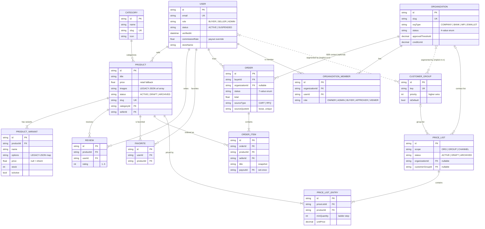

### 2.2 Negotiation & approvals

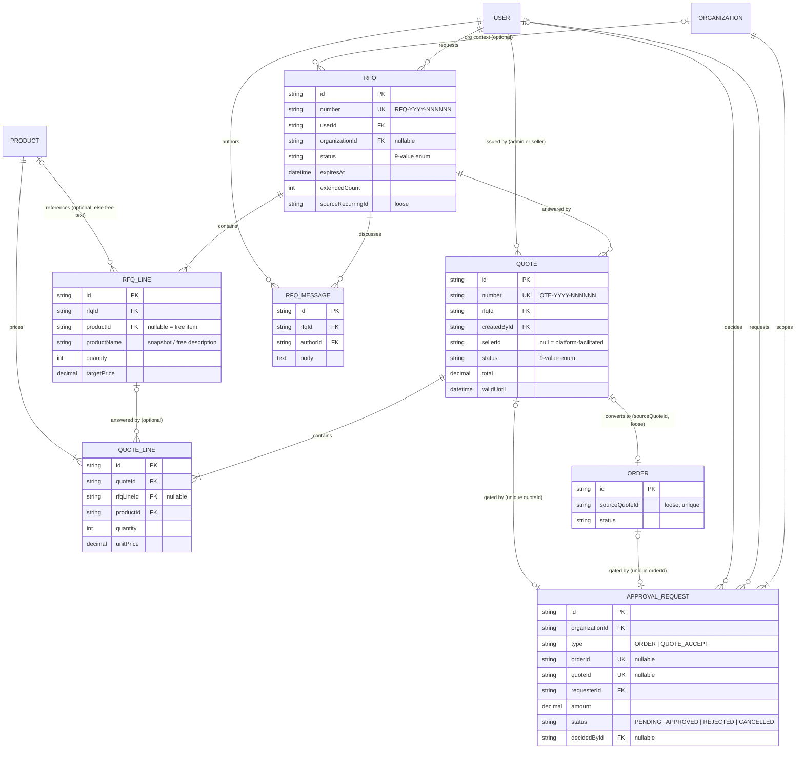

### 2.3 Payments, payouts, disputes, recurring & settings substrate

```mermaid
erDiagram
    ORDER ||--|| PAYMENT : "settled by (1:1)"
    USER |o--o{ PAYMENT : "captures (admin)"
    USER ||--o{ PAYOUT : "settled to (seller)"
    PAYOUT ||--o{ ORDER_ITEM : "sweeps unsettled items"
    ORDER ||--o{ DISPUTE : "disputed via"
    USER ||--o{ DISPUTE : "raised by (buyer)"
    USER ||--o{ DISPUTE : "against (seller)"
    USER |o--o{ DISPUTE : "resolved by (admin)"
    USER ||--o{ RECURRING_RFQ : owns
    RECURRING_RFQ ||..o{ RFQ : "spawns (loose sourceRecurringId)"
    USER ||--o{ NOTIFICATION : receives
    USER ||--o{ MEDIA_ASSET : uploads
    USER ||--o{ SETTING_CHANGE : "records"
    AUDIT_LOG }o..o| USER : "actorId (loose, nullable)"
    RFQ_SETTING }o..o| USER : "updatedById (loose, nullable)"
    SETTING_CHANGE }o..|| SETTING_CHANGE : "rollbackOfId (loose)"
    DISPUTE }o..|| RFQ : "rfqId context (loose)"
    RECURRING_RFQ }o..o| ORGANIZATION : "orgId (loose, nullable)"
    QUOTE ||..o| ORDER : "sourceQuoteId (loose, unique)"

    PAYMENT {
        string id PK
        string orderId FK "unique"
        string method "CARD | BANK_TRANSFER | INVOICE"
        string status "PENDING | SUCCEEDED | FAILED | CANCELLED"
        decimal amount
        datetime dueAt "INVOICE NET-terms"
        string capturedById FK "nullable"
    }
    PAYOUT {
        string id PK
        string number UK "PY-YYYY-NNNNNN"
        string sellerId FK
        string status "PENDING | PAID | CANCELLED"
        decimal grossAmount
        float commissionRate "snapshot"
        decimal commission
        decimal netAmount
    }
    ORDER_ITEM {
        string id PK
        string payoutId FK "set-once, nullable"
        string sellerId FK
    }
    DISPUTE {
        string id PK
        string number UK "DSP-YYYY-NNNNNN"
        string orderId FK
        string raisedById FK
        string sellerId FK
        string reason "7-value enum"
        string status "6-value enum"
        string outcome "6-value enum, nullable"
        datetime escalateAt
    }
    RECURRING_RFQ {
        string id PK
        string userId FK
        string frequency "5-value enum"
        datetime nextRunAt
        bool active
        int emptyCycles
    }
    NOTIFICATION {
        string id PK
        string userId FK
        string type "10-value enum"
        string linkView "rfq | orders | business | seller"
        datetime readAt
    }
    MEDIA_ASSET {
        string id PK
        string key UK
        string sha256 UK
        string variants "LEGACY-JSON"
        string uploadedById FK
    }
    AUDIT_LOG {
        string id PK
        string actorId "loose, nullable"
        string actorType "USER | SELLER | ADMIN | SYSTEM"
        string action
        string entityType
        string entityId
        json metadata "LEGACY-JSON"
    }
    RFQ_SETTING {
        string id PK
        string key "panel key"
        string scopeType "PLATFORM | ORG_TYPE | ORG | CATEGORY | REGION"
        string scopeId "empty at platform scope"
        string value "LEGACY-JSON document"
    }
    SETTING_CHANGE {
        string id PK
        string settingKey
        string field
        string userId FK
        string rollbackOfId "loose"
    }
    PLATFORM_SETTING {
        string key PK
        string value "LEGACY-JSON document"
    }
    SEQUENCE {
        string key PK
        int value
    }
    BANNER_SLIDE {
        string id PK
        int position
        bool active
    }
    COUPON {
        string id PK
        string code UK
        int percentOff
        bool active
    }
    RFQ {
        string id PK
        string number UK
    }
    USER {
        string id PK
    }
    ORGANIZATION {
        string id PK
    }
    QUOTE {
        string id PK
    }
```

### 2.4 Financing domain (PLANNED — every entity below is NOT in the database yet)

> Caption: **ALL 18 entities in this diagram are PLANNED** (source: `team/FINANCIER_SCHEMA.md`
> v5.0, owner-gated). Only `ORGANIZATION`, `USER`, `MEDIA_ASSET` (and `QUOTE`/`ORDER`/`RFQ_LINE`
> as loose targets) are existing substrate, referenced without duplication (R-2/R-3). Field
> names are verbatim from FINANCIER_SCHEMA v5.0. Zero Json columns anywhere in this domain
> (R-1 / DP-18).

```mermaid
erDiagram
    ORGANIZATION ||--|| FINANCIER_PROFILE : "1:1 legal entity"
    FINANCIER_PROFILE ||--o{ FINANCIER_BRANCH : has
    FINANCIER_PROFILE ||--o{ FINANCIER_SERVICE : offers
    FINANCIER_SERVICE ||--|{ FINANCIER_SERVICE_ATTRIBUTE : "features / eligibility"
    FINANCIER_SERVICE ||--|{ FINANCIER_SERVICE_COVERAGE : "geographic coverage"
    ORGANIZATION |o--o{ CONDITION_TEMPLATE : "FINANCIER-private scope (null = GENERAL)"
    USER ||--o{ CONDITION_TEMPLATE : "created by (admin / financier staff)"
    CONDITION_TEMPLATE ||--|{ CONDITION_OPTION : "SELECT / MULTI_SELECT choices"
    FINANCIER_SERVICE ||--|{ SERVICE_REQUIREMENT : "composed acceptance checklist"
    CONDITION_TEMPLATE ||--|{ SERVICE_REQUIREMENT : "attached to services via"
    SERVICE_REQUIREMENT ||--o{ REQUIREMENT_SUBMISSION : "verified per request"
    FINANCIER_SERVICE ||--o{ FINANCING_REQUEST : "applied for (kind = FINANCING)"
    FINANCIER_SERVICE ||--o{ ACCREDITATION_REQUEST : "program (kind = ACCREDITATION)"
    ORGANIZATION |o--o{ FINANCING_REQUEST : "applicant org (nullable, DP-13)"
    USER ||--o{ FINANCING_REQUEST : "created by"
    USER |o--o{ FINANCING_REQUEST : "platform gate reviewer (R-4)"
    FINANCING_REQUEST ||..o| QUOTE : "targetId (loose)"
    FINANCING_REQUEST ||..o| ORDER : "targetId (loose)"
    FINANCING_REQUEST ||..o| RFQ_LINE : "targetId (loose)"
    FINANCING_REQUEST ||--o{ REQUIREMENT_SUBMISSION : "checklist (XOR parent)"
    ACCREDITATION_REQUEST ||--o{ REQUIREMENT_SUBMISSION : "checklist (XOR parent)"
    USER |o--o{ REQUIREMENT_SUBMISSION : "verified by (gate / autoPass)"
    ORGANIZATION ||--o{ ACCREDITATION_REQUEST : "applicant org (companies only)"
    USER ||--o{ ACCREDITATION_REQUEST : "submitted by"
    USER |o--o{ ACCREDITATION_REQUEST : "gate reviewer / decider / revoker"
    USER ||--o{ ACCOUNT_DOCUMENT : "owns (every user — DP-27)"
    ORGANIZATION |o--o{ ACCOUNT_DOCUMENT : "org-scope (nullable)"
    ACCOUNT_DOCUMENT }o--|| MEDIA_ASSET : "mediaId (one storage subsystem)"
    USER |o--o{ ACCOUNT_DOCUMENT : "reviewed by (verified once)"
    ACCOUNT_DOCUMENT |o--o{ REQUIREMENT_SUBMISSION : "DOCUMENT evidence (reuse)"
    ACCOUNT_DOCUMENT ||--o{ REQUEST_ATTACHMENT : "referenced by"
    FINANCING_REQUEST |o..o{ REQUEST_ATTACHMENT : "parentId (loose, by parentType)"
    ACCREDITATION_REQUEST |o..o{ REQUEST_ATTACHMENT : "parentId (loose, by parentType)"
    FINANCING_REQUEST ||--o{ FINANCING_OFFER : receives
    USER ||--o{ FINANCING_OFFER : "issued by (financier staff)"
    FINANCING_OFFER ||--|{ FINANCING_OFFER_INSTALLMENT : schedules
    FINANCING_OFFER |o--|| FINANCING_AGREEMENT : "accepted offer (1:1)"
    FINANCING_AGREEMENT ||--o{ FINANCING_EVENT : "track-only ledger"
    FINANCING_AGREEMENT ||--o{ FINANCING_FEE : "platform commission"
    USER |o--o{ FINANCING_EVENT : "reported by"

    FINANCIER_PROFILE {
        string id PK
        string organizationId FK "unique, 1:1"
        text about
        string licenseNumber
        string regulator
        string logoUrl "MediaAsset-backed"
        string contactEmail
        string contactPhone
        decimal minTicket
        decimal maxTicket
        int viewCount
    }
    FINANCIER_BRANCH {
        string id PK
        string financierProfileId FK
        string name
        string kind "BRANCH | AGENT | ATM"
        string street
        string city
        string district
        decimal latitude
        decimal longitude
        bool isActive
    }
    FINANCIER_SERVICE {
        string id PK
        string financierProfileId FK
        string serviceKind "FINANCING | ACCREDITATION (DP-22)"
        string category "taxonomy per kind"
        string name
        string summary
        string targetSegment "BUSINESS | INDIVIDUAL | BOTH"
        string status "DRAFT | ACTIVE | ARCHIVED"
        string currency "YER"
        decimal amountMin "null = open (ACCREDITATION)"
        decimal amountMax
        string rateType "MURABAHA_ANNUAL | FIXED_ANNUAL | FLAT_FEE"
        decimal rateMax
        decimal feeFlat
        int tenorMinMonths
        int tenorMaxMonths
        bool shariaCompliant
        int accreditationValidMonths "ACCREDITATION kind: grant lifetime"
        decimal accreditationFeeAmount "ACCREDITATION kind: fee"
        int viewCount
    }
    FINANCIER_SERVICE_ATTRIBUTE {
        string id PK
        string serviceId FK
        string kind "FEATURE | ELIGIBILITY_CONDITION"
        int position
        string text
    }
    FINANCIER_SERVICE_COVERAGE {
        string id PK
        string serviceId FK
        string regionName "normalized, case-insensitive match"
    }
    CONDITION_TEMPLATE {
        string id PK
        string scope "GENERAL | FINANCIER (R-5)"
        string organizationId FK "null = GENERAL platform library"
        string conditionType "DOCUMENT | PROFILE_FIELD | DECLARATION | TEXT | NUMBER | DATE | SELECT | MULTI_SELECT"
        string code "optional stable ref"
        string title
        text description
        string profileFieldKey "PROFILE_FIELD only"
        string documentType "DOCUMENT only"
        decimal validationMin "NUMBER only, inclusive"
        decimal validationMax "NUMBER only, inclusive"
        int validityMonths "evidence freshness window"
        bool isRepeatable "DOCUMENT only"
        bool isActive
        string createdById FK
    }
    CONDITION_OPTION {
        string id PK
        string conditionTemplateId FK
        string value "stored + displayed"
        int position
    }
    SERVICE_REQUIREMENT {
        string id PK
        string serviceId FK
        string conditionTemplateId FK
        bool isRequired "optional conditions never gate"
        int displayOrder
        string instructions "per-service override text"
        bool autoPassAccredited "auto-VERIFIED on live grant (DP-26)"
        bool isActive
    }
    REQUIREMENT_SUBMISSION {
        string id PK
        string serviceRequirementId FK
        string financingRequestId FK "XOR parent (nullable)"
        string accreditationRequestId FK "XOR parent (nullable)"
        string status "PENDING | SUBMITTED | VERIFIED | REJECTED | WAIVED"
        string valueText "TEXT / DECLARATION / SELECT answers"
        decimal valueNumber "NUMBER answers"
        datetime valueDate "DATE answers"
        string accountDocumentId FK "DOCUMENT evidence (reuse)"
        datetime submittedAt
        datetime verifiedAt
        string verifiedById FK "null on autoPass"
        string decisionNote "rejection / waiver reason"
    }
    ACCOUNT_DOCUMENT {
        string id PK
        string userId FK "owner — ALWAYS set (all users)"
        string organizationId FK "org-scope docs (nullable)"
        string mediaId FK "THE storage entry"
        string documentType "15-value enum"
        string title
        datetime issuedAt
        datetime expiresAt "freshness vs validityMonths"
        string status "PENDING | VERIFIED | REJECTED"
        string reviewedById FK "nullable"
        datetime reviewedAt
        text note
        bool isActive "soft-delete"
    }
    REQUEST_ATTACHMENT {
        string id PK
        string parentType "FINANCING_REQUEST | ACCREDITATION_REQUEST"
        string parentId "loose FK (Dispute pattern)"
        string accountDocumentId FK
        string kind "GUARANTEE_DOC | STUDY | PROJECT_FILE | OTHER"
    }
    FINANCING_REQUEST {
        string id PK
        string number UK "FR-YYYY-NNNNNN via Sequence FIN"
        string organizationId FK "nullable (DP-13)"
        string createdById FK
        string serviceId FK "REQUIRED — service-scoped (DP-22)"
        string targetType "WORKING_CAPITAL | QUOTE | ORDER | RFQ_LINE"
        string targetId "loose"
        string multiGroupId "sibling routing (DP-25)"
        string activityStatus "NEW | EXISTING"
        string activityName
        string activityCity
        string activityLocationType "OWNED | RENTED"
        string activityCategory
        decimal capitalAmount
        decimal ownContributionAmount
        decimal monthlyInstallmentCapacity
        bool previousFinancing
        decimal amountRequested
        string currency
        text purpose
        string guaranteeType "8-value enum"
        string guaranteeStatus "4-value enum"
        text applicantNotes
        datetime consentAt
        string platformReviewedById FK "THE GATE (R-4)"
        datetime platformReviewedAt
        text platformNote
        datetime returnedAt "set on RETURNED_FOR_COMPLETION"
        string returnedReason "aggregate; per-item notes on submissions"
        datetime forwardedAt "financier visibility starts HERE"
        string status "11-value gate machine"
        datetime expiresAt
    }
    ACCREDITATION_REQUEST {
        string id PK
        string number UK "ACC-YYYY-###### via Sequence ACC"
        string organizationId FK "companies only — NOT nullable"
        string submittedById FK
        string serviceId FK "ACCREDITATION-kind service"
        string multiGroupId "sibling routing (DP-25)"
        string scopeNotes "what the accreditation covers"
        datetime consentAt
        string platformReviewedById FK "THE GATE (R-4)"
        datetime platformReviewedAt
        text platformNote
        datetime returnedAt
        string returnedReason
        datetime forwardedAt
        string status "11-value gate machine"
        string decidedById FK "financier's deciding staff"
        datetime decidedAt
        string decisionNote "grant / reject note"
        datetime accreditedAt "grant stamp (ACCREDITED only)"
        datetime validUntil "grant lifetime (accreditationValidMonths)"
        string revokedById FK "financier or platform admin"
        datetime revokedAt
        string revocationReason "REQUIRED on revoke"
        datetime expiresAt "request-level expiry (pre-decision)"
    }
    FINANCING_OFFER {
        string id PK
        string requestId FK
        string createdById FK "financier staff"
        decimal amount
        string currency
        string rateType
        decimal ratePercent
        decimal feeFlat
        int tenorMonths
        string collateralRequired
        datetime validUntil
        string status "DRAFT | SENT | ACCEPTED | DECLINED | EXPIRED | WITHDRAWN"
        datetime sentAt
        datetime acceptedAt
    }
    FINANCING_OFFER_INSTALLMENT {
        string id PK
        string offerId FK
        int installmentNo
        datetime dueDate
        decimal amount
    }
    FINANCING_AGREEMENT {
        string id PK
        string number UK "AGR-YYYY-NNNNNN via Sequence AGR"
        string offerId FK "unique, the ACCEPTED offer"
        string fundingStatus "PENDING | REPORTED_FUNDED | REPORTED_SETTLED"
        string status "ACTIVE | COMPLETED | DEFAULTED | CANCELLED"
        datetime acceptedAt
        datetime fundedReportedAt
        datetime settledReportedAt
    }
    FINANCING_EVENT {
        string id PK
        string agreementId FK
        string type "DISBURSEMENT | REPAYMENT | EARLY_SETTLEMENT | LATE_FEE | NOTE"
        datetime eventDate
        decimal amount
        string reportedById FK "nullable, financier staff"
    }
    FINANCING_FEE {
        string id PK
        string agreementId FK
        string type "SUCCESS | ORIGINATION | ACCREDITATION"
        decimal baseAmount
        decimal percentApplied "snapshot"
        decimal amount
        string status "ACCRUED | INVOICED | PAID | WAIVED"
    }
```

---

## 3. Relationship inventory

### 3.1 EXISTING — Prisma-enforced foreign keys

| # | From (field) | To | Cardinality | onDelete | Semantics |
|---|---|---|---|---|---|
| 1 | `Product.categoryId` | `Category.id` | N:1 (required) | Restrict (default) | Product belongs to one category |
| 2 | `Product.sellerId` | `User.id` | N:1 (required) | Restrict (default) | Owning seller |
| 3 | `Order.buyerId` | `User.id` | N:1 (required) | Restrict (default) | Buying user |
| 4 | `Order.organizationId` | `Organization.id` | N:1 (optional) | SetNull (default) | B2B purchasing org context |
| 5 | `OrderItem.orderId` | `Order.id` | N:1 (required) | Cascade | Order line |
| 6 | `OrderItem.productId` | `Product.id` | N:1 (required) | Restrict (default) | Ordered product |
| 7 | `OrderItem.payoutId` | `Payout.id` | N:1 (optional) | SetNull (default) | Set-once settlement link (see §4) |
| 8 | `ProductVariant.productId` | `Product.id` | N:1 (required) | Cascade | Variant of product |
| 9 | `Review.productId` | `Product.id` | N:1 (required) | Cascade | Reviewed product |
| 10 | `Review.userId` | `User.id` | N:1 (required) | Restrict (default) | Review author |
| 11 | `Favorite.userId` | `User.id` | N:1 (required) | Restrict (default) | Favoriting user |
| 12 | `Favorite.productId` | `Product.id` | N:1 (required) | Cascade | Favorited product |
| 13 | `OrganizationMember.organizationId` | `Organization.id` | N:1 (required) | Cascade | Membership |
| 14 | `OrganizationMember.userId` | `User.id` | N:1 (required) | Cascade | Member user |
| 15 | `PriceList.organizationId` | `Organization.id` | N:1 (optional) | Cascade (explicit) | ORG-scope contract list |
| 16 | `PriceList.customerGroupId` | `CustomerGroup.id` | N:1 (optional) | Cascade (explicit) | GROUP-scope list |
| 17 | `PriceListEntry.priceListId` | `PriceList.id` | N:1 (required) | Cascade | Ladder entry |
| 18 | `PriceListEntry.productId` | `Product.id` | N:1 (required) | Cascade | Priced product |
| 19 | `Rfq.userId` | `User.id` | N:1 (required) | Restrict (default) | Requesting user |
| 20 | `Rfq.organizationId` | `Organization.id` | N:1 (optional) | SetNull (default) | Org context for settings resolution |
| 21 | `RfqLine.rfqId` | `Rfq.id` | N:1 (required) | Cascade | RFQ line |
| 22 | `RfqLine.productId` | `Product.id` | N:1 (optional) | SetNull (default) | Catalog reference; null = free item |
| 23 | `Quote.rfqId` | `Rfq.id` | N:1 (required) | Cascade | Quote answers RFQ |
| 24 | `Quote.createdById` | `User.id` | N:1 (required) | Restrict (default) | Issuing admin/seller |
| 25 | `ApprovalRequest.organizationId` | `Organization.id` | N:1 (required) | Cascade | Approving org |
| 26 | `ApprovalRequest.orderId` | `Order.id` | 1:1 (optional) | SetNull (default) | ORDER-type gate; unique |
| 27 | `ApprovalRequest.quoteId` | `Quote.id` | 1:1 (optional) | SetNull (default) | QUOTE_ACCEPT-type gate; unique |
| 28 | `ApprovalRequest.requesterId` | `User.id` | N:1 (required) | Restrict (default) | Requesting member |
| 29 | `ApprovalRequest.decidedById` | `User.id` | N:1 (optional) | SetNull (default) | Deciding member (≠ requester) |
| 30 | `QuoteLine.quoteId` | `Quote.id` | N:1 (required) | Cascade | Quote line |
| 31 | `QuoteLine.rfqLineId` | `RfqLine.id` | N:1 (optional) | SetNull (default) | Answered RFQ line |
| 32 | `QuoteLine.productId` | `Product.id` | N:1 (required) | Restrict (default) | Quoted product |
| 33 | `Notification.userId` | `User.id` | N:1 (required) | Cascade | Recipient |
| 34 | `RfqMessage.rfqId` | `Rfq.id` | N:1 (required) | Cascade | Negotiation thread |
| 35 | `RfqMessage.authorId` | `User.id` | N:1 (required) | Restrict (default) | Message author |
| 36 | `MediaAsset.uploadedById` | `User.id` | N:1 (required) | Restrict (default) | Uploader |
| 37 | `Dispute.orderId` | `Order.id` | N:1 (required) | Restrict (default) | Disputed order |
| 38 | `Dispute.raisedById` | `User.id` | N:1 (required) | Restrict (default) | Buyer (or admin for them) |
| 39 | `Dispute.sellerId` | `User.id` | N:1 (required) | Restrict (default) | Disputed seller |
| 40 | `Dispute.resolvedById` | `User.id` | N:1 (optional) | SetNull (default) | Mediating admin |
| 41 | `RecurringRfq.userId` | `User.id` | N:1 (required) | Restrict (default) | Schedule owner |
| 42 | `Payment.orderId` | `Order.id` | 1:1 (required) | Cascade | The order's payment |
| 43 | `Payment.capturedById` | `User.id` | N:1 (optional) | SetNull (default) | Admin who captured |
| 44 | `Payout.sellerId` | `User.id` | N:1 (required) | Restrict (default) | Settled seller |
| 45 | `SettingChange.userId` | `User.id` | N:1 (required) | Restrict (default) | Admin who changed a setting |

Implicit many-to-many (Prisma-managed join tables, no cascade semantics documented at field level):
`User ↔ CustomerGroup` (relation "UserCustomerGroups") and `Organization ↔ CustomerGroup`
(relation "OrganizationCustomerGroups").

### 3.2 EXISTING — loose string references (no DB constraint; enforced in service code)

| From (field) | To | Semantics |
|---|---|---|
| `Order.sourceQuoteId` (unique) | `Quote.id` | The quote whose acceptance produced this order; one order per quote, ever |
| `Rfq.sourceRecurringId` | `RecurringRfq.id` | The schedule whose lazy sweep spawned this run |
| `RfqLine.variantId` | `ProductVariant.id` | Referenced catalog variant |
| `QuoteLine.variantId` | `ProductVariant.id` | Quoted variant |
| `ApprovalRequest.rfqId` | `Rfq.id` | Owning RFQ context for QUOTE_ACCEPT approvals |
| `Dispute.rfqId` | `Rfq.id` | RFQ context when the order came from a quote |
| `RecurringRfq.organizationId` | `Organization.id` | Org context for settings resolution |
| `RecurringRfq.lastRfqId` | `Rfq.id` | Most recently spawned RFQ |
| `AuditLog.actorId` | `User.id` | Acting user; null = SYSTEM |
| `RfqSetting.updatedById` | `User.id` | Last editor (no relation declared) |
| `SettingChange.rollbackOfId` | `SettingChange.id` | Change this row reverts |

### 3.3 PLANNED — financier domain (NOT in the database yet)

Source: `team/FINANCIER_SCHEMA.md` v5.0 — **37 enforced FK fields + 2 loose reference patterns**
(v4.0 was 29 + 1; the requirements engine, the platform gate and universal documents account for
the growth).

| # | From (field) | To | Cardinality | onDelete | Semantics |
|---|---|---|---|---|---|
| 1 | `FinancierProfile.organizationId` (unique) | `Organization.id` | 1:1 (required) | Cascade | The financier legal entity (BANK/MFI/EWALLET) |
| 2 | `FinancierBranch.financierProfileId` | `FinancierProfile.id` | N:1 (required) | Cascade | Branch/agent/ATM of financier |
| 3 | `FinancierService.financierProfileId` | `FinancierProfile.id` | N:1 (required) | Cascade | Service catalog entry (DP-22) |
| 4 | `FinancierServiceAttribute.serviceId` | `FinancierService.id` | N:1 (required) | Cascade | Feature / eligibility bullet |
| 5 | `FinancierServiceCoverage.serviceId` | `FinancierService.id` | N:1 (required) | Cascade | Covered region name |
| 6 | `ConditionTemplate.organizationId` | `Organization.id` | N:1 (optional) | — | FINANCIER-private scope; null = GENERAL platform library (R-5) |
| 7 | `ConditionTemplate.createdById` | `User.id` | N:1 (required) | — | Admin (GENERAL) or financier staff (FINANCIER) |
| 8 | `ConditionOption.conditionTemplateId` | `ConditionTemplate.id` | N:1 (required) | Cascade | SELECT / MULTI_SELECT choice row (R-1) |
| 9 | `ServiceRequirement.serviceId` | `FinancierService.id` | N:1 (required) | Cascade | Template attached to this service |
| 10 | `ServiceRequirement.conditionTemplateId` | `ConditionTemplate.id` | N:1 (required) | — | The attached condition definition |
| 11 | `RequirementSubmission.serviceRequirementId` | `ServiceRequirement.id` | N:1 (required) | Cascade | Checklist row — the gate's verification unit |
| 12 | `RequirementSubmission.financingRequestId` | `FinancingRequest.id` | N:1 (optional) | Cascade | XOR parent #1 (service-enforced exactly-one) |
| 13 | `RequirementSubmission.accreditationRequestId` | `AccreditationRequest.id` | N:1 (optional) | Cascade | XOR parent #2 (service-enforced exactly-one) |
| 14 | `RequirementSubmission.accountDocumentId` | `AccountDocument.id` | N:1 (optional) | — | DOCUMENT evidence — REUSE of a vault doc (R-2) |
| 15 | `RequirementSubmission.verifiedById` | `User.id` | N:1 (optional) | — | Platform admin (null on autoPass) |
| 16 | `AccountDocument.userId` | `User.id` | N:1 (required) | Cascade | Owner/uploader — ALWAYS set (all users, DP-27) |
| 17 | `AccountDocument.organizationId` | `Organization.id` | N:1 (optional) | — | Org-scope docs (company registry papers) |
| 18 | `AccountDocument.mediaId` | `MediaAsset.id` | N:1 (required) | — | THE storage entry (DP-19) |
| 19 | `AccountDocument.reviewedById` | `User.id` | N:1 (optional) | — | Verifying staff user (verified once) |
| 20 | `RequestAttachment.accountDocumentId` | `AccountDocument.id` | N:1 (required) | Cascade | Free attachment references the vault |
| 21 | `FinancingRequest.organizationId` | `Organization.id` | N:1 (optional) | — | Applicant org; null = individual (DP-13) |
| 22 | `FinancingRequest.createdById` | `User.id` | N:1 (required) | — | Submitting user |
| 23 | `FinancingRequest.serviceId` | `FinancierService.id` | N:1 (required) | — | REQUIRED — service-scoped application (DP-22) |
| 24 | `FinancingRequest.platformReviewedById` | `User.id` | N:1 (optional) | — | The admin working the gate (R-4) |
| 25 | `FinancingOffer.requestId` | `FinancingRequest.id` | N:1 (required) | Cascade | Offer answers request |
| 26 | `FinancingOffer.createdById` | `User.id` | N:1 (required) | — | Financier staff (via OrganizationMember, DP-1) |
| 27 | `FinancingOfferInstallment.offerId` | `FinancingOffer.id` | N:1 (required) | Cascade | Proposed schedule row |
| 28 | `FinancingAgreement.offerId` (unique) | `FinancingOffer.id` | 1:1 (required) | — | The accepted offer; NO snapshot (DP-20) |
| 29 | `FinancingEvent.agreementId` | `FinancingAgreement.id` | N:1 (required) | Cascade | Track-only ledger entry |
| 30 | `FinancingEvent.reportedById` | `User.id` | N:1 (optional) | — | Reporting financier staff |
| 31 | `FinancingFee.agreementId` | `FinancingAgreement.id` | N:1 (required) | Cascade | Platform commission row |
| 32 | `AccreditationRequest.organizationId` | `Organization.id` | N:1 (required) | — | Applicant company (NOT nullable) |
| 33 | `AccreditationRequest.submittedById` | `User.id` | N:1 (required) | — | Submitting org member |
| 34 | `AccreditationRequest.serviceId` | `FinancierService.id` | N:1 (required) | — | ACCREDITATION-kind service (service-enforced) |
| 35 | `AccreditationRequest.platformReviewedById` | `User.id` | N:1 (optional) | — | The admin working the gate (R-4) |
| 36 | `AccreditationRequest.decidedById` | `User.id` | N:1 (optional) | — | Financier's deciding staff |
| 37 | `AccreditationRequest.revokedById` | `User.id` | N:1 (optional) | — | Revoking staff (financier or platform) |
| 38 | `FinancingRequest.targetId` (loose) | `Quote/Order/RfqLine.id` | N:1 (optional) | n/a | What the financing is for (Dispute pattern) |
| 39 | `RequestAttachment.parentId` (+`parentType`) (loose) | `FinancingRequest/AccreditationRequest.id` | N:1 (required) | n/a | Loose parent — one table serves both request kinds (Dispute pattern) |

"—" = onDelete not specified in FINANCIER_SCHEMA v5.0; Prisma defaults would apply (Restrict for
required, SetNull for optional).

---

## 4. Business invariants expressed as data rules

Owner-set invariants (DECISIONS.md) are marked D-xxx; financier ruling points DP-xxx.

1. **D-001 / D-002 — Orchestrator, never merchant of record.** No table holds buyer→vendor funds.
   `Payment` records expected external money per order; `Payout` records external settlement;
   `FinancingFee` is invoiced externally and only marked PAID by an admin. PLANNED
   `FinancingAgreement.fundingStatus` is REPORTED_* precisely because the platform never holds funds.
2. **Commission on success.** `FinancingFee` accrues at request ACCEPTED (type SUCCESS);
   `Payout.commission = commissionRate (snapshot) × grossAmount`; rate source = `User.commissionRate`
   override, else `PlatformSetting` key `payouts` (0–90%, zod-validated). Snapshots, never re-derived.
3. **D-003 — No multi-tenancy.** No tenantId column exists on any of the 32 models; none may be added.
4. **D-006 — Atomic numbering.** Every business number comes from `Sequence` via the service:
   RFQ (`Rfq.number`), QTE (`Quote.number`), DSP (`Dispute.number`), PY (`Payout.number`),
   format `PREFIX-YYYY-NNNNNN`. PLANNED additions: FIN → `FinancingRequest.number` (FR-),
   AGR → `FinancingAgreement.number`, ACC → `AccreditationRequest.number` (ACC-).
   Client-side counters are forbidden.
5. **D-011 — No cron.** `Rfq.expiresAt`, `Quote.validUntil`, `Dispute.escalateAt`,
   `RecurringRfq.nextRunAt` (and PLANNED `FinancingRequest.expiresAt`, `FinancingOffer.validUntil`,
   `AccreditationRequest.expiresAt`/`validUntil`) are all consumed by lazy
   sweeps triggered on traffic — never by timers.
6. **OrderItem.payoutId is set-once.** Payout eligibility selects items where `payoutId IS NULL` AND
   order status ≠ CANCELLED AND order payment SUCCEEDED. Once attached, an item never re-settles.
7. **Quote→Order is unique.** `Order.sourceQuoteId` is unique — one order per quote, ever.
   Conversion atomically sets `Quote.status = CONVERTED` + `Rfq.status = ORDERED`; accepting a quote
   auto-declines sibling quotes and closes the RFQ.
8. **ApprovalRequest requester ≠ decider.** BUYER-role members trigger; OWNER/ADMIN/APPROVER decide;
   self-approval is impossible by construction. `orderId`/`quoteId` are unique — exactly one
   approval gate per order/quote; trigger condition: amount ≥ `Organization.approvalThreshold`.
9. **FinancingAgreement is 1:1 with an offer.** `offerId` unique; no terms snapshot — the accepted
   offer and its installment rows are frozen instead (DP-20).
10. **Single entry per data point (financier domain, R-2).** Applicant personal data lives only on
    `User` (12 additive nullable columns); documents live ONCE at account level on
    `AccountDocument` (uploaded + verified once, reused by every request type — see #20);
    per-application facts only on `FinancingRequest`/`AccreditationRequest`; money schedules only
    on the offer; status history only in `AuditLog`/`Notification` (DP-15).
11. **Zero JSON in the financier domain (R-1 / DP-18).** All 18 planned models have zero Json
    columns — every list is a child table (`FinancierServiceAttribute/Coverage`, `ConditionOption`,
    `FinancingOfferInstallment`, `RequestAttachment`), every address is typed scalars, every
    select option is a `ConditionOption` row. Legacy Json columns elsewhere are FROZEN (see
    `06-data-dictionary.md` appendix).
12. **One storage subsystem (DP-19).** `AccountDocument.mediaId → MediaAsset` — no
    storageKey/fileName/size duplication anywhere.
13. **Purchase-time snapshots.** `OrderItem.title/image/variantName`, `RfqLine.productName/variantName`,
    `QuoteLine.variantName`, `Payout.commissionRate` — display/settlement data is frozen at write
    time against later catalog edits.
14. **Uniqueness contract set.** `Review (productId,userId)`, `Favorite (userId,productId)`,
    `OrganizationMember (organizationId,userId)`, `PriceListEntry (priceListId,productId,minQuantity)`,
    `RfqSetting (key,scopeType,scopeId)`, PLANNED `FinancierServiceAttribute
    (serviceId,kind,position)`, `FinancierServiceCoverage (serviceId,regionName)`,
    `ConditionOption (conditionTemplateId,value)`, `ServiceRequirement
    (serviceId,conditionTemplateId)`, `RequirementSubmission (financingRequestId,
    serviceRequirementId)` + `(accreditationRequestId,serviceRequirementId)`,
    `FinancingOfferInstallment (offerId,installmentNo)`, `AccreditationRequest
    (serviceId,organizationId)`.
15. **Media integrity.** `MediaAsset.sha256` unique — content-level dedupe; deletes are
    reference-checked by the storage pipeline.
16. **Settings history survives deletion.** `SettingChange` is deliberately NOT FK-linked to
    `RfqSetting`; rollback (`rollbackOfId`) is itself logged.
17. **THE PLATFORM VERIFICATION GATE (financier domain, R-4 / DP-23).** No financing or
    accreditation request is EVER visible to a financier before `forwardedAt` is set — financier
    inbox queries filter to `FORWARDED_TO_FINANCIER` and later states only, so a `SUBMITTED`
    request is platform-private by construction. Incomplete or incorrect requests are
    `RETURNED_FOR_COMPLETION` with per-requirement `RequirementSubmission.decisionNote`s and an
    aggregate `returnedReason`.
18. **Forward is blocked by the checklist (R-4).** The `FORWARDED_TO_FINANCIER` transition is
    transaction-guarded: every `RequirementSubmission` whose `serviceRequirement.isRequired = true`
    must be `VERIFIED` (or `WAIVED` with a `decisionNote`); `PENDING`/`SUBMITTED`/`REJECTED` items
    block the transition.
19. **One accreditation record per program per org.** `AccreditationRequest` carries
    `@@unique([serviceId, organizationId])` — at most one accreditation record per financier
    program per organization; renewals are NEW requests, allowed only after
    EXPIRED/REVOKED/REJECTED/CANCELLED (service-enforced).
20. **Documents verified once, reused everywhere (R-2 / DP-27).** An `AccountDocument` is
    verified at account level (status + reviewedById/At) and then reused via
    `RequirementSubmission.accountDocumentId` and `RequestAttachment.accountDocumentId` —
    documents are never re-uploaded or re-verified per request.
21. **Exactly-one parent on RequirementSubmission.** `financingRequestId XOR accreditationRequestId`
    — both FKs are nullable, exactly one is set, enforced in the service layer; the composite
    uniques `[financingRequestId, serviceRequirementId]` and
    `[accreditationRequestId, serviceRequirementId]` keep one checklist row per requirement per
    request.

---

## 5. State machines

Statuses are verbatim from the schema comments; transitions are verified against the service
layer (`src/server/modules/*`, `src/app/api/orders/[id]/route.ts`). Terminal states in each
diagram end the flow.

### 5.1 RFQ (`Rfq.status`) — transition table in `src/server/modules/rfq/service.ts`

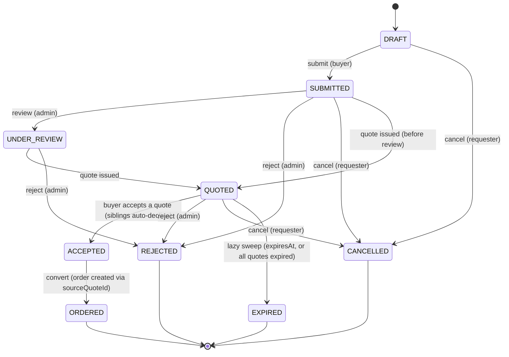

### 5.2 Quote (`Quote.status`)

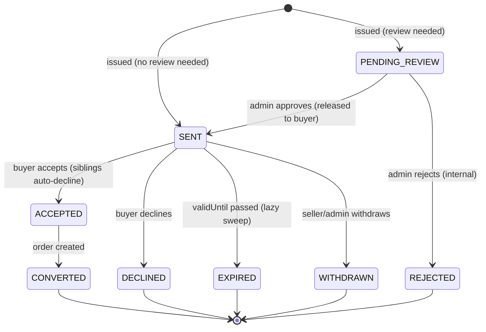

(`DRAFT` exists in the enum for future use; the issue path currently creates SENT or
PENDING_REVIEW directly.)

### 5.3 Order (`Order.status`) — `src/app/api/orders/[id]/route.ts`, approvals/payments services

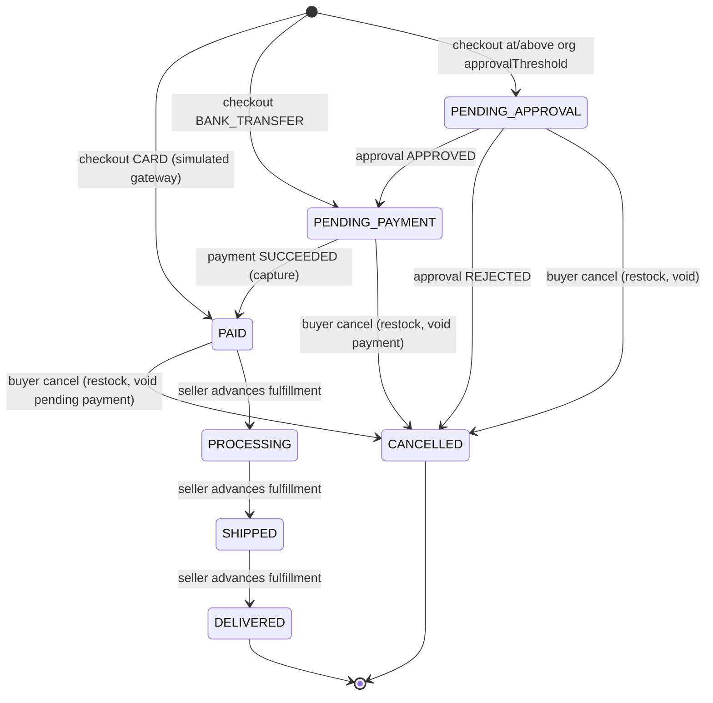

Note: fulfillment advances strictly one step along PAID→PROCESSING→SHIPPED→DELIVERED; quote
conversion creates the order directly at PROCESSING (B2B invoiced, payment on terms).

### 5.4 Payment (`Payment.status`) — `src/server/modules/payments/service.ts`

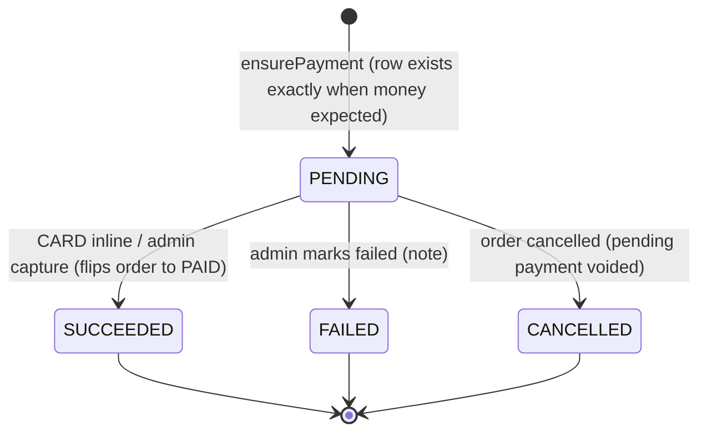

### 5.5 Payout (`Payout.status`) — `src/server/modules/payouts/service.ts`

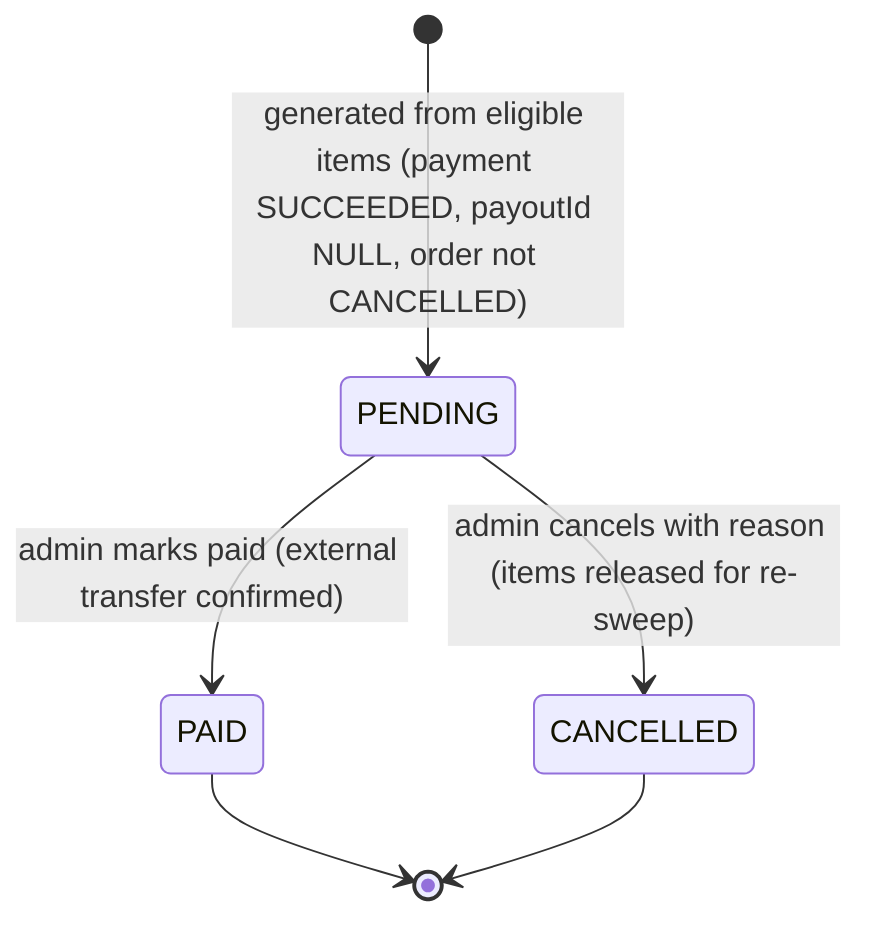

### 5.6 Dispute (`Dispute.status`) — lifecycle comment in `src/server/modules/rfq/disputes.ts`

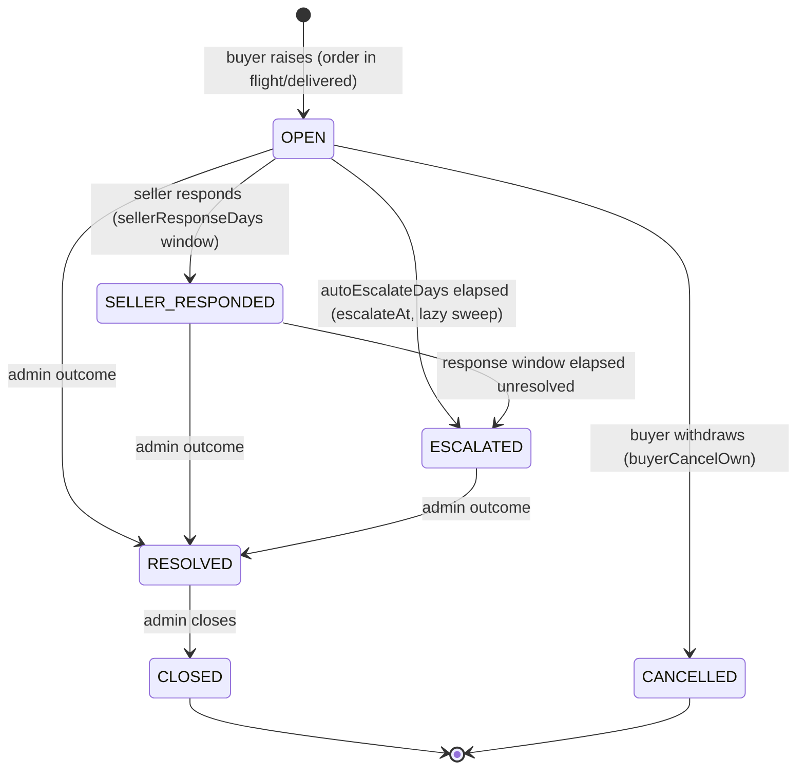

### 5.7 PLANNED — FinancingRequest v3 (`FinancingRequest.status`) — the platform verification gate (FINANCIER_SCHEMA v5.0 §5.1)

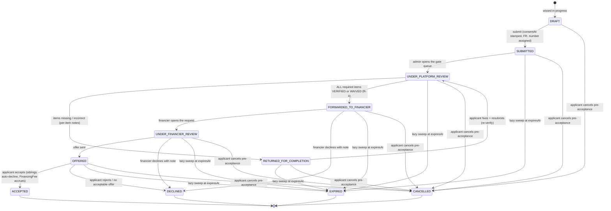

- `FORWARDED_TO_FINANCIER` is the ONLY state from which a financier inbox query can see a request
  (queries filter to `FORWARDED_TO_FINANCIER` and later states — R-4/DP-23): a `SUBMITTED` request
  is platform-private by construction; `forwardedAt` is stamped at the forward transition.
- Re-submit after `RETURNED_FOR_COMPLETION` goes straight back to `UNDER_PLATFORM_REVIEW`
  (previously VERIFIED items may be preserved when the resubmission did not touch their evidence).
- On `ACCEPTED`: a `FinancingAgreement` (AGR-) is created from the accepted offer and a
  `FinancingFee` (type SUCCESS) accrues.

### 5.8 PLANNED — AccreditationRequest (`AccreditationRequest.status`) — FINANCIER_SCHEMA v5.0 §5.2 (DP-26)

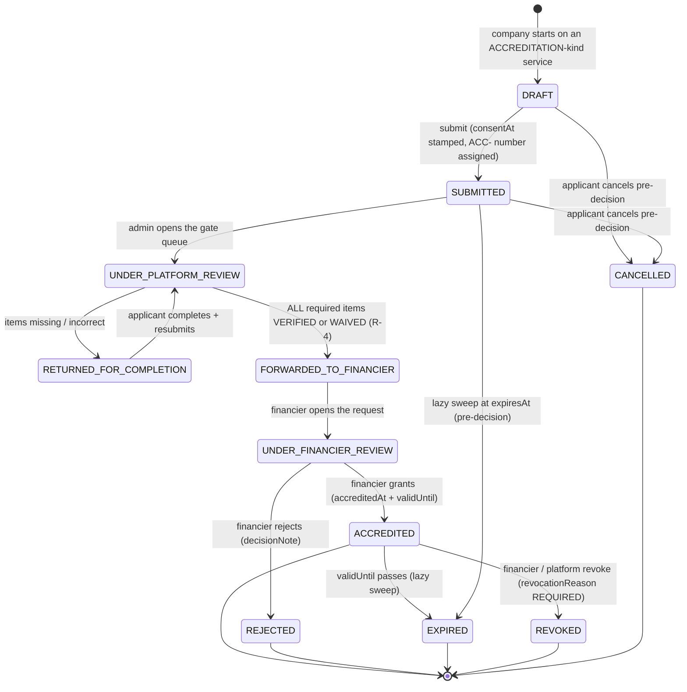

`ACCREDITED` + `validUntil` in the future = a **live accreditation** → RFQ send/receive
participation unlock with that financier + `autoPassAccredited` requirement auto-verification on
the financier's other services (DP-26). Renewal = a NEW `AccreditationRequest` for the same
service (the old record is EXPIRED/REVOKED); `@@unique([serviceId, organizationId])` permits
exactly one record per financier program per organization.

### 5.9 PLANNED — RequirementSubmission (`RequirementSubmission.status`) — the gate's verification unit (FINANCIER_SCHEMA v5.0 §5.3)

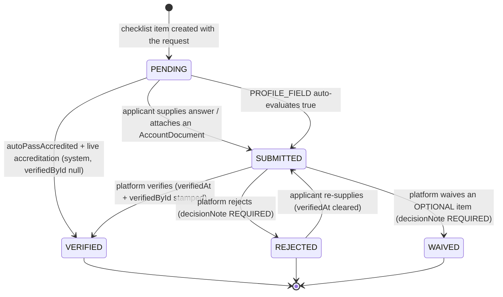

Gate completeness rule (R-4): a request may move to `FORWARDED_TO_FINANCIER` only when every
`RequirementSubmission` whose `serviceRequirement.isRequired = true` is `VERIFIED` (or `WAIVED`
with a `decisionNote`); `PENDING`/`SUBMITTED`/`REJECTED` items block the transition.

### 5.10 PLANNED — FinancingOffer (`FinancingOffer.status`)

```mermaid
stateDiagram-v2
    [*] --> DRAFT : financier drafts terms
    DRAFT --> SENT : sent to applicant
    SENT --> ACCEPTED : applicant accepts (offer + installments frozen; agreement created)
    SENT --> DECLINED : applicant declines
    SENT --> EXPIRED : validUntil passed
    SENT --> WITHDRAWN : financier withdraws
    ACCEPTED --> [*]
    DECLINED --> [*]
    EXPIRED --> [*]
    WITHDRAWN --> [*]
```

### 5.11 PLANNED — FinancingAgreement `fundingStatus` (financier-reported, D-002) and `status`

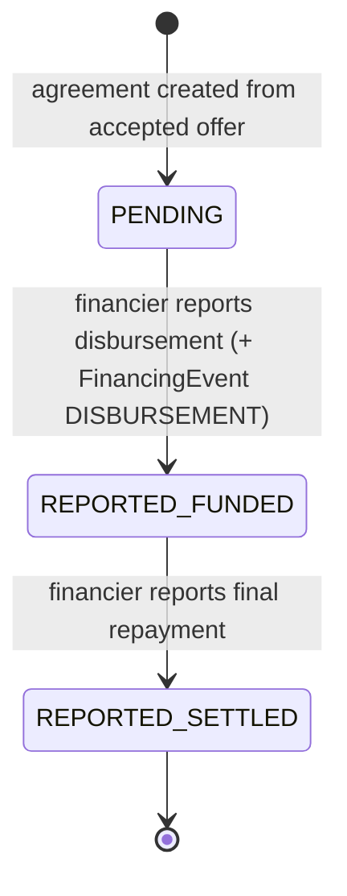

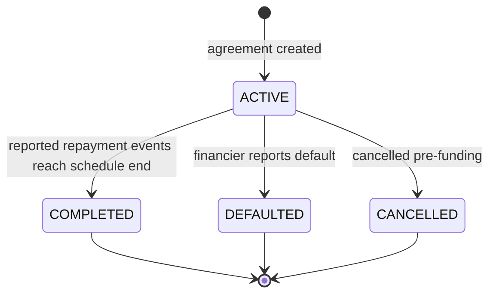

---

## 6. Traceability chains

### 6.1 EXISTING — the commerce chain

```
Rfq (RFQ-YYYY-NNNNNN)
 └─ RfqLine (productId nullable / free text, targetPrice)
     └─ Quote (QTE-…) ── QuoteLine ── answers RfqLine
         │   validUntil window · money Decimal(12,2) · optional paymentTerms (NET-30)
         ├─ ApprovalRequest (type QUOTE_ACCEPT, amount ≥ org threshold, requester ≠ decider)
         └─ Order (sourceType=RFQ, sourceQuoteId unique → Quote, poNumber, paymentTerms)
              │   Quote flips CONVERTED · Rfq flips ORDERED (siblings auto-declined)
              ├─ OrderItem (title/image/variantName snapshots, sellerId split)
              │    └─ Payout (PY-…) — set-once payoutId; commission snapshot;
              │         rate = User.commissionRate ?? PlatformSetting 'payouts'
              ├─ Payment (1:1; CARD | BANK_TRANSFER | INVOICE; SUCCEEDED → Order PAID)
              └─ Dispute (DSP-…; rfqId loose context; escalateAt lazy sweep)
Side rails: AuditLog (every transition) · Notification (RFQ_*/APPROVAL_* events) ·
            RecurringRfq → spawns Rfq runs (sourceRecurringId, lazy sweep at nextRunAt)
B2C entry: cart → Order (sourceType=CART) joins the chain at Order.
```

Every hop writes an `AuditLog` row; user-visible hops emit `Notification`s. `Sequence` numbers the
four artifact kinds atomically (D-006).

### 6.2 PLANNED — the financing chain (owner-gated)

```
User (applicant profile — 12 additive nullable columns, single entry)
 └─ FinancingRequest v3 (FR-YYYY-NNNNNN via Sequence FIN)
      │   serviceId REQUIRED → FinancierService (serviceKind = FINANCING, DP-22)
      │   targetType WORKING_CAPITAL | QUOTE | ORDER | RFQ_LINE → targetId (loose FK)
      │   multiGroupId — sibling requests, one per selected financier's matching service (DP-25)
      │   typed ACTIVITY / UNDERWRITING / GUARANTEE columns; consentAt stamped at submit
      │   THE GATE (R-4 / DP-23): platformReviewedBy/At · platformNote · returnedAt/Reason ·
      │     forwardedAt — forward only when ALL required checklist items are VERIFIED/WAIVED
      ├─ RequirementSubmission (one row per ServiceRequirement — the gate verifies item-by-item;
      │    typed answers; accountDocumentId → AccountDocument, REUSED not re-uploaded)
      ├─ RequestAttachment (free attachments → AccountDocument; loose parentType/parentId)
      └─ FinancingOffer (per financier; rateType/ratePercent/feeFlat/tenorMonths)
           ├─ FinancingOfferInstallment (installmentNo, dueDate, amount)
           └─ acceptance → FinancingAgreement (AGR-YYYY-NNNNNN via Sequence AGR)
                 │   offerId unique, 1:1, NO snapshot — offer frozen instead (DP-20)
                 ├─ FinancingEvent (DISBURSEMENT | REPAYMENT | … — track-only, D-002)
                 │    fundingStatus PENDING → REPORTED_FUNDED → REPORTED_SETTLED
                 └─ FinancingFee (SUCCESS | ORIGINATION | ACCREDITATION; ACCRUED → INVOICED
                      → PAID/WAIVED — invoiced externally per D-001/D-002)
Substrate reuse: status history = AuditLog.summary + Notification (DP-15);
settings = RfqSetting 'financing' section (6 panels); staff access = OrganizationMember (DP-1);
numbers = Sequence FIN/AGR/ACC.
```

### 6.3 PLANNED — requirements engine, accreditation and document-reuse chains

```
FinancierService (DP-22 — serviceKind FINANCING | ACCREDITATION)
 └─ ServiceRequirement (per-service attachment: isRequired, displayOrder, instructions,
      │   autoPassAccredited; @@unique([serviceId, conditionTemplateId]))
      └─ ConditionTemplate (scope GENERAL — platform-curated library, organizationId null —
           │   or FINANCIER — private to one financier org; R-5)
           │   conditionType DOCUMENT | PROFILE_FIELD | DECLARATION | TEXT | NUMBER | DATE
           │   | SELECT | MULTI_SELECT; profileFieldKey / documentType / validationMin/Max /
           │   validityMonths / isRepeatable
           └─ ConditionOption (SELECT / MULTI_SELECT choices — rows, never JSON; R-1)

AccreditationRequest (ACC-YYYY-###### via Sequence ACC — DP-26, a MAIN service)
 └─ organizationId (companies only) + serviceId (ACCREDITATION kind) + multiGroupId (DP-25)
      ├─ RequirementSubmission ← ServiceRequirement → ConditionTemplate
      │    (the SAME requirements engine as financing — one engine, both flows)
      │    gate (R-4) → financier decision: ACCREDITED (accreditedAt + validUntil from
      │    service.accreditationValidMonths) | REJECTED (decisionNote); REVOKED with reason;
      │    renewal = a NEW request after EXPIRED/REVOKED (@@unique per service+org)
      └─ live grant → RFQ send/receive unlock with that financier + autoPassAccredited
           requirements auto-VERIFIED on the financier's other services

AccountDocument (universal vault — DP-27: every user, optional org scope)
 └─ mediaId → MediaAsset (ONE storage subsystem, DP-19); verified ONCE (PENDING → VERIFIED,
      reviewedById/At, expiresAt freshness) then REUSED by:
      ├─ RequirementSubmission.accountDocumentId (DOCUMENT-kind gate evidence)
      └─ RequestAttachment.accountDocumentId (free attachments, loose parent)
```

---

*End of document. Field-level definitions for every column of every model live in
`06-data-dictionary.md`.*
