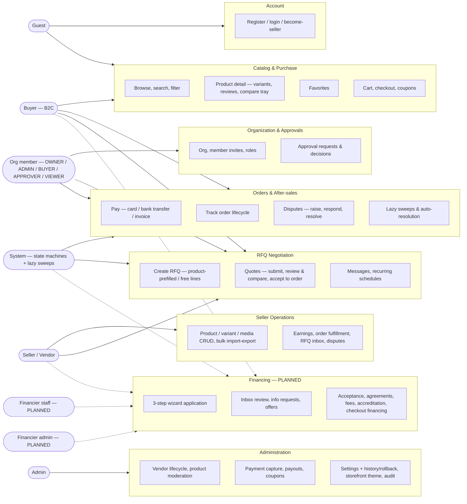

# Vendora — Use Cases & User Stories

> **Version 1.0 · September 2026 · Audience:** engineering and product stakeholders (expert level).
> Scope: Vendora unified commerce platform (B2C + B2B) — single-route SPA (`/` with `?view=` routing), roles BUYER / SELLER / ADMIN plus org membership roles OWNER / ADMIN / BUYER / APPROVER / VIEWER.
> Statuses are grounded in the verified capability map (2026-09 code recon) and the plan stack: `team/PLATFORM_PLAN.md` v2.0 (six business flows, phases P0–P6) and `team/FINANCIER_SCHEMA.md` v4.0. Nothing marked EXISTS is PARTIAL/PLANNED in those sources.
> Status legend: **EXISTS** (implemented), **PARTIAL** (backbone exists, deltas pending), **PLANNED** (per PLATFORM_PLAN phases).
> Invariants respected throughout: D-001 (platform is orchestrator, never merchant of record, never holds inventory), D-002 (settlement external — never lends/holds funds; commission on success), D-011 (no cron — state machines + lazy sweeps only).

---

## 1. Actors

| Actor | Description | Goals | Access rights |
|---|---|---|---|
| Guest | Unauthenticated visitor | Evaluate the platform, browse catalog, view products and seller storefronts | Read-only public catalog, product pages, storefront (`?view=store`); no cart persistence, no RFQ, no account views |
| Buyer (B2C) | Registered user with global role BUYER | Purchase directly, request quotes, favorite, review, track orders, dispute | All shopper views (`home`, `catalog`, `product`, `store`, `cart`, `checkout`, `orders`, `favorites`, `account`, `rfqs`); own data only |
| Buyer org member | B2B user in an Organization; membership role OWNER / ADMIN / BUYER / APPROVER / VIEWER | Purchase on behalf of the org, negotiate RFQs, route spend through approvals, benefit from org pricing | `?view=business` plus member-role-scoped org data; APPROVER additionally decides approval requests; VIEWER read-only |
| Seller / Vendor | Registered user with global role SELLER (one seller profile) | Sell products, quote RFQs, fulfill orders, earn, resolve disputes, source from other suppliers (Flow 6) | `?view=seller` console: products/variants/media, bulk import/export, orders, earnings, disputes, RFQ inbox; may also post RFQs as a buyer |
| Admin | Platform operator (global role ADMIN) | Govern vendors, catalog, orders, payments, payouts, pricing, RFQ settings, disputes, audit | `?view=admin` all tabs: overview, vendors, products, orders, organizations, pricing, coupons, payments, payouts, RFQs, disputes, audit logs, settings (incl. storefront theme + 7-section/22-panel RFQ settings with history/rollback), slides |
| System | Server-side state machines and lazy sweeps (no UI, never an authenticated principal) | Keep lifecycle state consistent without cron: quote/RFQ/dispute expiry, dispute auto-resolution, recurring RFQ re-issue, notification emission | Runs inside module services on request-triggered sweeps (D-011); audit-log rows on transitions |
| Financier staff — PLANNED | OWNER/ADMIN member of an organization with orgType BANK / MFI / EWALLET and an ACTIVE FinancierProfile (no new global role — DP-1) | Review financing requests, request info/documents, issue offers, report funding events | PLANNED `?view=financier`: inbox, request detail, offer composer, my offers |
| Financier admin — PLANNED | OWNER/ADMIN of a financier org | Manage financing products (rates, fees, ranges, tenor), run accreditation programs | PLANNED `?view=financier` profile & products; accreditation program definition |

---

## 2. Use-case diagram

One cluster per bounded context. Solid edges = exists; dotted edges = planned (Financing).

---

## 3. Use-case catalog

47 use cases. Main success scenarios are terse; alternatives and extensions are noted inline where they carry domain weight.

| ID | Use case | Primary actor | Precondition | Main success scenario | Postcondition | Status |
|---|---|---|---|---|---|---|
| UC-001 | Register account | Guest | — | 1) Open sign-up 2) Submit name, email, password 3) Server validates and hashes credentials 4) Account created with role BUYER | Account exists; session active; user is BUYER | EXISTS |
| UC-002 | Log in | Guest | Account exists | 1) Submit credentials 2) Server verifies 3) Session issued 4) Role-scoped navigation rendered | Session active; only entitled views reachable | EXISTS |
| UC-003 | Become seller | Buyer | Signed in | 1) Open become-seller flow 2) Submit seller profile (store details) 3) Role upgraded to SELLER 4) Seller console unlocked | User is SELLER; seller profile created | EXISTS |
| UC-004 | Browse, search & filter catalog | Guest | — | 1) Open home/catalog 2) Enter keyword or pick category 3) Apply filters 4) Paginate results. Ext: add products (max 4) to compare tray for side-by-side comparison | Result set reflects query; comparison available | EXISTS |
| UC-005 | View product detail | Guest | Product published | 1) Open product page 2) Review gallery, description, resolved price 3) Select variant (SKU, price, stock) 4) Read reviews. Ext (buyer, after DELIVERED): write review with 1–5 rating | Variant context fixed for cart/favorite/RFQ prefill | EXISTS |
| UC-006 | Favorite products | Buyer | Signed in | 1) Press favorite on product card or detail 2) Toggle persisted 3) Open `?view=favorites` | Favorite saved or removed; list accurate | EXISTS |
| UC-007 | Checkout from cart with coupon | Buyer | Signed in; cart non-empty | 1) Add items (variant, quantity) to cart 2) Open checkout 3) Enter shipping data 4) Apply coupon (validated) 5) Confirm | Order created PENDING_PAYMENT; items grouped per seller; totals include discount | EXISTS |
| UC-008 | Pay for order | Buyer | Order PENDING_PAYMENT | 1) Choose method 2a) CARD — simulated gateway confirms immediately 2b) BANK_TRANSFER — transfer instructions shown; admin confirms receipt 2c) INVOICE — credit-approved buyer; admin captures later | Order PAID; commission and payout basis fixed | EXISTS |
| UC-009 | Track order lifecycle | Buyer | Order exists | 1) Open `?view=orders` 2) Open order detail 3) Follow status PENDING_PAYMENT → PAID → PROCESSING → SHIPPED → DELIVERED (or CANCELLED) | Buyer informed; timeline visible | EXISTS |
| UC-010 | Raise dispute | Buyer | Order in paid-to-delivered range, within window | 1) Open order 2) Raise dispute with reason and description 3) DSP- number assigned | Dispute OPEN; seller notified | EXISTS |
| UC-011 | Respond to dispute | Seller | Dispute OPEN on own order | 1) Open seller console → disputes 2) Post response / proposed resolution | Response recorded; buyer notified | EXISTS |
| UC-012 | Resolve or escalate dispute | Admin | Dispute OPEN | 1) Review evidence from both sides 2) Escalate if needed 3) Rule and apply decision | Dispute RESOLVED; parties notified; audit row written | EXISTS |
| UC-013 | Run lazy sweeps & auto-resolution | System | Sweep-triggering request occurs; settings windows defined | 1) Sweep executes on access 2) Quotes/RFQs past validity expire 3) Disputes past configured window auto-resolve 4) Parties notified | Terminal states reached without cron (D-011); audit rows written | EXISTS |
| UC-014 | Create RFQ | Buyer / org member | Signed in | 1) Entry from product page (line prefilled) or business view (free lines) 2) Add lines: product/spec, quantity, target price, notes 3) Submit | RFQ- number assigned; eligible sellers computed and notified | EXISTS |
| UC-015 | Submit quote | Seller | RFQ open; seller eligible | 1) Open RFQ from inbox 2) Compose quote (unit price, payment terms, validity) 3) Send | QTE- quote SENT; buyer notified | EXISTS |
| UC-016 | Review & compare quotes | Buyer | RFQ has ≥ 1 quote | 1) Open RFQ detail 2) Review quote cards — price, NET/payment terms, validity windows, seller reputation — on one page 3) Optionally negotiate via messages | Buyer able to rank offers. (Consolidated multi-line compare grid is Flow 2 — see UC-047) | EXISTS |
| UC-017 | Accept quote, convert to order | Buyer (APPROVER if above threshold) | RFQ has open quote | 1) Press accept 2) If org order above threshold: approval request routed first 3) On approval, quote ACCEPTED and sibling quotes auto-declined 4) Convert accepted quote to order | Order created PENDING_PAYMENT with quote terms; quote locked | EXISTS |
| UC-018 | Exchange RFQ messages | Buyer / Seller | Both parties on same RFQ | 1) Open RFQ thread 2) Post message 3) Counterparty notified | Thread persisted; notification sent | EXISTS |
| UC-019 | Schedule recurring RFQ | Org member | Signed in with org | 1) Define recurring schedule (cadence, lines) 2) Activate | System re-issues RFQ per cadence via lazy sweep | EXISTS |
| UC-020 | Create organization & invite members | Buyer | Signed in | 1) Create org (name, type) — creator becomes OWNER 2) Invite members with roles OWNER / ADMIN / BUYER / APPROVER / VIEWER 3) Members accept | Org active; members scoped by role | EXISTS |
| UC-021 | Request org approval | Org member (BUYER) | Order or quote acceptance exceeds org threshold | 1) Submit order / accept quote 2) System creates approval request and blocks the action | Request PENDING with approvers; actor notified | EXISTS |
| UC-022 | Decide approval request | Org APPROVER | Approval request PENDING | 1) Open business view → approvals 2) Approve or reject (self-approval blocked) | Decision recorded; order/acceptance proceeds or is cancelled; audit row | EXISTS |
| UC-023 | Manage price lists | Seller / Admin | Signed in with rights | 1) Create price list (scope, currency, validity) 2) Add per-product prices 3) Publish | Entitled buyers see resolved prices (org list > group list > retail) | EXISTS |
| UC-024 | Manage customer groups | Admin | Admin session | 1) Create group 2) Assign buyers/orgs 3) Link group price lists | Group members receive group pricing | EXISTS |
| UC-025 | Manage seller catalog | Seller | SELLER session | 1) Create product with media (sha256-deduped webp pipeline) 2) Add variants (SKU, price, stock) 3) Publish (subject to admin moderation) 4) Bulk import/export via CSV (validated rows, error report) | Catalog updated; assets stored once and reusable | EXISTS |
| UC-026 | View earnings | Seller | SELLER with sales | 1) Open earnings 2) Review gross, commission, net per period | Net = gross − commission displayed | EXISTS |
| UC-027 | Fulfill orders | Seller | Own order PAID | 1) Open seller orders 2) Advance PROCESSING → SHIPPED with carrier/tracking | Order SHIPPED; buyer notified | EXISTS |
| UC-028 | Work RFQ inbox | Seller | SELLER session | 1) Open RFQ inbox 2) Filter matching requests 3) Open detail 4) Quote (UC-015) or message (UC-018) | Seller response submitted | EXISTS |
| UC-029 | Govern vendor lifecycle | Admin | Admin session | 1) Open vendors 2) Verify or suspend/reactivate a vendor 3) Set commission override | Vendor state + commission recorded; audit row | EXISTS |
| UC-030 | Moderate products & takedowns | Admin | Admin session | 1) Review listing queue 2) Approve, reject, or take down with reason | Listing state changed; seller notified | EXISTS |
| UC-031 | Capture manual payments | Admin | Manual payment pending | 1) Open payments 2) Match bank-transfer receipt or invoice 3) Mark captured | Order PAID; audit row | EXISTS |
| UC-032 | Generate payouts & mark paid | Admin | Seller earnings exist | 1) Generate payout batch (Σ gross − commission; vendor override or platform setting 0–90%) 2) Review batch 3) Mark PAID after external transfer | Payout records PAID — platform records only, never transfers funds (D-002) | EXISTS |
| UC-033 | Manage settings with history & rollback | Admin | Admin session | 1) Edit settings (7-section / 22-panel RFQ settings, payouts, etc.) 2) Save (zod-validated) 3) Inspect history 4) Rollback to a prior version if needed | Settings versioned; every change audited; rollback restores prior values | EXISTS |
| UC-034 | Customize storefront theme | Admin | Admin session | 1) Open theme settings 2) Set colors/branding 3) Publish | Storefront re-themed live | EXISTS |
| UC-035 | Manage coupons | Admin | Admin session | 1) Create coupon (type, value, window, usage cap) 2) Monitor redemptions | Coupon redeemable at checkout; abuse capped | EXISTS |
| UC-036 | Review audit log | Admin | Admin session | 1) Open audit logs 2) Filter by action, actor, time | Immutable trail of governed actions visible | EXISTS |
| UC-037 | Read notifications | Any signed-in user | Signed in | 1) Bell shows unread count 2) Open list 3) Click item → deep link to the relevant view | Item marked read; user routed to context | EXISTS |
| UC-038 | Apply for financing (3-step wizard) | Buyer / org member (seller org for Flow 3) | Signed in; entry from product, quote/order, or business view | 1) Step 1 — profile & KYC review (read-only, single entry; edit profile) + consent checkbox (consentAt) 2) Step 2 — 22-field activity/financing form (activity status, capital, installment capacity, previous financing, activity type/name/address/city/district, amount, currency, purpose, guarantee type/status, attachments, notes) 3) Step 3 — review by reference + terms agreement 4) Submit | FR- number assigned; status SUBMITTED; request distributed to matching verified financiers | PLANNED |
| UC-039 | Track & cancel my financing requests | Applicant | Request exists | 1) Open "My financing requests" 2) Review status history 3) Cancel before acceptance | Request CANCELLED / WITHDRAWN; financiers notified | PLANNED |
| UC-040 | Review financing inbox; request info | Financier staff | Financier org ACTIVE | 1) Open `?view=financier` inbox 2) Open request detail (target quote/order context) 3) Take UNDER_REVIEW 4) Ext: request missing documents/info → INFO_REQUESTED; applicant uploads via document subsystem | Request state advanced; applicant notified | PLANNED |
| UC-041 | Issue financing offer | Financier staff | Underwriting complete | 1) Compose offer — rate, fees, tenor, installment schedule, validity 2) Send | Offer SENT; request OFFERED; applicant notified | PLANNED |
| UC-042 | Compare & accept financing offer | Applicant | ≥ 1 live offer | 1) Open request offers 2) Compare side-by-side 3) Accept best | Sibling offers auto-DECLINE; request ACCEPTED; agreement created (AGR-); FinancingFee ACCRUED | PLANNED |
| UC-043 | Report agreement funding events | Financier staff | Agreement ACTIVE | 1) Report disbursement / repayment events from financier console | Events recorded in track-only ledger — money moves externally, platform never holds funds (D-002) | PLANNED |
| UC-044 | Settle financing fees | Admin | Fees ACCRUED | 1) Open admin fee console 2) Mark INVOICED (external invoice issued) 3) Mark PAID (external collection confirmed) | Fee lifecycle closed; audit rows written | PLANNED |
| UC-045 | Run accreditation program | Financier admin + Seller | Program defined | 1) Financier defines program criteria (data) 2) Seller submits documents 3) Financier/admin verifies 4) Accreditation fee invoiced 5) Auto-pass flag applies to future financing requests | Supplier accredited; verification reusable | PLANNED |
| UC-046 | Finance at checkout | Buyer | Checkout with eligible order (Flow 5; gated on DP-6 track-only ruling) | 1) At checkout choose financing 2) FinancingRequest created against the order 3) Financier approves and pays supplier directly 4) Repayment events tracked only | Financed order proceeds; commission + origination fee recorded; no funds touch the platform | PLANNED |
| UC-047 | Compose super-cart mixed-line RFQ | Buyer | Cart or RFQ composer with mixed lines (Flow 2) | 1) Compose one RFQ with N typed lines (PRODUCT / SERVICE / FINANCING / LOGISTICS / INSURANCE) 2) Lines routed to typed provider pools 3) Providers quote only their line 4) Buyer accepts best per line 5) Multi-party order with per-line commission | One RFQ, many provider deals, per-line commission | PARTIAL (RFQ backbone, multi-seller orders, per-item commission exist; typed lines, routing pools, per-line accept, consolidated compare are PLANNED — phase P3) |

---

## 4. User stories with acceptance criteria

12 epics, 65 stories. Each story: narrative, Given/When/Then acceptance criteria, MoSCoW priority, status. All money-handling stories respect D-002 (platform records, never holds or moves buyer↔vendor or financier funds).

### E-01 Account

**US-001 — Register** · Must · EXISTS
As a visitor, I want to create an account with email and password, so that I can transact as an identified buyer.
- Given no session exists, when I submit valid registration data, then an account is created with global role BUYER and a session starts.
- Given the email is already registered, when I submit, then the request is rejected with a duplicate error and no second account is created.

**US-002 — Log in** · Must · EXISTS
As a registered user, I want to log in, so that I can access my cart, orders, RFQs and console.
- Given valid credentials, when I submit the login form, then a session is issued and role-scoped navigation renders.
- Given invalid credentials, when I submit, then the attempt is rejected and no session is created.

**US-003 — Become a seller** · Must · EXISTS
As a buyer, I want to upgrade to a seller account, so that I can list products and receive RFQs.
- Given I am signed in as BUYER, when I complete the become-seller flow with store details, then my global role becomes SELLER and the seller console becomes available.
- Given I am already a SELLER, when I open the flow, then it is not offered again.

**US-004 — Role-scoped navigation** · Should · EXISTS
As a signed-in user, I want navigation limited to the views my roles allow, so that I never reach dead-end guarded screens.
- Given I am BUYER, when I browse the app, then seller and admin console entries are hidden.
- Given I am ADMIN, when I open `?view=admin`, then all admin tabs are reachable.

### E-02 Catalog

**US-005 — Search & filter the catalog** · Must · EXISTS
As a shopper, I want to search by keyword and filter by category and attributes, so that I quickly find relevant products.
- Given the catalog view, when I enter a keyword, then only matching published products are returned.
- Given results are shown, when I apply category and price filters, then the result set narrows accordingly.
- Given a large result set, when I paginate, then the query state is preserved.

**US-006 — View product detail & variants** · Must · EXISTS
As a shopper, I want full product detail with variant selection, so that I buy exactly the configuration I need.
- Given a published product, when I open its page, then gallery, description, resolved price and reviews render.
- Given the product has variants, when I select one, then SKU, price and stock update and the selection is used by cart, favorite and RFQ prefill.

**US-007 — Compare products side-by-side** · Should · EXISTS
As a shopper, I want to add up to four products to a compare tray, so that I can evaluate alternatives before committing.
- Given product cards or pages, when I add products to compare, then the tray appears with my selections (max 4).
- Given the compare dialog, when I open it, then the selected products are shown attribute-by-attribute.
- Given I enter checkout, when the tray would compete with payment UI, then it hides itself.

**US-008 — Manage favorites** · Must · EXISTS
As a buyer, I want to favorite and unfavorite products, so that I can shortlist them for later.
- Given I am signed in, when I toggle favorite on a product, then the state persists and the icon reflects it.
- Given favorites exist, when I open the favorites view, then exactly those products are listed.

**US-009 — Review a purchased product** · Should · EXISTS
As a buyer, I want to review and rate a delivered product, so that other shoppers benefit from my experience.
- Given one of my orders is DELIVERED, when I open the product page, then I can submit a review with a 1–5 rating.
- Given I have not purchased the product, when I attempt to review, then submission is not offered.
- Given a review exists, when another shopper opens the product, then the review and rating are visible.

### E-03 Checkout & Payment

**US-010 — Manage cart** · Must · EXISTS
As a buyer, I want to add variant-specific items to a cart and edit quantities, so that I can consolidate a purchase.
- Given a product with variants, when I add to cart, then the item carries the selected variant and quantity.
- Given a non-empty cart, when I change quantity or remove an item, then totals recompute.
- Given an out-of-stock variant, when I attempt to add it, then the attempt is rejected.

**US-011 — One checkout, multiple sellers** · Must · EXISTS
As a buyer, I want a single checkout for items from different sellers, so that I place one order with per-seller fulfillment.
- Given a cart with items from multiple sellers, when I confirm checkout, then one order is created with items grouped per seller.
- Given the order exists, when each seller fulfills their part, then order status advances per fulfillment.

**US-012 — Apply a coupon** · Must · EXISTS
As a buyer, I want to apply a coupon at checkout, so that I pay the discounted total.
- Given a valid, unexpired coupon within its usage cap, when I apply it, then the discount is reflected in the order total.
- Given an invalid or expired coupon, when I apply it, then it is rejected with a reason and the total is unchanged.

**US-013 — Pay by card (simulated)** · Must · EXISTS
As a buyer, I want to pay by card, so that my order is confirmed immediately.
- Given an order PENDING_PAYMENT, when I choose card and confirm the simulated payment, then the order transitions to PAID without admin involvement.

**US-014 — Pay by bank transfer (manual)** · Must · EXISTS
As a buyer, I want to pay by bank transfer, so that I can use my bank when cards are unavailable.
- Given an order PENDING_PAYMENT, when I choose bank transfer, then transfer instructions are shown and the order awaits confirmation.
- Given the admin sees the matched receipt, when they confirm, then the order transitions to PAID.

**US-015 — Pay by invoice (manual)** · Must · EXISTS
As an approved B2B buyer, I want to pay by invoice, so that I can settle after delivery per agreed terms.
- Given an eligible buyer, when I choose invoice, then the order records the invoice payment method and awaits capture.
- Given the invoice falls due, when the admin captures the payment, then the order transitions to PAID.

### E-04 Orders & Disputes

**US-016 — Track order status** · Must · EXISTS
As a buyer, I want to follow my order through its lifecycle, so that I know when to expect delivery.
- Given my orders view, when I open an order, then its current status (PENDING_PAYMENT / PAID / PROCESSING / SHIPPED / DELIVERED / CANCELLED) and history are visible.
- Given the seller ships, when tracking data is added, then I can see it on the order.

**US-017 — Cancel an order** · Should · EXISTS
As a buyer, I want to cancel an order before fulfillment starts, so that I am not charged for unwanted goods.
- Given my order is PAID but not yet processing, when I cancel, then the order becomes CANCELLED and any pending approval/payment artifacts are cancelled with it.
- Given my order is already PROCESSING or later, when I attempt to cancel, then cancellation is refused.

**US-018 — Raise a dispute** · Must · EXISTS
As a buyer, I want to dispute an order within the allowed window, so that I can seek remedy.
- Given an order in the disputable range, when I submit a dispute with reason and description, then a DSP- number is assigned and the seller is notified.
- Given the window has elapsed, when I attempt to dispute, then the attempt is rejected.

**US-019 — Respond to a dispute** · Must · EXISTS
As a seller, I want to respond to disputes on my orders, so that I can resolve them before escalation.
- Given a dispute OPEN on my order, when I post my response, then it is recorded on the thread and the buyer is notified.

**US-020 — Resolve or escalate a dispute** · Must · EXISTS
As an admin, I want to resolve or escalate disputes, so that parties get a final, fair outcome.
- Given a dispute OPEN, when I review both sides and rule, then the dispute is RESOLVED, the parties are notified and an audit row is written.
- Given a dispute needs senior handling, when I escalate it, then its state reflects escalation and resolution follows the escalated path.

**US-021 — Automatic expiry & auto-resolution** · Must · EXISTS
As a platform operator, I want the system to expire stale quotes/RFQs and auto-resolve aged disputes via lazy sweeps, so that state stays consistent without cron jobs.
- Given a quote past its validity, when a sweep triggers, then the quote is marked expired and the buyer is informed.
- Given a dispute past the configured window, when a sweep triggers, then it is auto-resolved per settings and both parties are notified.
- Given no user activity, when time passes, then no background process runs (D-011) — state changes only on the next triggering request.

### E-05 RFQ & Negotiation

**US-022 — Create an RFQ from a product** · Must · EXISTS
As a buyer, I want to request a quote directly from a product page, so that negotiation starts with prefilled context.
- Given a published product, when I choose to request a quote, then an RFQ is created with the product line prefilled (variant and quantity editable).
- Given I submit the RFQ, then an RFQ- number is assigned and eligible sellers are computed.

**US-023 — Create a free-form multi-line RFQ** · Must · EXISTS
As a buyer, I want to submit an RFQ with multiple free-text lines and target prices, so that sellers compete on my exact needs.
- Given the RFQ composer, when I add lines (description/spec, quantity, target price, notes) and submit, then the RFQ is open with all lines visible to eligible sellers.
- Given a draft RFQ, when I do not submit, then it remains DRAFT and no seller sees it.

**US-024 — Seller matching & inbox** · Must · EXISTS
As a seller, I want matching RFQs delivered to my inbox, so that I can respond to business I can win.
- Given an RFQ is submitted, when seller matching runs, then only eligible sellers see it in their RFQ inbox.
- Given my inbox, when I filter requests, then I can reach the detail of any request I am allowed to quote.

**US-025 — Submit a quote with validity** · Must · EXISTS
As a seller, I want to quote a price with payment terms and a validity window, so that my offer is firm but bounded.
- Given an open RFQ in my inbox, when I compose and send a quote, then a QTE- number is assigned, the buyer is notified and the quote carries its validity.
- Given my quote's validity has passed without acceptance, when a sweep runs, then it expires.

**US-026 — Review & compare quotes** · Must · EXISTS
As a buyer, I want all quotes for an RFQ on one page with full pricing and terms, so that I can pick the best offer.
- Given an RFQ with quotes, when I open its detail, then every quote is presented as a comparable card (price, NET/payment terms, validity, seller).
- Given multiple quotes, when I accept one, then the others are handled per US-027.

**US-027 — Accept a quote into an order** · Must · EXISTS
As a buyer, I want to accept the winning quote and have it converted to an order, so that the deal closes without re-entry.
- Given an open quote on an RFQ, when I accept it, then the quote becomes ACCEPTED and all sibling quotes are automatically declined.
- Given an accepted quote, when I convert it, then an order is created from the quote terms and becomes PENDING_PAYMENT.
- Given my org's approval threshold applies, when I accept, then the acceptance is routed to approvers first and completes only on approval.

**US-028 — Negotiate via RFQ messages** · Should · EXISTS
As a buyer or seller, I want a message thread on each RFQ, so that we can clarify before quoting or accepting.
- Given a shared RFQ, when I post a message, then the counterparty is notified and the thread is persisted.

**US-029 — Schedule recurring RFQs** · Should · EXISTS
As an org member, I want an RFQ re-issued on a recurring schedule, so that periodic sourcing runs itself.
- Given a recurring schedule definition, when I activate it, then RFQs are re-issued per cadence by the lazy sweep.

### E-06 Organization & Approvals

**US-030 — Create an organization** · Must · EXISTS
As a buyer, I want to create a B2B organization, so that my team can transact as one company.
- Given I am signed in, when I create an organization with name and type, then the org is created and I become its OWNER.

**US-031 — Invite & manage members with roles** · Must · EXISTS
As an org OWNER/ADMIN, I want to invite members with roles OWNER / ADMIN / BUYER / APPROVER / VIEWER, so that access matches responsibility.
- Given an active org, when I invite a member with a role, then they join with that role and see only role-scoped org data.
- Given a member, when their role is changed or revoked, then their access reflects the change immediately.

**US-032 — Route orders through approval** · Must · EXISTS
As an org member, I want orders above our threshold to require approver sign-off, so that spend is controlled.
- Given I submit an order above the org threshold, when it is created, then an approval request is raised to the approvers and the order waits.
- Given the order is below threshold, when I submit, then no approval is required.

**US-033 — Route quote acceptance through approval** · Must · EXISTS
As an org member, I want accepted quotes above threshold to be approved before the deal closes, so that negotiated commitments are governed too.
- Given I accept a quote above the org threshold, when I confirm, then the acceptance is marked pending approval instead of closing.
- Given the approver approves, when the decision lands, then the quote acceptance completes and conversion proceeds.

**US-034 — Decide approval requests** · Must · EXISTS
As an org APPROVER, I want to approve or reject requests with a guard against self-approval, so that control is real.
- Given a PENDING approval request, when I approve or reject, then the decision is recorded, the requesting member is notified and an audit row is written.
- Given I am the requester, when I try to decide my own request, then the action is blocked.

### E-07 Pricing

**US-035 — Manage price lists** · Must · EXISTS
As a seller/admin, I want to publish scoped price lists, so that entitled buyers see negotiated prices.
- Given I create a price list with scope and per-product prices, when I publish it, then entitled buyers see those prices instead of retail.

**US-036 — Manage customer groups** · Must · EXISTS
As an admin, I want to group buyers and organizations, so that segment-level pricing and terms are possible.
- Given a customer group, when I assign members and link a group price list, then those members resolve group prices at catalog and quote time.

**US-037 — Price resolution precedence** · Must · EXISTS
As a buyer, I want the best price I am entitled to resolved automatically, so that I never overpay relative to my agreements.
- Given I belong to an org with an org price list, when I view a product, then the org price wins.
- Given I have no org price but my group does, when I view the product, then the group price applies.
- Given I have neither, when I view the product, then retail price applies.

### E-08 Seller Console

**US-038 — Product CRUD with variants** · Must · EXISTS
As a seller, I want to create products with variants, SKUs, prices and stock, so that shoppers can buy exact configurations.
- Given the seller console, when I create a product and add variants, then it appears in the catalog subject to admin moderation.
- Given I edit price or stock on a variant, when I save, then the catalog reflects it immediately for entitled buyers.

**US-039 — Bulk import & export** · Should · EXISTS
As a seller, I want to import and export products in bulk, so that large catalogs are manageable.
- Given an exported CSV of my catalog, when I edit and re-upload it, then valid rows are imported and invalid rows are reported with reasons.
- Given a bulk import completes, when I open my product list, then all imported products are present.

**US-040 — View earnings** · Must · EXISTS
As a seller, I want a transparent earnings view, so that I know my net after platform commission.
- Given completed sales, when I open earnings, then gross, commission and net (gross − commission) are shown per period.
- Given the admin sets my commission override, when it changes, then subsequent calculations use it.

**US-041 — Fulfill orders** · Must · EXISTS
As a seller, I want to advance my orders through fulfillment, so that buyers are informed and payouts mature.
- Given my order is PAID, when I move it to PROCESSING and then SHIPPED with tracking, then the buyer is notified at each step.

**US-042 — Source from other suppliers (Flow 6)** · Should · EXISTS
As a seller, I want to post RFQs as a buyer, so that I can source supplies from other vendors on the same platform.
- Given RFQ creation is not role-restricted, when I (as SELLER, with my org) create and submit an RFQ, then eligible suppliers can quote me and conversion earns the platform commission.
- Given the seller console, when I need a direct RFQ entry point, then it is a P6 UX allowance (platform plan) — the capability already works from the buyer surface.

### E-09 Admin Console

**US-043 — Govern vendors** · Must · EXISTS
As an admin, I want to verify, suspend and set commission per vendor, so that only trustworthy sellers trade on fair terms.
- Given a vendor in review, when I verify them, then their products can trade and the action is audited.
- Given a misbehaving vendor, when I suspend them, then their storefront and listings stop trading.
- Given a vendor, when I set a commission override, then their payouts use it (within 0–90%).

**US-044 — Moderate products & takedowns** · Must · EXISTS
As an admin, I want to approve, reject or take down listings, so that the catalog stays governed.
- Given a listing in the moderation queue, when I approve or reject with a reason, then the seller is notified and the catalog updates.
- Given a live listing that violates policy, when I take it down, then it is immediately unpublished.

**US-045 — Capture manual payments** · Must · EXISTS
As an admin, I want to confirm bank transfers and capture invoices, so that manual payment methods still close the loop.
- Given an order awaiting bank-transfer confirmation, when I confirm the receipt, then the order becomes PAID.
- Given an invoiced order due, when I capture it, then the order becomes PAID and the action is audited.

**US-046 — Run payouts as records** · Must · EXISTS
As an admin, I want to generate payout batches and mark them paid, so that seller settlements are accounted — while the platform itself never moves funds (D-002).
- Given seller earnings in a period, when I generate a payout batch, then each line equals gross − commission and carries PY- numbering.
- Given a batch, when I mark it PAID after the external transfer, then the payout records close as PAID.
- Given any payout, when it is inspected, then it is a record only — the platform never transfers or holds settlement funds.

**US-047 — Settings with history & rollback** · Must · EXISTS
As an admin, I want validated settings with full change history and rollback, so that configuration changes are safe and reversible.
- Given the settings console (7 sections / 22 panels for RFQ plus platform settings), when I save a change, then it is zod-validated and a history entry is written.
- Given a bad change, when I roll back to a prior version, then the previous values are restored and the rollback itself is audited.

**US-048 — Customize the storefront theme** · Should · EXISTS
As an admin, I want to adjust storefront branding, so that the marketplace reflects the operator's identity.
- Given theme settings, when I change colors/branding and publish, then the storefront re-renders with the new theme.

**US-049 — Manage coupons** · Should · EXISTS
As an admin, I want to create and monitor coupons, so that promotions are bounded and measurable.
- Given a new coupon with type, value, window and usage cap, when I publish it, then buyers can apply it within its bounds only.
- Given live coupons, when I view redemptions, then usage against the cap is visible.

**US-050 — Review the audit log** · Should · EXISTS
As an admin, I want a filterable audit trail, so that governance actions are attributable and reviewable.
- Given the audit view, when I filter by action, actor or time, then matching immutable entries are listed.

### E-10 Notifications & Media

**US-051 — Notification bell & deep links** · Must · EXISTS
As any signed-in user, I want a bell with unread count and click-through to context, so that I never lose track of events.
- Given unread notifications, when I open the bell list, then items are listed with unread state.
- Given a notification, when I click it, then I am routed to the view where the event happened.

**US-052 — Lifecycle event coverage** · Must · EXISTS
As a stakeholder in a transaction, I want a notification on every state change that concerns me, so that no manual polling is needed.
- Given an order, quote, approval or dispute transition that concerns me, when it occurs, then I receive a notification without any action on my side.
- Given a notification emission failure, when it happens, then the business transition still succeeds (emission never blocks).

**US-053 — Deduplicated media library** · Should · EXISTS
As a seller/admin, I want uploads deduplicated by content hash and converted to webp, so that storage stays lean and consistent.
- Given an identical file uploaded twice, when the second upload lands, then it resolves to the existing asset (sha256 match) instead of a duplicate.
- Given any uploaded image, when it is stored, then it is served in the normalized webp pipeline.

### E-11 Financing — PLANNED (Flows 3, 4, 5)

**US-054 — Apply for working capital via 3-step wizard** · Must · PLANNED (Flow 3)
As a seller org owner, I want to apply for financing through a 3-step wizard, so that my application is complete and consistent before submission.
- Given an ACTIVE seller org and a signed-in member, when I open the wizard, then step 1 renders my profile and KYC documents read-only with an edit-profile path and a consent checkbox (consentAt recorded).
- Given step 1 consent, when I proceed to step 2, then the 22-field activity/financing form (activity status, capital, installment capacity, previous financing, contribution, other income, activity type/name/description/start date/address/city/district/location type, amount, currency, purpose, guarantee type/status, attachments, notes) is captured into typed columns with attachments as dual-scope documents.
- Given step 2 is complete, when I reach step 3, then everything renders by reference (no profile data copied) and submission requires the terms checkbox.
- Given submission, when it succeeds, then a FR- number is assigned, the request is SUBMITTED and distributed to matching verified financiers, and it appears in "My financing requests" with status history.
- Given my request is pre-acceptance, when I cancel it, then it becomes CANCELLED/WITHDRAWN and the financiers are notified.

**US-055 — Financier reviews inbox & requests information** · Must · PLANNED (Flow 3)
As financier staff, I want a distributed-request inbox with full applicant context, so that I can underwrite without chasing data over email.
- Given my financier org is ACTIVE, when I open `?view=financier`, then I see requests distributed to us whose ticket range and product type match.
- Given a request, when I open its detail, then the target (quote/order/working capital) and applicant activity data are visible by reference.
- Given information or documents are missing, when I request them, then the request becomes INFO_REQUESTED and the applicant is notified; on re-submission it returns to review.

**US-056 — Issue an offer with installment schedule** · Must · PLANNED (Flow 3)
As financier staff, I want to issue a binding offer with rate, fees, tenor, installments and validity, so that the applicant can decide on complete terms.
- Given a request under review, when I compose an offer with its installment schedule and send it, then the request becomes OFFERED and the applicant is notified.
- Given an offer past its validity, when a lazy sweep runs, then it expires without cron (D-011).

**US-057 — Compare & accept an offer** · Must · PLANNED (Flow 3)
As an applicant, I want to compare all live offers side-by-side and accept one, so that I choose the best financing for my business.
- Given my request has multiple offers, when I open the compare view, then rate, fees, tenor and installment schedules are shown side-by-side.
- Given I accept an offer, when acceptance is processed, then sibling offers auto-DECLINE, the request becomes ACCEPTED, an agreement (AGR-) is created and a platform success fee is ACCRUED on the financed amount.
- Given I decline all offers, when the last one is declined, then the request reaches DECLINED_ALL.

**US-058 — Report agreement funding events (track-only)** · Must · PLANNED (Flow 3)
As financier staff, I want to report disbursement and repayment events on the agreement, so that both parties see progress — while the money never touches the platform.
- Given an ACTIVE agreement, when I report a funding or repayment event, then it is recorded in the track-only ledger with timestamp and amount.
- Given any agreement, when its funding status is updated, then the platform only records it — it never holds, lends or moves funds (D-002).

**US-059 — Settle financing fees externally** · Must · PLANNED (Flow 3)
As an admin, I want to invoice and reconcile the platform's financing fees, so that revenue is collected without the platform touching financing money.
- Given accepted offers, when fees accrue, then they appear as ACCRUED rows (percentage × financed amount, 0–5% configurable).
- Given an accrued fee, when I mark it INVOICED, then the external invoice reference is recorded.
- Given the external payment lands, when I mark it PAID, then the fee closes as PAID with an audit row — collection is external, never automated by the platform.

**US-060 — Run an accreditation program** · Should · PLANNED (Flow 4)
As a financier admin, I want to define accreditation programs that suppliers can complete, so that verified suppliers get faster financing and I get a fee.
- Given program criteria defined as data, when a supplier applies with documents, then a SupplierAccreditation is created for verification.
- Given documents meet the criteria, when I verify the accreditation, then the supplier is accredited, the accreditation fee is invoiced externally, and an auto-pass flag applies to the supplier's future financing requests.

**US-061 — Finance at checkout** · Should · PLANNED (Flow 5 — gated on DP-6 track-only ruling)
As a buyer, I want to finance my order at checkout, so that I can buy now and repay the financier over time.
- Given an eligible order at checkout, when I choose financing, then a FinancingRequest is created against that order and matching financiers respond.
- Given a financing offer accepted before the checkout window closes, when the financier confirms, then the order proceeds and the financier pays the supplier directly.
- Given the financed order completes, when repayment events are reported, then they are recorded in the track-only ledger — the platform records but never holds funds, and earns commission plus an invoiced origination fee.

### E-12 Super-Cart — PLANNED (Flow 2)

**US-062 — Compose a mixed-line RFQ** · Must · PLANNED
As a buyer, I want one RFQ containing product, service, financing, logistics and insurance lines, so that a complex project is sourced in a single request.
- Given my cart or the RFQ composer, when I add lines of different types, then each line carries its own lineType (PRODUCT / SERVICE / FINANCING / LOGISTICS / INSURANCE) and its line-specific fields.
- Given I submit the mixed RFQ, when it opens, then all lines are visible to their respective provider pools only.

**US-063 — Typed provider pools & per-line routing** · Must · PLANNED
As a buyer, I want each line routed only to providers of its type, so that sellers quote goods, financiers quote financing, and so on.
- Given a FINANCING line, when routing runs, then only verified financier organizations in range see and may quote that line.
- Given a PRODUCT line, when routing runs, then only eligible sellers of that product see the line.

**US-064 — Accept best per line into a multi-party order** · Must · PLANNED
As a buyer, I want to accept the best quote on each line independently, so that one RFQ closes as one multi-party deal with per-line commission.
- Given per-line quotes on my RFQ, when I accept one quote per line, then a single multi-party order is created with one item group per winning provider.
- Given the order settles, when payouts are generated, then commission is computed per line and each provider's net equals their line gross minus their line commission.

**US-065 — Consolidated quote comparison** · Should · PLANNED
As a buyer, I want a consolidated comparison grid across all lines and their quotes, so that I can optimize the whole basket, not just each line.
- Given multiple lines with multiple quotes, when I open the comparison, then quotes are comparable per line and a basket total per provider combination is shown.
- Given I accept the basket, when per-line acceptance completes, then the multi-party order reflects exactly the compared selection.

---

## 5. Traceability — story → use case → business flow

Business flows per PLATFORM_PLAN §1: **1** B2C direct purchase (EXISTS) · **2** Super-Cart mixed-line RFQ (PARTIAL) · **3** Supplier→Financier working capital (PLANNED) · **4** Accreditation-as-a-Service (PLANNED) · **5** Customer→Financing→Supplier checkout financing (PLANNED) · **6** Supplier→Supplier B2B sourcing (EXISTS ~95%). "—" = cross-cutting foundation.

| Stories | Use cases | Flow(s) |
|---|---|---|
| US-001 – US-004 | UC-001 – UC-003 | — (foundation for all) |
| US-005 – US-009 | UC-004 – UC-006 | 1 |
| US-010, US-011, US-012 | UC-007 | 1, 2 |
| US-013 – US-015 | UC-008 | 1 |
| US-016 – US-017 | UC-009 | 1 |
| US-018 | UC-010 | 1 |
| US-019 | UC-011 | 1 |
| US-020 | UC-012 | 1 |
| US-021 | UC-013 | all |
| US-022, US-023 | UC-014 | 1, 2, 6 |
| US-024 | UC-028 | 1, 6 |
| US-025 | UC-015 | 1, 6 |
| US-026 | UC-016 | 1, 6 |
| US-027 | UC-017 | 1, 6 |
| US-028 | UC-018 | 1, 6 |
| US-029 | UC-019 | 6 |
| US-030 – US-031 | UC-020 | — |
| US-032 – US-034 | UC-021 – UC-022 | 1 |
| US-035, US-037 | UC-023 | 1 |
| US-036 | UC-024 | — |
| US-038, US-039, US-053 | UC-025 | 1 |
| US-040 | UC-026 | 1 |
| US-041 | UC-027 | 1 |
| US-042 | UC-014 | 6 |
| US-043 | UC-029 | all |
| US-044 | UC-030 | 1 |
| US-045 | UC-031 | 1 |
| US-046 | UC-032 | 1 |
| US-047 | UC-033 | all |
| US-048 | UC-034 | 1 |
| US-049 | UC-035 | 1 |
| US-050 | UC-036 | all |
| US-051, US-052 | UC-037 | all |
| US-054 | UC-038, UC-039 | 3 |
| US-055 | UC-040 | 3 |
| US-056 | UC-041 | 3 |
| US-057 | UC-042 | 3, 5 |
| US-058 | UC-043 | 3, 5 |
| US-059 | UC-044 | 3, 4, 5 |
| US-060 | UC-045 | 4 |
| US-061 | UC-046 | 5 |
| US-062 – US-065 | UC-047 | 2 |

---

## 6. Non-goals (explicit)

- **The platform never lends or holds funds (D-002).** All financing money moves directly buyer⇄financier or financier⇄supplier. The platform records reported events in a track-only ledger, charges commission/fees on success, and settles fees via external invoices that an admin marks INVOICED/PAID. Payouts are records (gross − commission) marked PAID after external transfer — the platform never executes transfers.
- **No SaaS multi-tenancy (D-003).** No tenantId anywhere, no platform-of-platforms, one operator.
- **Entertainment top-ups are out of scope.** The competitor's top-up vertical is B2C retail, not Vendora's B2B/B2C trade model.
- **Education center & success stories are deferred (DP-9).** Competitor-inspired content layer is a P6-tail decision, not part of these use cases.
- Related financier non-goals (per FINANCIER_PLAN): no credit scoring, no wallets or escrow, no automated fee collection, no FX, no CREDIT_LINE products in v1.
- **No time-based automation (D-011):** all lifecycle progression is state-machine + lazy-sweep; no cron drives any flow in this document.
