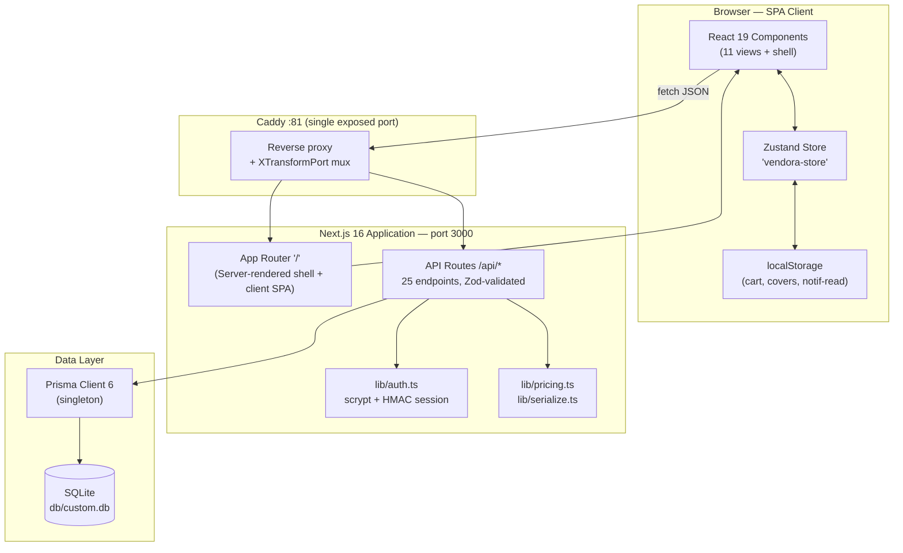
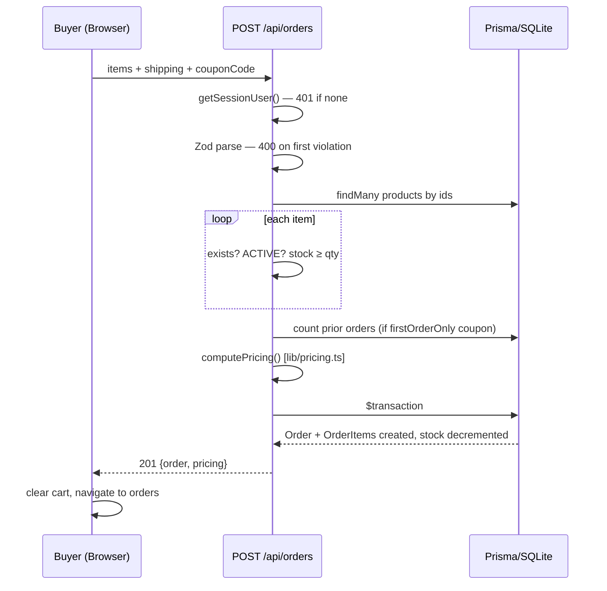
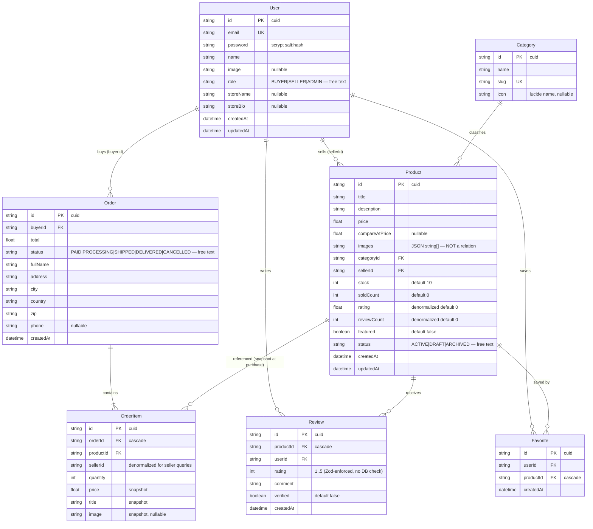

# Vendora — Technical Documentation Suite

> **Document ID:** WHOIS-1 · **Type:** Systems Analysis & Software Engineering Audit
> **Method:** Full static audit of every source file + live runtime inspection (agent-browser E2E, 10 documented QA rounds)
> **Codebase audited:** `/home/z/my-project` — 15,733 lines of TypeScript/TSX across `src/`, 1 Prisma/SQLite database, 1 Caddy gateway
> **Purpose:** Definitive A-to-Z record of what exists in code *today*, how it works, where it is weak, and what must change to reach the production-grade, modular, infinitely scalable platform you ordered from day 1. No aspiration is presented as fact; every claim below is traceable to a file path.

---

# 1. Executive Summary & System Definition

## 1.1 System Abstract & Core Objectives

**Vendora** is a multi-vendor e-commerce marketplace (B2C in its current implementation) where:

- **Buyers** browse a shared catalog, search/filter products, maintain a persistent cart and save-for-later list, apply coupons, place orders, track order lifecycle, write reviews, favorite products, and manage an account.
- **Sellers** (users who opted into the `SELLER` role) create/edit/archive product listings, fulfill orders (advance status), monitor a KPI dashboard (revenue, sales-by-day chart, top products), view derived payout summaries, and run a public storefront page with a selectable cover image.
- **Admins** (hand-promoted `ADMIN` role) view a read-only platform analytics overview and export CSV datasets.

**Business logic core:** seller-owned product listings → shared catalog discovery → server-authoritative checkout (stock decrement in a DB transaction) → order lifecycle management → derived seller analytics.

**Operational goal conflict (documented, unresolved):** You required a **production-ready, modular, scalable B2B/B2C RFQ marketplace** (multi-line RFQs, vendor quotes, verification/moderation/disputes, revenue ledger). The delivered codebase is a **B2C direct-checkout marketplace**. A five-deliverable rebuild proposal (PLAN-1 in `worklog.md`) was written to close this gap and is **awaiting your approval**. This document audits what *is*, not what was proposed.

## 1.2 Functional Architecture Map

```
┌─────────────────────────────────────────────────────────────────────────────┐
│                            CLIENT (Browser)                                  │
│  Next.js 16 App Router · React 19 · Single-route SPA at "/"                 │
│  ┌────────────────────────────────────────────────────────────────────┐    │
│  │ marketplace-app.tsx (root shell)                                    │    │
│  │  ├─ Header (search, nav, cart badge, notifications bell, theme)      │    │
│  │  ├─ 11 view components (home/catalog/product/store/cart/checkout/   │    │
│  │  │   orders/favorites/seller/account/admin) — query-param routed    │    │
│  │  ├─ CartDrawer · AuthModal · BackToTop · Footer                      │    │
│  │  └─ Zustand store "vendora-store" (localStorage persistence)        │    │
│  │      persists: cart, savedForLater, recentlyViewed only             │    │
│  └────────────────────────────────────────────────────────────────────┘    │
│  Client-side data caches (NOT server-truth):                                 │
│   localStorage: vendora-store · vendora-store-cover:{sellerId} ·             │
│                 notification read-state keys · recently-viewed               │
└───────────────┬─────────────────────────────────────────────────────────────┘
                │ fetch('/api/...') — relative paths, JSON, no external calls
┌───────────────▼─────────────────────────────────────────────────────────────┐
│                     APPLICATION SERVER (Next.js, port 3000)                  │
│  17 route files · 25 endpoints · Zod request validation · role guards         │
│  ┌──────────────┬──────────────┬───────────────┬────────────────────┐      │
│  │ /api/auth/*  │ /api/products│ /api/orders   │ /api/seller/*      │      │
│  │ login        │ list/filter  │ checkout(txn) │ orders fulfillment │      │
│  │ register     │ create/edit/ │ history/cancel│ stats+payouts      │      │
│  │ me/logout    │ delete       │ detail/advance│                    │      │
│  │ become-seller│              │               │                    │      │
│  ├──────────────┼──────────────┼───────────────┼────────────────────┤      │
│  │ /api/home    │/api/categories│/api/reviews │/api/favorites      │      │
│  │ /api/coupons│/api/sellers/[id]│            │/api/admin/stats    │      │
│  │ /validate   │ (public store) │             │ (ADMIN-gated)      │      │
│  └──────────────┴──────────────┴───────────────┴────────────────────┘      │
│  Cross-cutting: lib/auth.ts (scrypt + HMAC cookie sessions) ·                │
│  lib/pricing.ts (single source of pricing truth) · lib/serialize.ts          │
└───────────────┬─────────────────────────────────────────────────────────────┘
                │ Prisma Client (singleton via globalThis)
┌───────────────▼─────────────────────────────────────────────────────────────┐
│  DATA LAYER — SQLite single file: db/custom.db (~143 KB, 7 models)           │
│  User · Category · Product · Order · OrderItem · Review · Favorite           │
└─────────────────────────────────────────────────────────────────────────────┘
                │
┌───────────────▼─────────────────────────────────────────────────────────────┐
│  EDGE / GATEWAY — Caddy on :81 (the ONLY externally exposed port)            │
│  Default → reverse_proxy localhost:3000                                      │
│  ?XTransformPort={port} → reverse_proxy localhost:{port} (mini-service mux)  │
└─────────────────────────────────────────────────────────────────────────────┘

Third-party integrations: NONE at runtime (all product images are OSS-hosted
static URLs; no payment gateway, no email provider, no webhooks, no analytics).
```

## 1.3 Audit Scope & Constraints

| Dimension | Value |
|---|---|
| Code audited | 100% of `src/` (66 files), `prisma/schema.prisma`, `next.config.ts`, `Caddyfile`, `package.json`, `scripts/add-admin.ts` |
| Versions | Lockfile-exact ranges: next ^16.1.1, react ^19.0.0, prisma ^6.11.1, typescript ^5 (see §3.1) |
| Runtime | Bun dev server (`next dev -p 3000`), inspected via live HTTP + agent-browser E2E |
| Database | SQLite file, seeded demo data (3 sellers, ~27 products, orders, reviews, favorites, 1 admin) |
| Out of scope | `node_modules`, generated `.next/`, `examples/websocket` (reference demo, not wired), `tests/*-build.sh` (sandbox infra scripts, not application tests), `skills/` |
| Known environment quirks | Dev server has died 3× over project life (restart procedure documented in worklog); intermittent dev-only HMR hydration warnings (investigated, not reproducible organically, no prod path) |

---

# 2. High-Level & Low-Level Architecture (HLD / LLD)

## 2.1 System Architecture Diagram — Macro Topology

**Style: Modular Monolith** (single deployable Next.js app; UI, API, and data access in one process; zero inter-service network calls).



**Verdict:** All logic — presentation, orchestration, validation, business rules, persistence — lives in one Next.js process. This is a **modular monolith only at file level** (clean folders: `api/*` per domain, `components/marketplace/*` per view, `lib/*` per concern); there are **no enforced module boundaries** (any route can import any lib and touch any table — see §6.3, TD-01).

## 2.2 Component & Module Decomposition (Bounded Contexts, as-built)

| Bounded Context | Files | Responsibility | Boundary quality |
|---|---|---|---|
| **Identity & Access** | `api/auth/*` (5 routes), `lib/auth.ts`, `auth-modal.tsx`, `scripts/add-admin.ts` | Register, login, logout, session restore, buyer→seller upgrade, role guards | **Weak** — no token rotation, no rate limit, role is free-text |
| **Catalog** | `api/products`, `api/products/[id]`, `api/categories`, `product-card.tsx`, `catalog-view.tsx`, `home-view.tsx`, `search-box.tsx` | Listing CRUD (seller-owned), browsing, search, filters, sort, pagination, home feed | **Medium** — read path solid; write path owner-checked |
| **Cart & Checkout** | `store/marketplace.ts`, `cart-drawer.tsx`, `cart-view.tsx`, `checkout-view.tsx`, `api/orders` (POST), `api/coupons/validate`, `lib/pricing.ts` | Client cart (persisted), server-authoritative pricing, coupon rules, transactional order creation | **Strong core, weak edges** — pricing single-sourced; payment is simulated |
| **Orders & Fulfillment** | `api/orders` (GET), `api/orders/[id]` (GET/PATCH), `api/seller/orders`, `orders-view.tsx`, `invoice-dialog.tsx` | Buyer history/timeline/invoice; buyer cancel (PAID-only, restock txn); seller status advance | **Medium** — lifecycle not persisted (see TD-04) |
| **Reviews & Social** | `api/reviews`, `api/favorites`, `star-rating.tsx` | Review create (unique per user×product), favorite toggle | **Medium** |
| **Seller Dashboard & Storefront** | `api/seller/stats`, `api/sellers/[id]`, `seller-view.tsx`, `store-view.tsx`, `lib/store-covers.ts`, `product-form-dialog.tsx` | KPIs, payouts (derived), public store page, cover picker (client-side) | **Weak at persistence** — covers/payout-epochs client-derived |
| **Admin Back-office** | `api/admin/stats`, `admin-view.tsx`, `lib/csv.ts` | Read-only analytics + 4 CSV exports | **Weakest** — no CRUD, no settings, no moderation (your standing complaint) |
| **Shared Kernel** | `lib/types.ts`, `lib/serialize.ts`, `lib/routing.ts`, `lib/format.ts`, `lib/utils.ts`, `hooks/use-api.ts` | DTOs, serializers, URL↔view mapping, formatting | **Good** — DTO layer keeps API contract typed |

## 2.3 Data Flow Diagrams

### DFD Level 0 (Context)

```
        ┌──────────┐   browse/search/buy    ┌──────────────┐   SQL (Prisma)   ┌────────────┐
        │  BUYER   │──────────────────────▶│              │─────────────────▶│            │
        └──────────┘◀──────────────────────│   VENDORA    │◀─────────────────│   SQLite   │
        ┌──────────┐   list/fulfill         │  Next.js 16  │                  │ custom.db  │
        │  SELLER  │──────────────────────▶│  (monolith)  │                  │  (7 tables)│
        └──────────┘◀──────────────────────│              │                  └────────────┘
        ┌──────────┐   view analytics       │  Caddy :81   │
        │  ADMIN   │──────────────────────▶│  gateway     │
        └──────────┘◀──────────────────────└──────────────┘
   External systems: NONE (no payment/email/webhook providers integrated)
```

### DFD Level 1 (Major Processes)

```
BUYER/SELLER/ADMIN
   │ HTTPS via Caddy
   ▼
[P1 Session Mgmt]──verify HMAC cookie──▶ D1 Session (stateless token, 30d)
   │
   ├─▶ [P2 Catalog Browse] ──read──▶ D2 Products/Categories ──▶ in-memory filter/sort/page
   │        └─▶ favorites join for session user
   ├─▶ [P3 Cart Mgmt] ──client-only──▶ D3 localStorage cart
   │
   ├─▶ [P4 Checkout] ─Zod validate─▶ stock check ─▶ coupon rules (D4 hardcoded COUPONS)
   │        └─▶ [P5 Order Create] ══TRANSACTION══▶ insert Order+OrderItems(snapshot)
   │                                          └─▶ decrement stock / increment soldCount
   ├─▶ [P6 Order Lifecycle] ──▶ buyer cancel (PAID only, restock txn) / seller advance status
   ├─▶ [P7 Reviews/Favorites] ──write──▶ D5 Review/Favorite (unique constraints)
   ├─▶ [P8 Seller Ops] ──read/aggregate──▶ D2+D6 Orders/OrderItems ──▶ stats/payouts derived
   └─▶ [P9 Admin Analytics] ──read/aggregate──▶ all tables ──▶ KPIs + CSV export (client)
```

### DFD Level 2 (Checkout — the only transactional flow)

```
Client cart (Zustand, localStorage)
   │ POST /api/orders {items[], shipping{}, couponCode?}
   ▼
Zod checkoutSchema ──fail──▶ 400 {error: first issue message}
   │ pass (session required → 401 if absent)
   ▼
Fetch all referenced products by id (D2)
   ├─ missing product ──▶ 400 "no longer exists"
   ├─ status ≠ ACTIVE ──▶ 400 "no longer available"
   └─ stock < qty ────────▶ 400 "Only N left in stock"
   ▼
Subtotal = Σ DB-price × qty        ◀── price NEVER taken from client
   ▼
Coupon validation (server-authoritative)
   ├─ unknown code ──▶ 400
   ├─ subtotal < minSubtotal ──▶ 400
   └─ firstOrderOnly && prior orders > 0 ──▶ 400
   ▼
computePricing(subtotal, coupon)   ◀── lib/pricing.ts shared with UI
   ▼
db.$transaction ──┬─▶ Order.create (status:'PAID' — PAYMENT IS SIMULATED)
                  ├─▶ OrderItem.create[] (title/image/price SNAPSHOTTED)
                  ├─▶ Product.update stock:{decrement} ×N
                  └─▶ Product.update soldCount:{increment} ×N
   ▼
201 {order, pricing{subtotal, discount, shipping, total, couponCode}}
   ▼
Client: clear cart → navigate orders → timeline renders (step dates after
"placed" are client-side projections — no OrderEvent rows exist)
```

## 2.4 Sequence & Activity Diagrams

### Checkout (happy path)



### Order lifecycle (state machine as enforced in code)

```
                    ┌────────────┐
        create      │    PAID    │ (simulated payment at checkout)
        ──────────▶ │            │
                    └─────┬──────┘
              buyer cancel │ seller advance
              (PAID only, │
               restock)   ▼
              ◀──    ┌────────────┐
                     │PROCESSING  │
                     └─────┬──────┘
                     seller│advance
                     ┌─────▼──────┐        ┌────────────┐
                     │   SHIPPED  │──────▶ │  DELIVERED  │
                     └────────────┘ seller └────────────┘
        CANCELLED reachable ONLY from PAID (buyer); seller advance
        moves linearly PAID→PROCESSING→SHIPPED→DELIVERED.
        Transitions are NOT persisted per-step (no timestamps beyond createdAt).
```

### Session auth (login + restore)

```mermaid
sequenceDiagram
    participant U as User
    participant L as POST /api/auth/login
    participant DB as SQLite
    U->>L: {email, password}
    L->>DB: findUnique user by email
    L->>L: scrypt verify (timing-safe)
    alt invalid
        L-->>U: 401 "Invalid email or password"
    else valid
        L->>L: createSessionToken = userId.expiry.HMAC
        L-->>U: 200 Set-Cookie vendora_session (httpOnly, lax, 30d, secure:false)
    end
    Note over U: Later requests: /api/auth/me parses cookie →
    HMAC verify → expiry check → user lookup
```

---

# 3. Technology Stack & Infrastructure Blueprint

## 3.1 Tech Stack Inventory (exact, from `package.json` + lockfile ranges)

**Runtime & language**

| Component | Version | Role |
|---|---|---|
| Bun | 1.3.x (bun-types ^1.3.4) | Package manager, dev runner |
| TypeScript | ^5 | Strict-typed source (but see TD-13: `ignoreBuildErrors:true`) |
| Node target | Next.js standalone output | Build script copies static + public into `.next/standalone` |

**Framework & UI**

| Component | Version | Role |
|---|---|---|
| next | ^16.1.1 | App Router SSR shell + API routes (the entire backend) |
| react / react-dom | ^19.0.0 | UI runtime |
| tailwindcss | ^4 (+ @tailwindcss/postcss ^4, tw-animate-css ^1.3.5) | Styling (OKLCH design tokens in `globals.css`) |
| shadcn/ui (New York) | 46 components in `src/components/ui/` | Component library (5,397 LOC — largest single folder) |
| Radix UI primitives | 26 packages ^1.x–^2.x | Headless behavior for shadcn |
| lucide-react | ^0.525.0 | Icons |
| framer-motion | ^12.23.2 | View transitions, micro-animations |
| next-themes | ^0.4.6 | Light/dark mode (class strategy) |
| recharts | ^2.15.4 | Seller + admin charts |
| sonner + custom toaster | ^2.0.6 | Toasts |
| embla-carousel-react | ^8.6.0 | Carousels |
| vaul / cmdk / input-otp / react-day-picker / dnd-kit / markdown stack | various | Installed shadcn-ecosystem extras (dnd-kit, MDX editor, markdown, resizable, syntax-highlighter **installed but unused by marketplace code** — dependency bloat, TD-14) |

**State & data**

| Component | Version | Role |
|---|---|---|
| zustand | ^5.0.6 | Global client store (persist: localStorage, skipHydration pattern) |
| @tanstack/react-query | ^5.82.0 | **Installed but unused** — all fetching is the custom `useApi` hook (TD-14) |
| @tanstack/react-table | ^8.21.3 | Installed (shadcn table base) |
| zod | ^4.0.2 | Request validation on every mutation endpoint |
| prisma + @prisma/client | ^6.11.1 | ORM, SQLite provider |
| next-auth | ^4.24.11 | **Installed but NOT used** — custom auth in `lib/auth.ts` instead (TD-15) |
| next-intl | ^4.3.4 | Installed, not wired (i18n absent) |
| date-fns | ^4.1.0 | Date formatting |
| uuid / sharp | ^11.1.0 / ^0.34.3 | Utilities (sharp for image pipeline potential, unused by app code) |

**Dev tooling:** eslint ^9 + eslint-config-next ^16.1.1 (flat config, `eslint.config.mjs`), bun-types.

## 3.2 Infrastructure as Code & Cloud Topology

**As-built (the honest inventory):**

| Item | Status |
|---|---|
| Cloud provider | None — single sandbox VM |
| Edge gateway | Caddy `:81` (Caddyfile in repo = the only IaC artifact) — TLS-terminated upstream, reverse proxy to :3000, plus `XTransformPort` query-mux for auxiliary mini-services |
| CDN | None (product images are externally OSS-hosted URLs; app assets served by Next) |
| VPC / subnets / LB | N/A (single host) |
| DNS / domains | None |
| Secrets management | `.env` with single var `DATABASE_URL`; `AUTH_SECRET` **not set** → code falls back to hardcoded `'vendora-dev-secret'` (CRITICAL — see §7.1, SEC-01) |

**Production gap:** no cloud topology exists. Scaling plan required: CDN in front of static assets, managed Postgres (replace SQLite), secrets vault, HTTPS enforced at edge.

## 3.3 Containerization & Orchestration

| Item | Status |
|---|---|
| Dockerfile / Compose / K8s | **None exist** |
| Build output | `next build` produces `.next/standalone` self-contained server (`package.json` build script) |
| Process model | Single `next dev`/standalone process on :3000, no PM2/supervisor |
| Observed reliability | Dev server died 3× (worklog R3, R8, R10) with no auto-restart watchdog — a documented operational risk |

## 3.4 CI/CD Pipelines

**None.** No GitHub Actions, no runners, no automated test suites, no deploy automation. Quality gates currently used manually during development: `bun run lint` (ESLint — clean as of audit), agent-browser E2E sweeps (documented in worklog), live `dev.log` inspection. **A production pipeline must add: lint → typecheck (remove `ignoreBuildErrors`) → unit/integration tests → build → migrate → deploy.**

---

# 4. Data Layer & Storage Schema

## 4.1 Entity-Relationship Diagram

Source of truth: `prisma/schema.prisma` (SQLite provider, `db/custom.db`).



**Index inventory:** Prisma auto-creates indexes on all `@unique` fields (User.email, Category.slug) and the two `@@unique` composites (Review[productId,userId], Favorite[userId,productId]) + FK indexes. **No additional indexes exist** — e.g., no index on `Product.sellerId` beyond FK, none on `Order.buyerId+createdAt` for history scans (TD-10).

## 4.2 Data Dictionary (every field, with validation rules)

### User (`models/User`)
| Field | Type | Null | Validation / Notes |
|---|---|---|---|
| id | String | no | PK, cuid default |
| email | String | no | UNIQUE; lowercase-trimmed + zod email at register; uniqueness 409 |
| password | String | no | Stored `salt:scryptHash`; min 8 chars (register) |
| name | String | no | 2–80 chars (register) |
| image | String | yes | URL, unused by marketplace UI |
| role | String | no | Default 'BUYER'; values BUYER/SELLER/ADMIN — **free-text column, no CHECK** (TD-09) |
| storeName | String | yes | Required to become seller (2–60 chars) |
| storeBio | String | yes | ≤500 chars |
| createdAt / updatedAt | DateTime | no | auto |

### Category
| Field | Type | Null | Notes |
|---|---|---|---|
| id | String cuid | no | PK |
| name | String | no | Seeded 6 categories (Electronics, Fashion, Home & Living, Sports, Beauty, Handmade); **no admin CRUD exists** |
| slug | String | no | UNIQUE; kebab-case URL key |
| icon | String | yes | Lucide icon name |

### Product
| Field | Type | Null | Validation (Zod `productSchema`) |
|---|---|---|---|
| id | String cuid | no | PK |
| title | String | no | 3–120 chars |
| description | String | no | 10–4000 chars |
| price | Float | no | positive |
| compareAtPrice | Float | yes | positive, optional |
| images | String | no | JSON-encoded URL array; Zod: 1–6 valid URLs; **column not relation** (TD-02) |
| categoryId | String FK | no | must exist (checked) |
| sellerId | String FK | no | from session — never client-supplied |
| stock | Int | no | default 10; Zod 0–100000 |
| soldCount | Int | no | default 0; incremented transactionally |
| rating | Float | no | denormalized 0–5; recomputed on review write |
| reviewCount | Int | no | denormalized; recomputed on review write |
| featured | Boolean | no | default false; **no admin control path** (TD-11) |
| status | String | no | ACTIVE/DRAFT/ARCHIVED free text; only ACTIVE served publicly |
| createdAt / updatedAt | DateTime | no | auto |

### Order
| Field | Type | Null | Validation |
|---|---|---|---|
| id | String cuid | no | PK; short-form shown in UI (`#`+last 8) |
| buyerId | String FK | no | from session |
| total | Float | no | server-computed only |
| status | String | no | PAID/PROCESSING/SHIPPED/DELIVERED/CANCELLED; created as 'PAID' (**payment simulated**) |
| fullName / address / city / country / zip | String | no | 2–80 / 5–200 / 2–80 / 2–80 / 3–20 chars |
| phone | String | yes | ≤30 |
| createdAt | DateTime | no | only lifecycle timestamp persisted |

### OrderItem (snapshot semantics)
| Field | Type | Null | Notes |
|---|---|---|---|
| id | String cuid | no | PK |
| orderId | String FK | no | cascade delete with order |
| productId | String FK | no | reference retained after product deletion (no cascade — FK still enforced) |
| sellerId | String | no | denormalized; drives seller-scoped queries |
| quantity | Int | no | 1–99 per item at checkout |
| price | Float | no | **snapshot of DB price at purchase** |
| title / image | String | no/yes | **snapshots** — listing edits/deletes don't corrupt history |

### Review / Favorite
Covered in ERD; Review unique(productId,userId) = one review per user per product; Favorite unique(userId,productId); both cascade on product delete.

## 4.3 Caching & NoSQL Strategy

| Layer | Mechanism | Assessment |
|---|---|---|
| Server cache | **None.** No Redis, no in-memory LRU, no Next data cache usage (`cache:'no-store'` on all client fetches; routes are dynamic) | Every catalog hit re-queries + re-filters in JS (TD-03) |
| Client cache | Zustand persist (cart/saved/recent) + browser HTTP cache only | Adequate for cart; no SWR-style revalidation (react-query installed, unused) |
| Derived-data "cache" | `Product.rating/reviewCount`, `soldCount` denormalized columns | Correctly transactional |

## 4.4 Data Retention & Archival Policies

**None exist.** No backups, no purge jobs, no archival tier, no replication (SQLite single file — the database IS the SPOF). GDPR/DSR tooling absent (no export/erase account endpoints). **Production requirements:** nightly encrypted backups + point-in-time, retention policy per data class, anonymization for lapsed buyers, and a migration path off SQLite (see §8.1).

---

# 5. API Catalog & Integration Specifications

## 5.1 Internal API Specification (complete — 25 endpoints)

Base: relative `/api/*`, JSON in/out, errors as `{ "error": string }` with proper status codes. Auth via `vendora_session` cookie (HMAC). **No OpenAPI spec file exists — this table is generated from source.**

### Health & aggregate
| Endpoint | Method | Auth | Purpose / Notes |
|---|---|---|---|
| `/api` | GET | none | Health check |
| `/api/home` | GET | none | Home feed: featured, trending (by soldCount), new arrivals, categories+counts, platform stats |
| `/api/categories` | GET | none | All categories + product counts |

### Auth
| Endpoint | Method | Auth | Purpose / Notes |
|---|---|---|---|
| `/api/auth/register` | POST | none | {email,password,name} → creates BUYER; 409 email taken |
| `/api/auth/login` | POST | none | sets session cookie; generic 401 on failure |
| `/api/auth/logout` | POST | none | clears cookie |
| `/api/auth/me` | GET | session | returns SessionUser or `{user:null}` (200) |
| `/api/auth/become-seller` | POST | session | {storeName,storeBio} → role upgrade to SELLER |

### Products
| Endpoint | Method | Auth | Query/Body / Notes |
|---|---|---|---|
| `/api/products` | GET | optional | q, category(slug), min, max, sort(popular\|price-asc\|price-desc\|rating\|newest), featured, sellerId, mine, ids(≤20), page, limit(≤48); returns {items,total,page,pages}; `favorited` flags when session present; **in-memory filter+sort+pagination (TD-03)** |
| `/api/products` | POST | SELLER | create listing (Zod productSchema); images as URL array (≤6) |
| `/api/products/[id]` | GET | none | detail + reviews + favorited flag |
| `/api/products/[id]` | PUT | owner | edit (same schema); 403 non-owner |
| `/api/products/[id]` | DELETE | owner | archive → status ARCHIVED (soft delete); 403 non-owner |

### Orders
| Endpoint | Method | Auth | Notes |
|---|---|---|---|
| `/api/orders` | POST | session | checkout (see DFD L2); $transaction; snapshots; stock guards |
| `/api/orders` | GET | session | buyer history desc |
| `/api/orders/[id]` | GET | buyer or item-seller | order detail (scoped `mine` flags per item) |
| `/api/orders/[id]` | PATCH | buyer or item-seller | `{action:'cancel'}` buyer+PAID-only (restock txn) · `{status}` seller advance one step forward |

### Seller / Admin / Social
| Endpoint | Method | Auth | Notes |
|---|---|---|---|
| `/api/seller/orders` | GET | SELLER | orders containing own items, scoped |
| `/api/seller/stats` | GET | SELLER | KPIs, salesByDay (14d), topProducts, payouts (derived: 8% commission, available vs in-transit, next Friday) |
| `/api/admin/stats` | GET | ADMIN | platform totals, ordersByStatus, revenueByDay(14d), topSellers, topCategories, recentOrders |
| `/api/sellers/[id]` | GET | none | public storefront aggregate |
| `/api/reviews` | POST | session | one per user×product (unique); recomputes product rating aggregates |
| `/api/favorites` | GET | session | list; `/api/favorites` POST toggles (idempotent) |
| `/api/coupons/validate` | POST | none | coupon preview (checks auth context for firstOrderOnly when session present) |

### Response conventions
- 400: Zod first-issue message (human-readable English); 401: "Please sign in…"; 403: role/ownership; 404: not found; 409: register email conflict; 500: `console.error` + generic message.

## 5.2 Authentication & Authorization Matrix

**Protocol:** custom stateless sessions — `userId.expiry` payload, HMAC-SHA256 signature, httpOnly cookie `vendora_session`, SameSite=Lax, 30-day, `secure:false` (dev artifact — see SEC-02). Passwords: scrypt, 16-byte salt, 64-byte key, `timingSafeEqual` compare. **Not OAuth2/OIDC/JWT-standard** (next-auth v4 installed but deliberately unused — custom code chosen instead; TD-15 documents the trade-off).

| Endpoint group | Anonymous | BUYER | SELLER | ADMIN |
|---|---|---|---|---|
| home, categories, product GET, seller store GET, coupons/validate | ✅ | ✅ | ✅ | ✅ |
| register / login | ✅ (open) | — | — | — |
| me / logout | n/a | ✅ | ✅ | ✅ |
| become-seller | ❌ 401 | ✅ (upgrade) | ✅ (idempotent) | — |
| product POST | ❌ | ❌ 403 | ✅ | ❌ 403 (admins don't sell) |
| product PUT/DELETE | ❌ | ❌ 403 | ✅ **own only** (403 others) | ❌ |
| orders POST/GET, orders/[id] GET | ❌ 401 | ✅ own only | ✅ (seller sees own-item orders) | ❌ |
| orders/[id] PATCH cancel | ❌ | ✅ **own+PAID only** | — | ❌ |
| orders/[id] PATCH advance | ❌ | ❌ | ✅ if sells an item in order | ❌ |
| reviews POST, favorites | ❌ 401 | ✅ | ✅ | ✅ |
| seller/orders, seller/stats | ❌ | ❌ 403 | ✅ (session-scoped) | ❌ |
| admin/stats | ❌ | ❌ | ❌ | ✅ (403 otherwise) |

RBAC is enforced **per-route in code** (no middleware chain, no policy engine — TD-08). IDOR testing across 10 QA rounds found zero leaked cross-user reads (ownership predicates present on every sensitive path).

## 5.3 Third-Party Integrations

**None at runtime.** Matrix of what a production build must add:

| Capability | Current state | Required integration |
|---|---|---|
| Payments | **Simulated** — order born `PAID` | Stripe/Braintree + webhook signature verify + idempotency keys + refund flow |
| Email | Simulated in UI only | Provider (SES/SendGrid/Resend) + templates + bounce handling |
| Webhooks (inbound/outbound) | Absent | Signed outbound events (order.paid, order.shipped…) |
| Image storage | Hardcoded OSS URLs (`lib/constants.ts`) | Object storage + upload pipeline + signed URLs |
| Analytics/telemetry | Absent | Product analytics + structured error tracking (Sentry) |
| Search | In-memory JS filter | Managed search (Meilisearch/Typesense/Elastic) |
| Rate limits | **Absent** | Gateway-level (Caddy) or app middleware |

---

# 6. Codebase Health, Patterns & Standards

## 6.1 Design Patterns & Architecture Styles (as implemented)

| Pattern | Where | Quality |
|---|---|---|
| **Single-route SPA** | `page.tsx` → `MarketplaceApp`; URL↔view mapping in `lib/routing.ts`; query-param deep links; popstate handling | Unusual but coherent; **costs**: no per-view SSR/SEO/code-split, admin/seller never independently cacheable |
| Repository-less service layer | API routes talk to Prisma directly | Pragmatic at this scale; no abstraction boundary to swap DB later |
| DTO + serializer layer | `lib/types.ts` + `lib/serialize.ts` | **Good** — API contract typed and centralized |
| Single source of truth pricing | `lib/pricing.ts` shared by server (authoritative) and client (preview) | **Good** — eliminated a real bug class |
| Server-authoritative writes | checkout re-prices from DB; sellerId from session | **Good** |
| Transactional consistency | checkout stock/order in `$transaction`; cancel restocks in `$transaction` | **Good** |
| Snapshot pattern | OrderItem title/price/image frozen at purchase | **Good** |
| State machines (implicit) | Order/Product/User statuses with transition guards in handlers | Functional but **not declared** — guards are if-statements in routes (TD-04) |
| Container/presentation split | Views are self-contained feature components over shadcn primitives | Reasonable |
| State: Zustand + persist + skipHydration | `store/marketplace.ts` | Clean; SSR-safe rehydration |
| Data fetching: custom `useApi` hook | `hooks/use-api.ts` | Minimal; no retry/debounce/dedup (react-query installed, unused) |

**Not present:** DDD aggregates, CQRS, event sourcing, message bus, domain events, feature flags, plugin/hooks architecture, multi-tenancy isolation layer. (The approved-pending PLAN-1 proposal addresses exactly these; see §8.2.)

## 6.2 Coding Standards & Style Guides

- ESLint 9 flat config + `eslint-config-next` — **lint is clean** at audit time; includes react-hooks rules (historical violation found & fixed: hooks below early-return).
- TypeScript throughout; **but `next.config.ts` sets `typescript.ignoreBuildErrors:true`** — type errors WILL NOT fail the build (TD-13, must be removed for production).
- Conventions observed: `'use client'` markers; named exports for components; comment headers on every API route describing method+auth; cuid IDs; DTO suffix pattern; `serializeX()` before JSON response; UTC ISO strings across the wire; USD formatting via `lib/format.ts`.
- Naming: kebab-case files, PascalCase components, camelCase functions; API folders mirror domain.

## 6.3 Code Audit & Technical Debt Registry

Severity: 🔴 blocks production · 🟠 major · 🟡 moderate · 🔵 minor/cosmetic

| # | Sev | Debt item | Location | Detail |
|---|---|---|---|---|
| TD-01 | 🔴 | No enforced module boundaries | whole app | Any route imports any lib/table; no domain ownership of data; monolith with clean folders but no contracts |
| TD-02 | 🔴 | Images as JSON string column | `Product.images` | No relation, no dedup, no alt-text, no upload pipeline; URLs hardcoded in `lib/constants.ts` sample lists |
| TD-03 | 🔴 | Catalog query loads ALL rows then filters/sorts/pages in JS | `api/products/route.ts` | `findMany` without `take/skip/orderBy`; breaks at ~10⁴ products; search is client-of-the-API memory scan |
| TD-04 | 🟠 | Order lifecycle not persisted | schema | No OrderEvent/status-timestamp table; timeline dates after "placed" are client-side projections marked "~/est." |
| TD-05 | 🟠 | Payment simulated | `api/orders` | Order created as PAID without any gateway; no payment entity, refunds, or idempotency keys |
| TD-06 | 🟠 | Coupons hardcoded | `lib/pricing.ts` | No Coupon model, no admin CRUD, no usage tracking (firstOrderOnly computed by counting orders) |
| TD-07 | 🟠 | Notifications + email simulated client-side | `notifications-bell.tsx` | Read-state in localStorage keys; no server Notification model; no delivery |
| TD-08 | 🟠 | RBAC hand-rolled per route, no middleware/policy layer | all routes | Repetitive guard code; role values free-text |
| TD-09 | 🟠 | Role/status as free-text String columns (no enums/CHECKs) | User, Product, Order | Invalid states representable at DB level; guarded only in code |
| TD-10 | 🟠 | Missing indexes for hot paths | schema | No composite index on Order(buyerId,createdAt), Product(sellerId,status), OrderItem(sellerId) |
| TD-11 | 🟠 | Admin back-office is read-only | `admin-view.tsx` | No CRUD for products/orders/users/categories/coupons/featured; no settings; no moderation — **your core complaint, confirmed by code** |
| TD-12 | 🟠 | Store cover + personalization in localStorage | `lib/store-covers.ts` | Seller's chosen cover not server-persisted; per-device only |
| TD-13 | 🟠 | `ignoreBuildErrors:true` + `reactStrictMode:false` | `next.config.ts` | Type safety not enforced at build; strict-mode double-invoke bugs can hide |
| TD-14 | 🟡 | Dead/unused dependencies | package.json | next-auth, next-intl, @tanstack/react-query, dnd-kit, MDX editor, react-markdown, syntax-highlighter, input-otp, react-table (unused by marketplace code) |
| TD-15 | 🟡 | Custom auth instead of battle-tested lib | `lib/auth.ts` | Own crypto/session code = own risk; no rotation, lockout, MFA hooks |
| TD-16 | 🟡 | No structured logging/audit trail | all routes | console.error only; no request IDs, no admin action log |
| TD-17 | 🟡 | Float for money | Product.price, Order.total | SQLite+Prisma Float; cent-rounding applied ad hoc (`Math.round(x*100)/100`) — should be integer cents |
| TD-18 | 🟡 | Single-route SPA limits SEO/SSR per view | `marketplace-app.tsx` | Product/store pages get client-rendered metadata only (root layout meta is static) |
| TD-19 | 🔵 | Seed/demo data in production DB | db/custom.db | Demo sellers, orders, reviews coexist with any real data |
| TD-20 | 🔵 | Hero/sample image URLs third-party hosted | `lib/constants.ts` | Availability depends on external OSS; one hero has visible watermark |

## 6.4 Test Coverage Report

**Automated test coverage: 0%.** No unit, integration, or E2E test suites exist (`tests/` contains unrelated sandbox infra scripts).

**What exists instead (manual but rigorous):** 10 documented agent-browser QA rounds in `worklog.md` covering the golden paths (browse→cart→coupon→checkout→timeline→cancel/advance→invoice), auth guard matrix, dark mode, mobile 390px overflow sweeps, console-error checks. This is **regression-vulnerable**: nothing prevents a refactor from silently breaking checkout, and there is no CI to run tests anyway.

**Production requirement:** Vitest unit (pricing, auth token, serializers) + Playwright E2E (checkout, guards) + Prisma isolation suite per module (per PLAN-1), wired into CI.

---

# 7. Security, Compliance & Performance Audit

## 7.1 Vulnerability Assessment (OWASP Top 10 2021 mapping)

| # | Risk | Status | Evidence |
|---|---|---|---|
| SEC-01 | A02 Cryptographic Failures | 🔴 **`AUTH_SECRET` unset → hardcoded fallback `'vendora-dev-secret'`** (`lib/auth.ts` L6). Anyone knowing this can forge session cookies for any user. Fix: require env secret, fail closed. | `lib/auth.ts` |
| SEC-02 | A02/A05 | 🔴 Session cookie `secure:false` — accepted over plain HTTP; must be true behind TLS in prod. SameSite=Lax + httpOnly are correctly set. | `lib/auth.ts` L88 |
| SEC-03 | A04 Insecure Design | 🟠 Payment simulated (TD-05); no idempotency key on checkout POST — network retry could double-order (client clears cart, but a replayed request re-orders). | `api/orders` |
| SEC-04 | A07 Auth Failures | 🟠 No rate limiting anywhere: login brute-force, register spam, checkout abuse unthrottled. No lockout, no 2FA, no session rotation on privilege change (become-seller keeps same token — acceptable since token carries only userId, role re-read from DB each request ✓). | all routes |
| SEC-05 | A01 Broken Access Control | 🟢 **Good** — every sensitive route re-derives identity from session; ownership predicates on product edit/delete, order cancel/advance, seller scoping, admin gate. 10 rounds of manual IDOR probing found no leaks. Residual: guards are hand-written per route (TD-08), one missed guard = breach. | routes |
| SEC-06 | A03 Injection | 🟢 Prisma parameterizes all queries; Zod validates input; search runs in JS not SQL. No raw SQL anywhere. | — |
| SEC-07 | A08 Data Integrity | 🟡 Client-side state presented as features (notifications read-state, store covers) — user-visible truth manipulable via localStorage; server data (orders/pricing) never trusts client ✓. | TD-07/12 |
| SEC-08 | A09 Logging Failures | 🟡 No audit log of admin/seller destructive actions; console.error only (TD-16). | — |
| SEC-09 | A05 Misconfiguration | 🟡 `ignoreBuildErrors:true` (TD-13); verbose errors avoided ✓ (generic 500 messages). | next.config |
| SEC-10 | A06 Vulnerable Deps | 🟡 No `bun audit` CI gate; deps are recent majors (next 16, react 19, prisma 6) — no known CVEs pinned at audit time, but next-auth v4 (unused, TD-14) should be removed to shrink surface. | package.json |
| SEC-11 | A10 SSRF | 🟢 Server never fetches user-supplied URLs (image URLs are stored strings rendered client-side). | — |
| SEC-12 | XSS | 🟢 React escaping throughout; no dangerouslySetInnerHTML in marketplace code; markdown renderer installed but unused. | — |

**SAST/DAST:** no scanners configured; findings above from manual line audit.

## 7.2 Compliance Matrix

| Standard | Alignment | Notes |
|---|---|---|
| GDPR | ❌ | No consent management, no DSR (export/erase) endpoints, no retention policy, EU data-residency N/A (no cloud) |
| PCI-DSS | ⚠️ N/A today | No card data touched (payment simulated). Becomes **critical** the moment a real gateway lands: SAQ-A scope, no card storage, gateway-hosted fields only |
| SOC 2 / ISO 27001 | ❌ | No audit logging, no access reviews, no change management (no CI/CD) |
| WCAG 2.1 | 🟡 Partial | Strong keyboard/ARIA hygiene in shadcn base + aria-live regions, focus rings, alt text, semantic landmarks (manually QA'd); no automated axe scan, no screen-reader regression suite |

## 7.3 Performance & Scalability Metrics (measured + analytic)

**Measured (dev sandbox, single user, agent-browser):** page loads 60–70ms render, API endpoints 5–15ms, all-200 dev.log. These numbers reflect **empty-system dev conditions, not load tests** — no load/stress/endurance testing has been performed.

**Analytic bottlenecks (from code structure):**

| Bottleneck | Why it breaks | Where |
|---|---|---|
| In-memory catalog (TD-03) | Every `/api/products` call deserializes the whole table; O(N) search/sort per request; one process, one CPU | `api/products/route.ts` |
| SQLite single-writer | Concurrent checkouts serialize on the file lock; write latency grows with connection contention | `db/custom.db` |
| No server cache | Home feed aggregates (counts, stats) recomputed per request | `api/home` |
| Node single process | No clustering; one CPU core serves all requests; dev server already died 3× without supervision | ops |
| Float money math (TD-17) | Correct today via rounding discipline, but fragile under new code paths | pricing |
| Images offsite | OSS URLs not CDN-fronted; no lazy-loading policy coordination, no width/height budget enforcement | constants |

**Memory leaks:** none observed (stateless routes; Prisma singleton; no timers). **CPU throttling:** N/A (single-tenant sandbox).

---

# 8. Gap Analysis, Strategic Suggestions & Recommendations

## 8.1 Scalability Bottlenecks & Single Points of Failure

| SPOF / limit | Impact | Mitigation priority |
|---|---|---|
| `db/custom.db` SQLite file | Total data loss if corrupted; no replication; single-writer | **P0** — migrate to Postgres (Prisma makes this a provider + types change; Float→Decimal/Int-cents at the same time) |
| Hardcoded auth secret (SEC-01) | Full account takeover by anyone with source knowledge | **P0** — env-enforced, no fallback |
| Single Next process, no supervisor | 3 documented outages already | **P0** — process manager + health-check restart |
| In-memory catalog query | ~10³–10⁴ product ceiling on responsiveness | **P1** — DB-level filtering (`where`+`orderBy`+`take/skip`), FTS or external search |
| No cache layer | Every request recomputes aggregates | **P1** — Redis or Next `revalidate` strategy per route |
| No rate limiting | Brute force / abuse | **P1** |
| No backups | Irrecoverable | **P0** |
| Client-side "features" (notifications, covers) | Data lost across devices; untrustworthy | **P2** — server models |
| Zero tests + no CI | Regressions ship silently | **P0** for pipeline, **P1** for suite breadth |

## 8.2 Refactoring Roadmap (prioritized, phased)

Two tracks must run **in parallel**: production-hardening of the current system (so what's live becomes trustworthy) and the architectural rebuild (so the platform becomes what you ordered). PLAN-1 in `worklog.md` already contains the approved-pending domain design; phases below fold it in.

**Track A — Harden what exists (no rewrites):**
1. **A1 (P0, days):** enforce AUTH_SECRET env (fail closed); cookie `secure` behind TLS; remove `ignoreBuildErrors`; drop unused deps (next-auth or adopt it deliberately); backups + supervised process; index hot paths.
2. **A2 (P1, week):** push catalog filtering/sorting/pagination into Prisma; add rate limiting (Caddy or middleware); money as integer cents; checkout idempotency key; structured logging with request IDs.
3. **A3 (P1–P2):** server-persist notifications, store covers, coupons (Coupon table + admin CRUD); OrderEvent table for real lifecycle timestamps; automated test suite (Vitest + Playwright golden paths) in CI.

**Track B — The modular rebuild (PLAN-1 phases, awaiting your go):**
1. **B0 Shared kernel + isolation:** guarded Prisma client (tenant-scope enforcement at ORM layer), module boundaries with owned tables, domain-event bus, Isolation Suite as a permanent CI gate.
2. **B1 Vendors & verification · B2 Canonical catalog** (ProductIdentifier anti-dup wall, proposals/merge) **· B3 Offers + moderation · B4 RFQ Super-Cart · B5 Deals + disputes · B6 Monetization ledger + discovery.**

## 8.3 Extensibility Strategy (making new features frictionless)

1. **Module skeleton:** `src/modules/<domain>/{api,service,repo,dto,events}` — routes thin, services own business rules, repos own tables; cross-module only via services + events (kills TD-01).
2. **Policy middleware chain:** declarative auth (`requireRole('SELLER')`, `requireOwnership`) replacing hand-written guards (TD-08).
3. **State machines as data:** declare Order/Product lifecycle transitions in one table-driven module; validate every PATCH against it (TD-04).
4. **Admin platform first-class (your standing demand):** full CRUD consoles per entity (products, orders, users/sellers, categories, coupons), server-persisted site settings with **unlimited free-form theming** (any accent color via full color picker — no fixed palettes), feature flags, moderation queue, audit log. Every limit you've called out traces to the absence of this layer (TD-06/11/12).
5. **Extension points for the B2B constitution:** RFQ/quote/dispute modules plug in as new bounded contexts without touching checkout (per PLAN-1 module map).
6. **Testing pyramid as a gate:** unit (pricing/auth/serializers) → integration (route+DB with isolation suite) → E2E golden paths → visual/mobile sweeps; all in CI (§3.4).

---

## A-to-Z Verdict

The system as built is a **coherent, honestly-guarded, transactionally-correct B2C marketplace of ~15.7k LOC** with genuinely strong spots (server-authoritative pricing, snapshot order items, transactional stock, typed DTO layer, clean lint). It is **not yet production-ready**: the P0 items (SEC-01 secret, SQLite SPOF, no backups/supervisor, no CI/tests, simulated payments) are disqualifying for real traffic, and the admin back-office is read-only telemetry rather than a management platform. The modular, everything-manageable, infinitely-scalable system you ordered requires Track A immediately and Track B (PLAN-1) on your approval — both roadmaps above are sequenced so no work is thrown away.

*End of document — WHOIS-1.*
